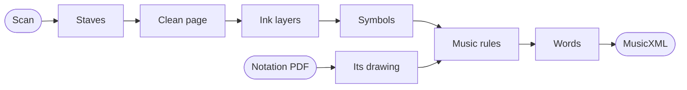

# ScoreReader

ScoreReader reads a scanned page of choir music and writes down what is on it: the notes of every part and the
words under them, as a MusicXML file that any notation program can open.

It is an attempt at a more faithful score reader. Most score readers do well on crisp modern engravings and
struggle with the pages a church choir really sings from: photocopies of photocopies, typewritten scores, music
copied out by hand. ScoreReader was started for the library of an Orthodox choir, where most of the music looks
like that, and the aim is a result that matches the page note for note and syllable for syllable.

Three things shape how it is built:

- It runs on your own computer. Nothing is uploaded, and it needs no account and no network.
- The notes are read by rules, with no AI model. The program measures the ink on the page (lines, strokes, blobs,
  the holes in hollow notes) and applies what a musician knows about how music is written down. When it gets
  something wrong, there is a reason you can find and fix.
- It shows its work. One command paints the page with each kind of ink in its own colour, so you can see at a
  glance what was taken for a staff line, a stem or a note head.

ScoreReader is still being built. See [Where it stands](#where-it-stands) before you rely on it.

## Using it

You need Python 3 with OpenCV and NumPy. To read PDFs you also need `pdftoppm`, which comes with poppler.

```
pip install opencv-python numpy pdfplumber
```

Then, from the top folder of this repository:

```
python -m scorereader hymn score.pdf --out out/my-hymn       # a whole hymn: every page, joined into one score
python -m scorereader read page.png --out out/my-hymn        # one page
python -m scorereader layers page.png --out out/check        # the page with its ink layers in colour
python -m scorereader layout page.png --out out/check        # only the staves and systems, in about two seconds
```

A page takes around fifteen seconds. Beside the `.musicxml` file you get a few files for checking the result: the
cleaned page that was read, the scan with the staves drawn on it, the picture of the layers, and a list of every
note with its place on the page. `python -m scorereader --help` shows the other options.

## Reading the words

Music is of little use to a choir without its words, so ScoreReader reads the text under the notes too and sets
each syllable under its note. A PDF that came out of notation software already holds its words as text. For a
scan there are two ways.

The first is ScoreReader's own letter reader, which you turn on by giving it a word list (`--words words.txt`).
It knows no alphabet. It groups the letter shapes it finds in the hymn and works out which shape is which letter,
so that the page reads like the words of the list. The list is a plain text file with the words of other hymns,
and `bench/wordlist.py` makes one. This way uses no model at all, but today it is the weaker of the two.

The second is Tesseract (`--tesseract`), a small open-source text reader that also runs on your computer.
ScoreReader finds the rows of words itself and gives them to Tesseract one at a time, so Tesseract never sees the
music. If you add a word list as well, ScoreReader uses it to mend misread words and to split words into
syllables. For now this is by far the more accurate way. It is optional, and it is the one part that is not
ScoreReader's own: Tesseract has a small neural network inside for recognising letters. No note depends on it.

Tesseract comes with a small language file. Its larger files (the standard and the "best" `eng.traineddata` from
Tesseract's own repositories) misread other words than the small one does, so they serve as second opinions:
`--second <folder>` names the folder of such a file, and a row that the small file leaves in doubt is read with it
too. They do not replace the small file: put in its place, the standard file read fewer words right.

## How it works



A scanned page goes through these steps:

1. **Staves.** Find each staff and follow its five lines across the page, even where the page bends or tilts, and
   work out which staves belong together as a system.
2. **Clean page.** Straighten every system and set it on a white page. The shadow of the binding and the clutter
   in the margins stay behind.
3. **Ink layers.** Split the ink into staff lines, upright strokes, thick marks, the holes of hollow notes, and
   everything else. Each later step looks only at the layer it needs.
4. **Symbols.** Read the note heads with their stems, flags, beams and dots, and around them the clefs, key
   signatures, sharps and flats, ties and bar lines.
5. **Music rules.** Turn the symbols into music. The clef and the key give each note its pitch, and the direction
   of a stem tells two voices on one staff apart. Parts that sing together have to agree: their notes line up
   and their bars add up, and a note that disagrees with the rest is corrected.
6. **Words.** Read the rows of text and set each syllable under its note.

A PDF that notation software wrote (Finale, MuseScore, Encore) takes a shortcut. Such a file keeps every note as
a character of a music font at an exact place, so ScoreReader reads that drawing directly and only has to apply
the music rules.

One idea runs through all of it: the page explains itself. One copyist draws every note head the same way, a hymn
keeps its key and its clefs from page to page, and the parts of a choir move together. A doubtful mark is settled
by what the rest of the page and the rest of the hymn say.

## What is in the repository

The reader is the Python package `scorereader/`.

Reading a scanned page, in the order the steps run:

| File | What it does |
|---|---|
| `staves.py` | Finds the staves and follows their lines across the page. |
| `systems.py` | Groups the staves into systems. |
| `page.py` | Builds the clean, straightened page. |
| `layers.py` | Splits the ink into layers and draws the colour picture. |
| `words.py` | Finds the rows of words between the staves. |
| `symbols.py` | Reads note heads, stems, flags, beams, dots and ledger lines. |
| `starts.py` | Reads the clef and the key signature at the start of each staff. |
| `meter.py` | Finds time signatures, so that their numbers are not read as notes. |
| `signs.py` | Reads the sharps, flats and naturals in front of notes. |
| `ties.py` | Reads ties. |
| `triplets.py` | Finds the brackets of triplets. |
| `rests.py` | Finds printed quarter rests. |
| `fermatas.py` | Finds fermatas, so that none is read as a note. |
| `drone.py` | On a chant page, reads the letters over the staff that name the ison, the held note. |
| `music.py` | Turns the symbols into pitches, voices and rhythm, and writes MusicXML. |
| `reader.py` | Runs these steps for one page. |

The words of a scan:

| File | What it does |
|---|---|
| `letters.py` | Groups the letters of a hymn by their shape. |
| `lyrics.py` | Names those shapes with the word list and sets the syllables under the notes. |
| `ocr.py` | The optional Tesseract step, with the word list to tidy what it reads. |

Everything else:

| File | What it does |
|---|---|
| `vector.py` | Reads a PDF from notation software straight from its drawing. |
| `hymn.py` | Joins the pages of a hymn into one score. |
| `cli.py` | The command line. |

Outside the package:

- `bench/` holds the checks and the script that runs ScoreReader over a set of test pages. `bench/yardstick/` reads
  the same pages with another reader, to compare against. It is a measuring tool and no part of ScoreReader.
  [bench/README.md](bench/README.md) says how to run them.
- `docs/worklog.md` is the detailed record: measurements, known limits and what comes next.
- `experiments/` keeps the first experiments that the project grew out of.
- `CLAUDE.md` holds the working notes and ground rules for development.

## Where it stands

ScoreReader is not accurate enough yet to use without proofreading what it gives you. Measured against hymns that
were typed in by hand, it reads about 99% of the notes in PDFs from notation software and about 97% of the notes
on clean printed scans, with about as many of their syllables when Tesseract and a word list help. Heavy
photocopies and hand-copied scores are harder, at roughly three notes in four, and they come next. Those figures
are from the pages the rules were worked out on. On a separate set of engraved choir pieces that no rule was
tuned on, it reads about 96% of the notes.

The goal is to read clean printed copies without a mistake, notes and words, and to get 99% of the notes and
the words on the hand-copied scores. The clean copies come first.

Some things are not read at all yet: most rests, slurs, repeats and the numbers of a time signature. The
[worklog](docs/worklog.md) has the full figures and the list of known limits.

## Testing

`bench/drawn_check.py` runs the whole reader on a page that the script draws itself, so it works anywhere:

```
python bench/drawn_check.py
```

The other checks read a kit of real test pages with typed answers. Those pages are scans of the choir's own
scores, so the kit is not in this repository. [bench/README.md](bench/README.md) describes the kit and the
commands.
