# scoreread: a local reader for choir scores

Version 0.6 (in work), 11 November 2026. One command reads a page of a score and writes its notes. Everything runs
on this computer: no network, no assistant and no cloud model. The notes are read by rules on the ink of the page
alone, written in this repository, with OpenCV and NumPy: no neural network and no other music reader is a part of
it. The words of a scan are read by rules too, or, when you ask for it, by Tesseract: a small text reader that runs
on this computer and that holds a small neural network for letters. It is the one optional step that is not our own.

```
python -m scoreread read "path/to/score.pdf" --page 1 --out out/my-hymn
python -m scoreread read page.png --out out/my-hymn
python -m scoreread hymn "path/to/score.pdf" --out out/my-hymn    # all pages of a hymn, joined into one file
python -m scoreread hymn "path/to/scan.pdf" --out out/my-hymn --words words.txt    # with the words of a scan
python -m scoreread hymn "path/to/scan.pdf" --out out/my-hymn --tesseract          # the words read by Tesseract
python -m scoreread layers page.png --out out/check       # the page with each layer of ink in its own colour
python -m scoreread layout page.png --out out/check       # only staves and systems, 2 seconds
```

`read` writes `<name>.musicxml` (the notes), `<name>.notes.json` (each note, its place and what it was read from),
`<name>.layout.json` (the staves and systems), `<name>.clean.png` (the page that was read), `<name>.staves.png` (the
scan with the staves drawn on it, as a check) and `<name>.layers.png` (the layers picture). One page takes about 14
seconds on one processor core. Python needs `opencv-python` and `numpy`; a PDF also needs `pdftoppm` (poppler), and
a PDF that notation software wrote is read from its own drawing with `pdfplumber`.

The words of a scan are read with a list of words that you give (`--words`, or `SCOREREAD_WORDS`): a text file
with the words of other hymns, as plain text or as lines of a word and its count. The reader has no letters of its
own: it groups the letter shapes of the hymn and names the groups so that the page reads like the words of the
list. `bench/wordlist.py` makes the list from typed hymns. Without a list, a scan gives its notes only.

With `--tesseract` (or `SCOREREAD_OCR=tesseract`) the rows of the words are read by Tesseract instead, when it is
installed (`apt install tesseract-ocr`, version 5; Apache-2.0 licence). It reads far more of the words right than
the own letter reader does today (see the results), and it needs no list of words. The reader finds the rows of the
words itself and gives Tesseract one row at a time: Tesseract never sees the notes. `SCOREREAD_TESSERACT` names the
program when it is not on the path, and `--language` (or `SCOREREAD_OCR_LANGUAGE`) its language file: `eng` when
nothing is given, `ron` for Romanian (`apt install tesseract-ocr-ron`).

## The goal

Every score of the choir's app (LitChoir) must be read on this computer, with no AI in the reader, and none of them
under 99 % of the notes that its pages show. The words under the notes belong to the result. This is not reached:
see the results and the limits below. The first milestone is 99 % on clean copies (printed notes and words, crisp
ink); the thick copies and the copies by hand come after it.

## What the reader does

| Step | File | Model used? | What it does |
|---|---|---|---|
| 1. Staves | `scoreread/staves.py` | No | Finds each staff and follows its five lines along the page, also where the page bends, tilts or the lines are weak. Looks twice, with the dark ink alone and with pale level lines too (some copies print the staff in grey hair lines), and keeps the better staff at each place. Drops blank staves, and a find in an ornament, a title or a photo: its five lines are uneven and one of them is mostly missing. |
| 2. Systems | `scoreread/systems.py` | No | Puts the staves into systems from the page's ink: the opening line, bar lines through the gap, and bar lines at the same places. Ink in the margin does not count. Finds a staff whose lines the copy lost. |
| 3. Clean page | `scoreread/page.py` | No | Makes each system level and puts the systems on a white page. The shadow of the binding and the page number stay behind. |
| 4. Layers | `scoreread/layers.py` | No | Splits the ink into staff lines, upright strokes (stems and bar lines), thick marks (note heads, beams, flags), the holes of hollow heads, and the rest. `layers` draws them in colours. |
| 5. Symbols | `scoreread/symbols.py`, `starts.py`, `meter.py`, `signs.py`, `ties.py`, `words.py`, `triplets.py`, `drone.py` | No | Reads the note heads (filled, hollow, and the thin slanted heads of a hand), their stems, flags, beams and dots, the ledger lines, the bar lines, the clef and key signature of each staff, the sharps, flats and naturals before a note, and the ties. The key of a page is a vote of its staves (a copy loses signs more easily than it gains them), and a page without a key signature has the key of the page before. Finds the time signatures, so that their numbers are no notes and no sharps. Finds the rows of the words, so that a stem ends where they begin and a letter is no note. Finds the brackets of triplets: two flat arms with a hook at each outer end and a number in the break between them. Reads the small 8 under a treble clef (the tenors' clef, an octave lower) by its two holes. On a chant page, reads the letters over the staff that name the ison (the held note), and "Un." where the ison joins the melody. |
| 6. Music | `scoreread/music.py`, `reader.py` | No | Pitch from the clef, the key and the signs of the bar. Two voices on a staff from the stem direction. Notes that begin together stand in one column. The voices of a system must agree on the length of each step, and a note that disagrees is changed. A note under the bracket of a triplet has two thirds of its drawn length. Choir rule: a treble staff over the bass staff is the tenors'. Writes MusicXML. |
| Words of a scan | `scoreread/letters.py`, `lyrics.py` | No | Cuts the rows of the words into letters and groups the letters of the whole hymn by shape (one copyist or one type draws a letter the same way each time). Names the groups with the list of words: the same shape is the same letter in every word, and the names under which the page reads most like the words of the list stay. The height of a letter, its dot and its holes say what a shape can be. Sets each syllable under its note. |
| Words of a scan, by choice | `scoreread/ocr.py` | Yes: Tesseract, when `--tesseract` is given | Cuts each row of the words out of the scan and gives it to Tesseract as one line of text. Cuts the line into syllables at its hyphens, drops a row that Tesseract is not sure of (stray ink under a staff), and sets the syllables under the notes as the own letter reader does. |
| Drawing | `scoreread/vector.py` | No | A PDF that notation software wrote holds each sign as a character of a music font at its exact place, and its words as text. Such a page is read from that drawing, with its words; no image is read. |
| Hymn | `scoreread/hymn.py`, `cli.py` | No | Reads the pages of a hymn in order and joins them into one score: the same staff of every system of every page is one part. The key and the clefs of a page go on to the next page. |

Steps 4 to 6 are the own symbol step. They replaced copisteria's network of version 0.4, which is only a yardstick
now: it lives in `bench/yardstick`, outside the reader (see "Tests").

## How the reader works, in diagrams

The diagrams show the logic of the reader as the code runs it, without the optional Tesseract step. No box holds
a model: each one is a rule on the ink, or on the signs of a PDF. The yardstick in `bench/yardstick` is a test
tool, not a part of the reader, and is not shown. GitHub draws the diagrams from the text below (Mermaid).

### The whole reader

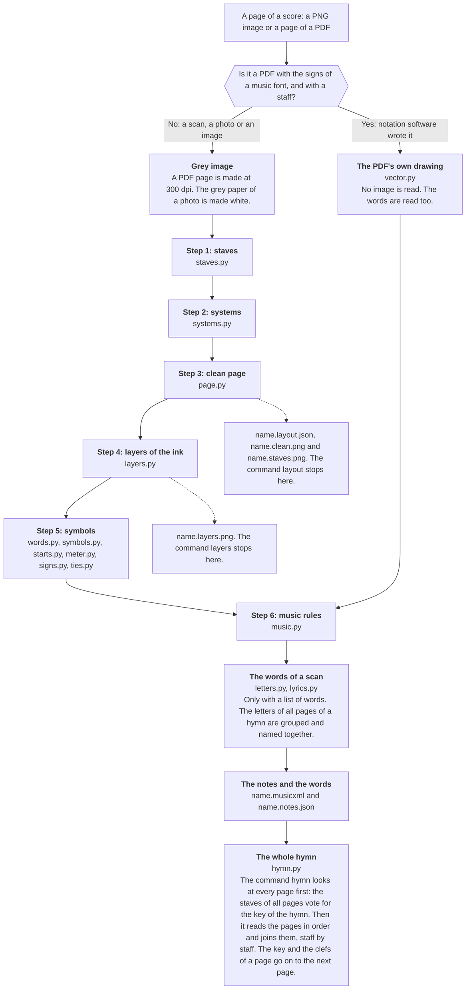

### Steps 1 to 3: staves, systems and the clean page

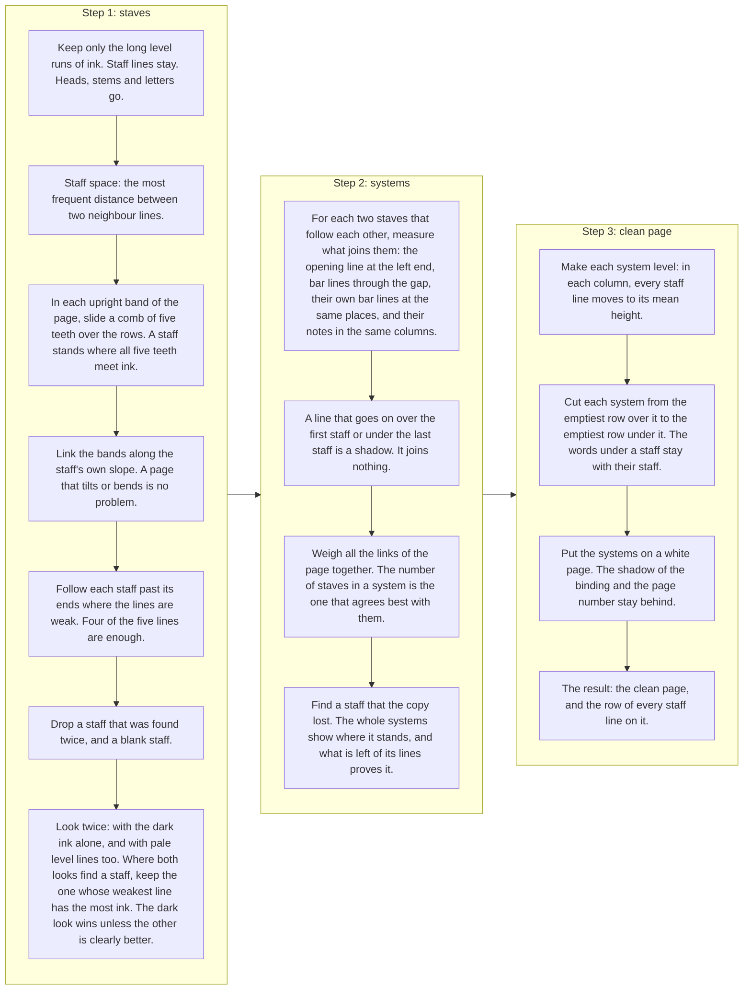

### Step 4: the layers of the ink

On the clean page the row of every staff line is known, so each layer comes from a plain measure of the ink. The
colours are those of `name.layers.png`.

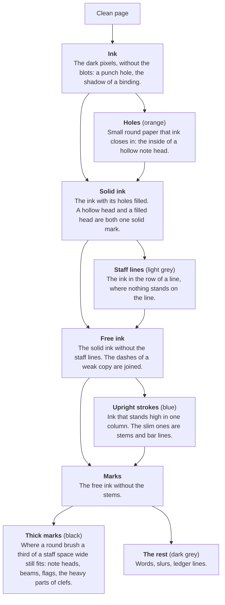

### Step 5: from the layers to the symbols

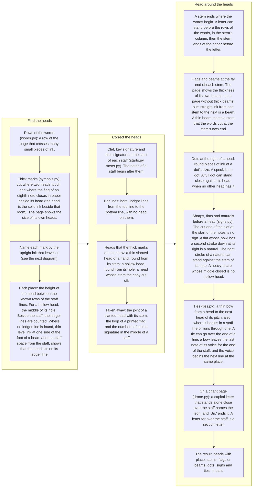

What a thick mark is. Each mark is asked where upright ink leaves it.

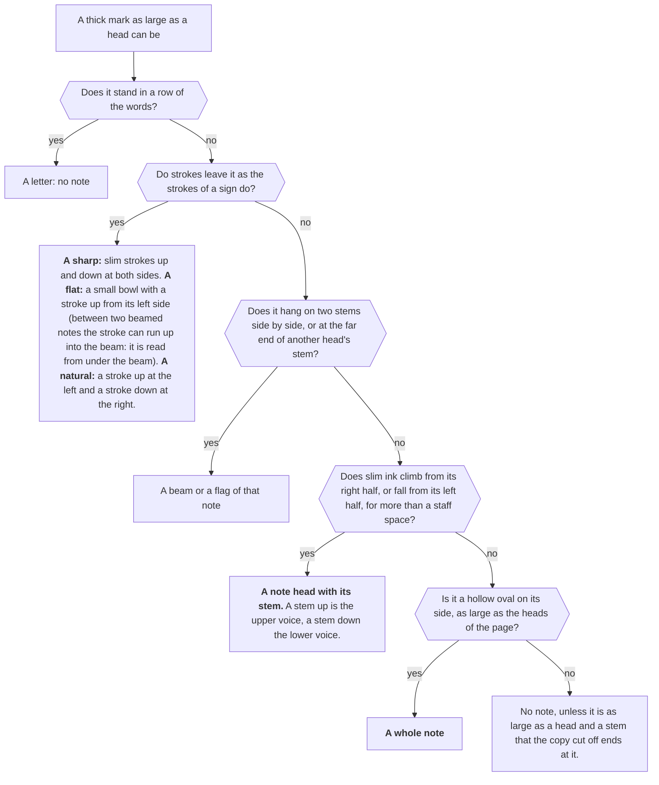

### The clef, the key signature and the time signature

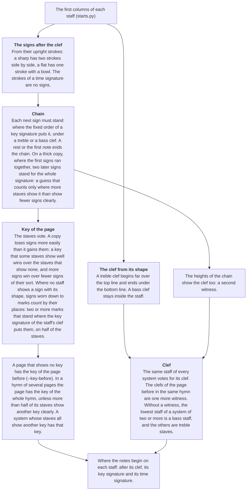

A time signature is found so that its numbers are not read as notes or as sharps. The numbers themselves are not
read yet. The C of common time at the start of a staff is found by its bow: one thin stroke about two staff spaces
high around the middle line, with an end that turns to the right, nothing beside it, and no spot as thick as a note
head. A flat after it is the flat of the first note, not a key signature.

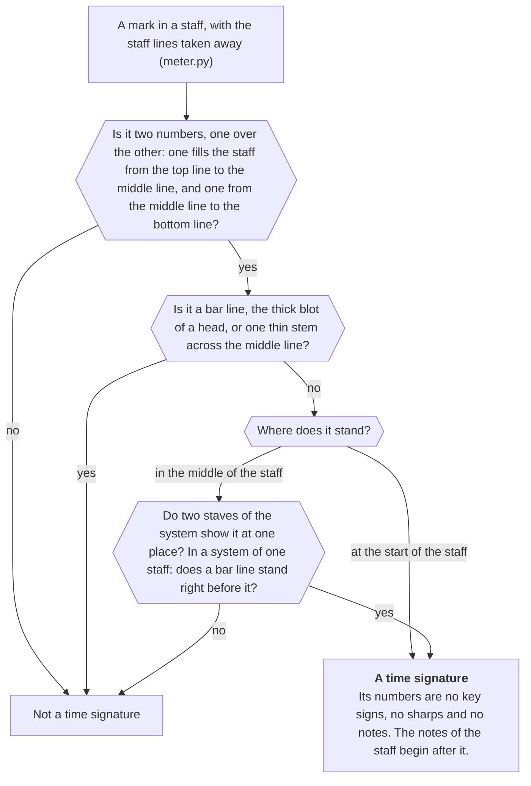

### Step 6: the music rules

How long a note is:

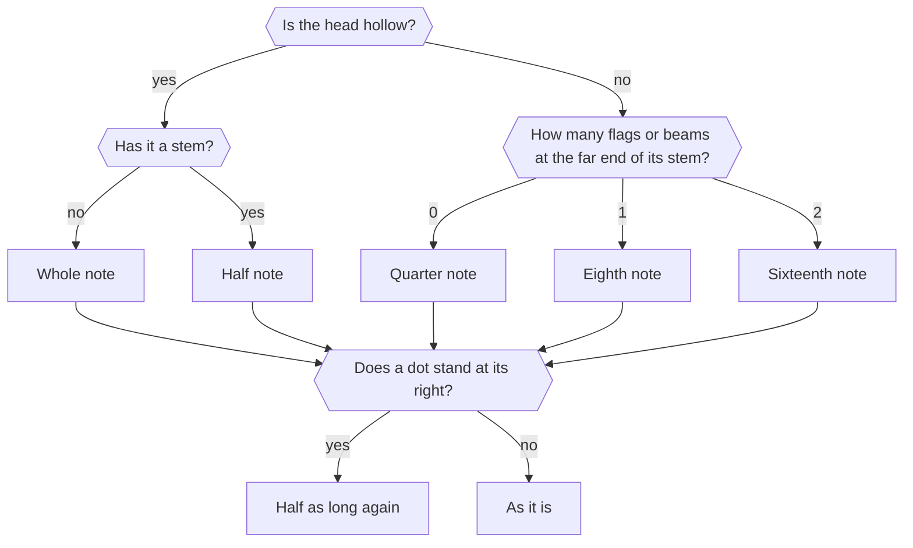

From the symbols to the notes:

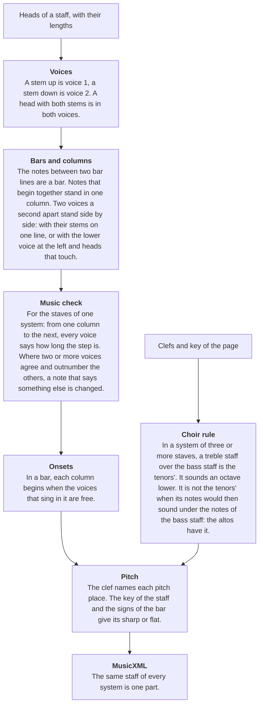

### A PDF that notation software wrote

Such a PDF holds each sign as a character of a music font at its exact place (Maestro, Petrucci, Anastasia, Leland,
Bravura and fonts like them), so nothing has to be recognised.

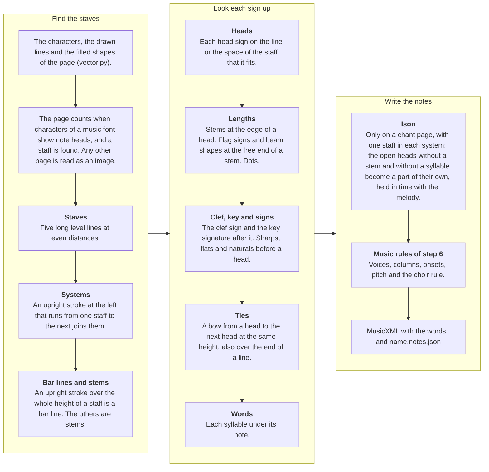

### The words of a scan

```mermaid
flowchart TD
    rows["The rows of the words of every page of the hymn (words.py)"] --> cut["<b>Letters</b> (letters.py)<br/>Each free piece of ink of a row. The dot of an i joins its stroke."]
    cut --> line["The line that the letters stand on, and the height of the small letters, for each row"]
    line --> canvas["Each letter on one canvas: scaled by the height of the small letters, set on the line"]
    canvas --> groups["<b>Groups of one shape</b><br/>A letter joins the group that it differs from by no piece of ink (the bar of an e is such a piece: a c lacks it). The groups have no names yet."]
    groups --> kinds["<b>What each piece is by size and place</b> (lyrics.py)<br/>Letter, hyphen, comma, dot, apostrophe, or a stem that reaches into the words"]
    kinds --> syllables["<b>Syllables and words</b><br/>A gap or a hyphen ends a syllable. Syllables that hyphens join are one word."]
    syllables --> classes["<b>What a group can be</b><br/>It rises over the small letters (b, d, h, a capital), goes under the line (g, p, y), has a dot (i, j), or none of these (a, c, e, n, o). Its holes cost a little: an o has one, a c has none."]
    classes --> vote["<b>First names</b><br/>A word of the page can be each word of the list in which the same shape is the same letter. The group that the words agree on best is named, and so on."]
    vote --> shake["<b>The best names</b><br/>The names are shaken, much at first and then less. A word of the list counts, and so does each run of three letters that the words of the list often have. The names under which the hymn reads most like the list stay."]
    shake --> rest["<b>The shapes that come once</b><br/>A broken letter gets the name of the named shape that it is near. Letters that touch are read as a row of named shapes side by side."]
    rest --> under["<b>Under the notes</b><br/>A row belongs to the staff over it. Its syllables and the notes of that staff keep their order, and each syllable stands under the note that it is nearest to. A syllable with no note of its own is written after the syllable of the note before it, as on a reciting note. A letter with no name is written as a question mark."]
```

Not in the diagrams: the brackets of triplets (`triplets.py`, after the dots), and what the reader of scans does not
do yet: rests, slurs, and the numbers of a time signature (see "Limits").

## Results on every score of LitChoir (the wide test)

The wide test reads every score of the app that has a typed hymn to compare with: 369 scores on 657 pages, 516 of
them scans. 364 are counted: the page of 5 scans holds another version than the typed hymn. Notes right means pitch
and length both right. The count is of the notes that the pages show: 5,906 typed notes that no page prints are
listed apart. Most are recited syllables and the held notes of an ison that the page does not mark; 335 are a
refrain or a repeat that the page prints once and the typed hymn writes out again. 218 typed notes that a part
sings from another part's staff are not compared. Each score is read as the `hymn` command reads it: its pages in
order, with one vote for its key.

| Kind of score | Scores | Notes right | At 99 % or more | At 90 % or more | Under 50 % |
|---|---:|---:|---:|---:|---:|
| PDFs that notation software wrote (read from their drawing) | 70 | 99.3 % (19,947 of 20,096) | 53 | 70 | 0 |
| Scans | 294 | 80.4 % (55,556 of 69,057) | 13 | 99 | 23 |
| All | 364 | 84.7 % (75,503 of 89,153) | 66 | 169 | 23 |

The first milestone is 99 % on clean copies: the scan scores with printed notes and words and crisp ink. 81 were
sorted as clean and 78 are counted: one has words lettered by hand, was sorted wrongly and counts with the copies
by hand now, and the page of two holds another version than the typed hymn. The other scans come after the
milestone: 26 printed but thick, blurred or grey copies, and 190 with notes or words by hand.

| Scans by copy | Scores | Notes right | At 99 % or more | At 90 % or more | Syllables right, own letter reader | Syllables right, with Tesseract | Whole words right, with Tesseract |
|---|---:|---:|---:|---:|---:|---:|---:|
| Clean print | 78 | 94.2 % (20,997 of 22,299) | 12 | 70 | 49.9 % (3,286 of 6,584) | 83.3 % (5,302 of 6,368) | 78.7 % (3,613 of 4,589) |
| Thick or grey print | 26 | 76.2 % (6,345 of 8,326) | 0 | 6 | 32.9 % (658 of 2,000) | 69.8 % (1,395 of 2,000) | 65.2 % (902 of 1,383) |
| By hand | 190 | 73.4 % (28,214 of 38,432) | 1 | 23 | 37.7 % (5,401 of 14,345) | 70.2 % (10,097 of 14,374) | 64.1 % (6,639 of 10,351) |

- Of the clean scores, 43 are at 95 % or more. About 1,130 more notes are needed for 99 % of each clean copy.
  The mistakes that are left are many small causes: the largest rule of the last round brought 7 notes. Of 24
  mistakes drawn by lot, 16 are the reader's, 6 are the scorer lining a staff up with the wrong part, 1 is a typed
  hymn that differs from its page, and 1 is unclear. Two fine engravings hold about 245 of the lost notes.
- Words with the optional Tesseract step: 22,449 of 28,847 syllables are right (77.8 %): 93 % on the software-made
  PDFs (their words are text in the PDF; Tesseract is not used there), and 73.8 % on the scans (16,794 of 22,742).
  With the own letter reader, which uses no model, the scans have about 40 %; its column in the table was measured
  three rounds ago and not again since.
- The words are counted in three ways. Syllables right: the typed syllables that the reader wrote, in the typed
  order. Whole words right: the same for words, each joined from its syllables at the hyphens that the reader
  read; a word counts only when all of it is right, and a word that the page prints with no hyphen over two notes
  is still one word. Letters in order (86 % on the scans with Tesseract, 93 % on the clean copies): a lenient
  count, since two unlike hymn texts of one length share two fifths of their letters in order. Under which note a syllable stands is not
  scored yet.
- A note can hold several syllables (a reciting note, or a syllable whose note was not read), and the words of
  such a note are counted one by one, in the reading and in the typed hymn. The figures of the own letter reader
  on the thick copies and the copies by hand are from before this count.
- Some typed syllables stand on no page: a refrain that the page prints once and the typed hymn writes out after
  each verse. The two clean scores that miss the most syllables are of this kind. Such syllables are not counted
  apart yet, as the notes of a repeat are.
- The sorting into clean, thick and by hand was done by eye from the first system of each score. Some typed hymns
  differ from their page in ways that the scorer was not told, and count as wrong: a tie that the page prints and
  the typed hymn does not, a refrain, a note that a pencil changed.
- The scorer gives each staff of a page the typed parts that it lines up with best. A small change in the reading
  can turn that choice: one hymn lost 16 notes in an earlier round because one wrong note was no longer
  read, and the scorer then took its staff for one part and not for two.
- The last round: 5 rules for signs, ledger lines and ties, each scored alone on the clean copies, then alone on
  all pages, and then together. Together they gain 24 notes on the clean copies and lose none (94.1 % to 94.2 %),
  and gain 78 and lose 11 over all pages. Each alone, on the clean copies and on all pages: a heavy sharp whose
  middle closed, which was read as a hollow head with a stem, 7 and 26 (none lost); a tie over the end of a line 7
  (1 lost) and 7 (7 lost); a natural whose right stroke stands against the stem of its note, which was read as a
  flat, 5 and 5 (none lost); a head that sits on a ledger line set close to the staff 3 and 11 (2 lost); the
  strokes of a heavy sharp, which are half a staff space wide, 1 and 43 (8 lost, and 3 after it was narrowed).
- What that round loses. The tie rule: on a clean copy one bow over the end of a line that the typed hymn writes
  as two notes, and on two copies by hand a slur that passes under the last note of a line and a pencilled arrow
  at the end of a staff (6 notes). The wide strokes: a short double bar drawn by hand that is read as a sharp
  (2 notes: that score, a page with a few lines of music, fell under 50 %, 34 of its 71 drawn notes, before 36),
  and one more false sharp. The ledger rule moves two heads on copies by hand. The wide strokes lost 5 more notes
  at first, with the rim of a whole note read as a sharp glued to its head: two heavy strokes that lie on a head
  are a part of that head now.
- Measured in that round and dropped: a second form of the ledger rule (3 notes gained, 2 lost, and no measure
  tells them apart), a looser limit for sharps with uneven strokes (3 and 1), wide strokes for flats and naturals
  too (6 and 4: the rim of a large hollow half note became a flat), and two looser limits for a flat tie (2 and
  2, 3 and 3). About 20 ties inside a line are still not read on the clean copies: a bow far under its heads, or a
  bow that lies along a staff line.
- The round before it: 8 rules for dots, flags, beams and signs, each scored alone on the clean copies and then
  together on all pages. Together they gain 67 notes on the clean copies and lose 1 (93.8 % to 94.1 %), and gain
  164 and lose 16 over all pages (one copy by hand fell under 50 %: 29 of its 59 notes, before 31). Each alone on
  the clean copies: a printed flag that reaches a little over half a staff space from its stem 16; the slim beams
  of a fine engraving 15; the cut end of a clef that was read as a flat before the first note, and held for the
  whole line, 9; a speck, or the cut end of a ledger line, that was read as a dot 7; a natural that was read as a
  flat 7; a thin beam at stems that the rows of the words cut 5; a stem that ended inside a letter 5 (2 lost: one
  is an eighth note on its page that the typed hymn writes as a quarter, the other a slur at the edge of the
  words that is read as a thin beam now); a full dot that stands close against its head 4. An eighth note read
  as a quarter stood 117 times on the clean copies and stands 78 times now.
- The limits of that round were counted before a run was spent on them. For a kind of mistake a census is taken:
  every read note of the clean copies that the scorer lines up with a typed note (22,725), with the measures that
  the rule looks at (the pieces of ink beside the head, or at the end of the stem) and the typed length. A limit
  is counted against the census in a second, and the counts met the runs. The census also showed what does not
  pay: a dot nearer to its head, a flatter dot and a paler dot each lose as many notes as they gain when the limit
  is only moved (4 for 8, 2 for 6, 9 for 7), and the size of the page's own dots does not tell a dot from a speck.
- The census showed more of the typed hymns too. Of 49 places where a typed dotted half note was read as a half
  note, about 20 are dots on the page. The others show no dot: a tie that was not read, or a typed hymn that
  differs from its page. Some half notes that count as read as quarters are two tied quarter notes on the page
  whose tie was not read.
- The two rounds before that: 23 rules, each scored alone on the clean copies and then together on all pages. Together
  they gained 310 notes on the clean copies and lost 4 (92.2 % to 93.8 %), and gained 541 and lost 97 over all pages.
  The largest, each alone on the clean copies: key signs that the copy wore down to marks, told by their places,
  61 notes; the heads of two voices of flagged eighth notes, closed in by their flags, 61; a filled head with a
  pale middle on a page of large holes 45 (8 lost); the ison of chant scans from the letters over the staff 42; two
  strokes that are a flat with a high bowl 35; a half note with a thin rim 24 (2 lost); the mended bracket of a
  triplet 18 (2 lost); a head that sits on top of a ledger line 13 (1 lost); a small heavy sharp 12 (1 lost); a
  flat between two beamed notes whose stroke runs up into the beam 4.
- Two of these rules lost notes on the fresh test set (see below). They were switched off, narrowed with
  LitChoir's pages, and switched on again. A half note with a thin rim is read from its open hole and its stem: the
  rule took the paper between a head, its stem and its flag for such a note, and on LitChoir's pages the paper
  between a bar line, the end of a tie and a staff line. Now the stem must be the note's own: no bar line, no
  stroke of a sharp, and not the stem of a filled head. A small heavy sharp is one mark with two strokes: the rule
  took the stroke at the side of a breve (the long reciting note) for one. Now a sign must stand before its head:
  a mark that lies in a head without a stem is a part of that head. Before, the two rules lost 285 and 29 notes on
  the fresh set; now they gain 8 and lose 5 there.
- Two voices a second apart stand side by side. Some prints set the lower voice at the left, with the stems at
  the outer sides; the reader took such a pair for two notes, one after the other. Now they begin together when
  their heads touch (11 pairs on one page of a wedding hymn). The count of right notes does not show it, because
  it is taken part by part: it changes no note on the clean copies, loses 4 on copies by hand, and takes away
  about 55 notes that are not there.
- Five more of these rules lost notes on pages they were not made for and were narrowed. The worn key signature read
  the numbers of a time signature as two sharps of the other clef (142 notes on one hymn): it counts only
  under the clef that the staff shows. The ison rule read a section letter far over the staff as an ison (125
  notes). The ledger rule moved heads on a print that draws its ledger lines a full space from the staff (4). The
  rule for flagged eighth notes took chords of two half notes and a whole note under a quarter note for a flag's
  loop (12), and cut "heads" out of treble clefs: it tells a flag's loop from the hole of a hollow head by the
  ink at the two sides of the loop, and keeps off the start of a staff. The rule for a flat under a beam changed
  the key signature of two copies by hand (19 notes): it reads the signs of notes only. Two rules for whole notes
  gained nothing and are switched off.
- Before them: two staves with no bar line through their gap are two systems, 176 notes (none lost); six
  rules for a clef on the opening line, half notes, and heads that a flag or a beam closes in, 527 (38 lost).
- The small 8 under a treble clef is read. On LitChoir it changes no figure: two hymns show
  it, one was read as the tenors' staff already, and the other is typed an octave above what its page sounds (the
  scorer was told). On the fresh test set it is the largest single gain so far (see below).
- Earlier, each rule scored alone: a narrow printed flag that hugs its stem 96 notes on the clean copies
  (7 lost) and 112 on the other scans (43 lost); two heads one over the other on a stem, which were read as a
  stem, 209 on the clean copies (5 lost) and 207 on the other scans (15 lost).
- Before that, on the clean copies, each rule scored alone: half-note chords on staff lines 11 notes (none
  lost), the column of a stem that ends in a letter 10 (1 lost), a letter beside a stem's end that was taken for a
  slur 7, a false staff in an ornament 33 (4 lost on a photo page), and the brackets of triplets 98 (none lost).
  A rule for beams inside the rows of the words lost 3 notes to slurs and is off.
- The last rounds on the scans: new rules for the systems brought 1,511 notes, the rules for keys and time
  signatures 713 (4 lost), staves in pale lines 695 (6 lost), and a flat that a staff line cut off 105 (27 lost).
  Then, with none lost: the rule for the tenors' staff 402, and one key for the whole hymn 121. The sign of common
  time is found now: about 40 notes that were read from it are gone.

## Results on a fresh test set (pages that no rule was set on)

The rules above were set on LitChoir's own pages, so its figures are the best case. The fresh test set measures
what the reader does on pages it has never seen: 228 choir pieces from four open collections (English Orthodox
music, the Romanian liturgy, Romanian choral pieces, Church Slavonic pieces), each engraved with LilyPond together
with an exact list of every note and syllable on the page. The set is outside git. The pages are read as images
at 300 dpi, never from the PDF's drawing, and the words by Tesseract in the language of the piece. 214 pieces
are scored (258 pages, 40,906 notes); 14 have a staff with three voices or more, which the scorer cannot split yet.

| | Pieces | Notes right | At 99 % or more | At 90 % or more | Syllables right | Whole words right | Letters in order |
|---|---:|---:|---:|---:|---:|---:|---:|
| First reading, with the rules as LitChoir left them | 214 | 86.8 % (35,486 of 40,906) | 63 | 152 | 54 % | | |
| With the small 8 under a treble clef | 214 | 91.9 % (37,612 of 40,906) | 65 | 161 | 54.6 % (6,194 of 11,341) | 64.7 % (4,303 of 6,647) | 97.1 % |
| After two rounds of 23 rules | 214 | 92.3 % (37,772 of 40,906) | 70 | 162 | 54.6 % (6,194 of 11,341) | 64.7 % (4,302 of 6,647) | 97.0 % |
| After the round of dots, flags, beams and signs (8 rules) | 214 | 92.6 % (37,861 of 40,906) | 70 | 164 | 54.6 % (6,194 of 11,341) | 64.7 % (4,302 of 6,647) | 97.0 % |
| After the round of signs, ledger lines and ties (5 rules) | 214 | 93.2 % (38,127 of 40,906) | 73 | 165 | 54.6 % (6,194 of 11,341) | 64.7 % (4,303 of 6,647) | 97.1 % |
| of these, English (Orthodox Liturgics) | 109 | 94.8 % (13,574 of 14,324) | 45 | 83 | 62.7 % | 68.0 % | 96.7 % |
| Romanian | 88 | 91.2 % (16,606 of 18,209) | 28 | 68 | 52.6 % | 60.0 % | 98.2 % |
| Church Slavonic | 17 | 94.9 % (7,947 of 8,373) | 0 | 14 | 40.2 % | 66.1 % | 95.4 % |

- These are crisp engraved pages, not scans: they say how well the rules hold on print they were not made for,
  and nothing about thick or faded copies.
- The first reading found a rule that LitChoir's pages could not teach: 63 pieces set the tenors under a treble
  clef with a small 8, and 2,178 notes were right but an octave too high. The rule for the 8 was written with
  LitChoir's two hymns that show one; on the fresh set it gained 2,126 notes and lost none.
- The round of 21 rules shows why the set is read. The rules gained notes on LitChoir's pages, but with all of
  them the fresh set fell from 91.9 % to 91.6 % (37,455 notes). The rules were then switched off one by one on the
  pieces that fell: a half note with a thin rim cost 285 notes here, and a small heavy sharp 29. The pages showed
  the causes (the paper between a head and its flag, the stroke at the side of a breve). Each rule was narrowed
  with LitChoir's pages, where the same kind of mistake stands, and then read here again: together the rules of
  the two rounds now gain 147 notes on this set. One limit of this figure: these two rules were switched off and
  on again by this set, so for that one choice its pages are no longer unseen.
- The round of 8 rules for dots, flags, beams and signs was read here before it was committed, with no rule
  switched by it: 89 notes gained, and no piece lost a note. 86 of them are on the Romanian pieces.
- The round of 5 rules for signs, ledger lines and ties was read here before it was committed: 270 notes gained
  and 29 lost. Each rule was then read alone. The heavy sharp whose middle closed gains 248 notes and loses 1: the
  Church Slavonic pieces and many Romanian ones are engraved with heavy sharps. The wide strokes of a sharp gained
  34 and lost 26: these pages draw a stroke at each side of a breve, and the stroke with the rim of the hollow
  head was read as a sharp glued to the head. LitChoir's copies by hand show the same mistake at the rim of a
  whole note, and the rule was narrowed with them (two heavy strokes that lie on a head are a part of that head).
  Read again, the round gains 270 notes and loses 4. Two of the 4 are a bow over the end of a line between two
  equal notes: the answer writes a slur, and the page cannot tell it from a tie. One limit of this figure: the
  narrowing was made after this set showed the loss, so for that one choice its pages are no longer unseen.
- Almost no note is missed (166 of 40,906). What is lost, counted on the comparison of each piece two rounds ago: a sixteenth
  note read as an eighth (about 420: the second beam or flag), an eighth read as a quarter or a half (about 360),
  the long reciting note (a breve) read as a whole note (about 240), a triplet with no bracket (about 60), and
  about 1,200 notes with a wrong pitch.
- The reader writes 5,888 notes that are not there, most of them rests: these pages have many rests, and the
  reader of scans does not know a rest yet.
- The words: Tesseract reads the letters (97 % in order), but the words are cut wrongly. A fifth of the words are
  two words that it read as one, because the engraving sets the words of a row close together; and the engraving
  prints a word whole where its syllables stand close, so a count by syllables cannot be met without cutting such
  a word over its notes. The Church Slavonic pieces are in the old spelling, which Tesseract's Russian does not
  know.
- The set is for measuring. No rule or limit is set on one of its pages; a cause that it shows is worked on with
  LitChoir's pages and then measured here.

## Results on the reader test (31 typed hymns, 38 pages, 6901 notes)

The kit is the small test that each rule is checked on. Notes right is counted by the kit's `score.py` against the
typed hymns, of all typed notes.

| Kind of score | Hymns | copisteria alone | homr alone | scoreread 0.4 (copisteria's network) | scoreread now (no model) |
|---|---:|---:|---:|---:|---:|
| Printed | 12 | 67 % | 82 % | 76 % | 91 % |
| Old copy (notes drawn by hand) | 9 | 76 % | 37 % | 88 % | 86 % |
| By hand | 5 | 65 % | 70 % | 79 % | 85 % |
| Poor (faded or broken) | 2 | 93 % | 49 % | 95 % | 80 % |
| Digital PDF | 3 | 81 % | 72 % | 81 % | 100 % |
| All 31 hymns | 31 | 71 % | 66 % | 81 % | 89.0 % (6145 notes) |

- Over all hymns the own rules read more notes right than the network they replaced: 89.0 % against 81 %.
- They are behind the network on two kinds: old copies (86 % against 88 %) and the two poor pages (80 % against 95 %).
- 8 of the 31 hymns are at 95 % or more, and 18 are at 90 % or more. 6 are under 80 %.
- The kit's own scorer counts 13 notes fewer than three rounds ago (6149). The rules were first set on these pages,
  so a new rule finds little to gain here and its few false finds show: the wide test gained 541 notes with the
  same rules.

## Limits

- The reader is not accurate enough yet to put a scanned hymn into the app without a check. Only 13 of the 294
  scanned scores are at 99 % (12 of the 78 clean ones), and 23 are under 50 %: thick copies where signs and heads ran together, pages
  where a clef is hidden, and pages of a service book with a few lines of music among the text.
- The rules and their limits were set on the same pages that test them. Those figures are therefore the best
  case. On the fresh test set, crisp engraved pages that no rule was set on, the reader has 93.2 % of the notes.
- The wide test compares with typed hymns that were made for singing, not for testing. Some differ from the page
  (another key, an octave, a repeat written out). Known cases are told to the scorer; others count as wrong.
- About 13,700 drawn notes of the scans are wrong (a note can be wrong in two ways): about 4,800 are not read at
  all, about 5,100 have a wrong pitch (a wrong key or clef, or one or two places off; no single cause stands out),
  and about 5,500 a wrong length (a half note read as a quarter because the copy filled its hole, an eighth read as
  a quarter because its flag or beam was not seen, dots). A rule of the bar length does not mend the filled half
  notes: most of them stand in hymns with no steady bar, and tested on all scans it lost 656 notes for 57.
- Some scores cannot reach the typed hymn by reading the notes alone: a psalm that gives a treble staff to the men
  by a word ("Men:"), and a typed hymn that sets a part an octave from the page.
- The score counts each part. A staff of two parts is split by the stem direction (stem up is the upper part). One
  stem read wrong, or one head of a chord missed, gives the note to the wrong part.
- The ison of a chant scan is read only where the page names it with a letter over the staff, and it is scored by
  its marks: one note for each letter, with its pitch. How long each held note lasts is not scored. Where the
  page does not mark the ison, the typed ison is listed apart.
- Not read yet on scans: rests and slurs. A rest can be read as a note (about 5,900 notes that are not there on the fresh test set,
  beside 40,906 true ones). A reciting note drawn as a breve is read as a whole note. A triplet is read from its bracket only: a
  3 over a beam without a bracket is not seen, and the number in the bracket is not read (it is taken for a 3).
- The words of a scan are right for 4 syllables of 10 with the own letter reader. On clean type its limit is the
  grouping of the letter shapes (n and u, h and b fall into one group), not the list of words. With the optional
  Tesseract step they are right for 7 of 10 (8 of 10 on the clean copies). What it still loses there: words in
  capitals with long lines after held syllables, a word that the page prints without a hyphen over two notes, two
  words that it reads as one, and a row of words that the reader does not find. Tesseract is not our own step and
  it holds a small neural network: the own letter reader must catch up with it before the goal is met.
- Time signatures are
  found so that they are no notes (the numbers, and the C of common time; not the sign of cut time, and not a small
  C), but they are not read into the result. A tie is read when its bow runs from head to
  head on one line of the page, or over the end of a line to the next line of the same page. A tie over a page
  break is not read, and a slur between two equal notes cannot be told from a tie.
- The reader also writes notes that are not there (about 490 on the kit), from rests, letters of the words,
  ornaments and slurs. They are counted apart and do not lower notes right, but a singer would see them.
- `hymn` joins the pages of a score into one MusicXML file, staff by staff. It does not know repeats, its joined
  file is not scored as a whole yet (the wide test reads the pages as `hymn` does and joins them itself), and the
  reader does not write the app's hymn format yet.

## Next steps

1. The clean copies to 99 %, notes and words. Notes: an eighth note read as a quarter (78 on the clean copies: a
   short stem with a small hook for a flag, a flag or a beam that lies in the rows of the words), a tie inside a
   line that is not read (about 20 pairs: a bow far under its heads, a bow along a staff line), a slur at the edge of the words that is read as
   a thin beam, a whole note beside a bar line or under another voice's stem that is read as a half note, a pale
   filled head that is read as a half note (one faint engraving loses 159 notes), a sign glued to its head, a
   heavy tie that runs into a head, dots that touch a tie or a head, the numbers of a time signature and the
   rooms of beams that are read as notes, and the holes of clefs in the page's measure of a hollow head. Words:
   count the syllables
   that no page prints apart, score under which note a syllable stands, and bring the own letter reader up to
   Tesseract (name each letter by its nearest known shape, taught by hymns whose text is typed).
   The fresh test set is read beside the clean copies after each round. What it shows first: rests, the second
   beam or flag of a sixteenth note, the breve of a reciting note, and two words that Tesseract reads as one.
2. Then the thick copies and the copies by hand: clefs hidden behind a bracket, and the pages where almost nothing
   is read.
3. Score the joined hymn of the `hymn` command, and let the hymn teach the page more (parts, time).
4. Half notes whose hole the copy filled, by the notes that sound with them. Flags and beams that are not seen.
5. Rests, with a check of each bar's length.
6. The app's hymn format.

## Tests

```
export SCOREREAD_KIT="$HOME/Projects/LitChoir/tmp/omr-test"     # the test kit, see below
PY="$SCOREREAD_KIT/tools/copisteria/.venv/bin/python"           # or any Python with opencv-python and numpy
$PY bench/drawn_check.py                                      # the whole reader on a page the script draws; needs no kit
$PY bench/staves_check.py "$SCOREREAD_KIT/pages" out/staves   # 38 of 38 pages right
$PY bench/systems_check.py "$SCOREREAD_KIT"                   # 37 of 38; on the other page the copy lost a staff
bash bench/kit.sh own                                         # reads all 38 pages (rules only)
bash bench/kit.sh v04 --yardstick                             # the yardstick: the same clean pages with copisteria's network
python3 "$SCOREREAD_KIT/score.py" --results out/kit --tools own v04
```

`bench/kit.sh` takes its Python from `SCOREREAD_PYTHON`, or the kit's copisteria environment without it.

The yardstick (`bench/yardstick`) reads the reader's clean pages with copisteria's network, to measure the own rules
against it. It is a test tool: the reader does not load it, and nothing of it ships with the reader.

The wide test (every score of LitChoir) is run with scripts outside this repository, because it needs the app's
scans and typed hymns.

## The test kit

The tests need the test kit, which is not in this repository. The reader itself does not need it.

- `pages/`: 38 page images of 31 hymns. They are scans of the choir's scores, so they stay out of git.
- `truth/`: the same hymns typed by hand, as the answer key.
- `score.py`, `cases.json`, `env.sh`: the scoring script, the list of hymns and the settings of the tools.
- `tools/copisteria`: copisteria with its own Python and its model files (about 4 GB with the other readers), for
  the yardstick (`bench/yardstick`).

`SCOREREAD_KIT` names the kit's folder. Without it, the tests look in `~/Projects/LitChoir/tmp/omr-test`.
`SCOREREAD_COPISTERIA` names another copy of copisteria.

## History

`experiments/2026-11-09-hard-scans/` holds the first tests on one difficult hymn, with a report. They found the three
causes that this reader removes: wrong systems from ink in the margin, staves found twice on bent pages, and the
ledger lines of one copyist.

Version 0.5 replaced copisteria's network with the own symbol step (layers, symbols, music). Each rule was switched
on alone and scored on all 38 pages, and a rule that did not gain notes was dropped.

Version 0.6 (in work) reads software-made PDFs from their drawing with their words, groups the staves of scans by
three more checks, votes for the key of a page and of a whole hymn, finds time signatures and staves in pale
lines, tells the altos' staff from the tenors' by its place over the bass staff, joins the pages of a hymn
(`hymn`), and moved the yardstick out of the reader. It reads the words of a scan with no model, the brackets of
triplets, and drops false staves; the clean copies are scored apart since then. The words of a scan can be read
by Tesseract instead (`--tesseract`), as an optional step that the owner allowed on 11 November 2026.
