# scoreread: a local reader for choir scores

Version 0.6 (in work), 11 November 2026. One command reads a page of a score and writes its notes. Everything runs
on this computer: no network, no assistant and no cloud model. The notes are read by rules on the ink of the page
alone, written in this repository, with OpenCV and NumPy: no neural network and no other music reader is a part of
it. The words of a scan are read by rules too, or, when you ask for it, by Tesseract: a small text reader that runs
on this computer and that holds a small neural network for letters. It is the one optional step that is not our own.

```
python -m scoreread read "path/to/score.pdf" --page 1 --out out/my-hymn
python -m scoreread read page.png --out out/my-hymn
python -m scoreread hymn "path/to/score.pdf" --out out/my-hymn    # all pages of a hymn, joined into one file
python -m scoreread hymn "path/to/scan.pdf" --out out/my-hymn --words words.txt    # with the words of a scan
python -m scoreread hymn "path/to/scan.pdf" --out out/my-hymn --tesseract          # the words read by Tesseract
python -m scoreread layers page.png --out out/check       # the page with each layer of ink in its own colour
python -m scoreread layout page.png --out out/check       # only staves and systems, 2 seconds
```

`read` writes `<name>.musicxml` (the notes), `<name>.notes.json` (each note, its place and what it was read from),
`<name>.layout.json` (the staves and systems), `<name>.clean.png` (the page that was read), `<name>.staves.png` (the
scan with the staves drawn on it, as a check) and `<name>.layers.png` (the layers picture). One page takes about 14
seconds on one processor core. Python needs `opencv-python` and `numpy`; a PDF also needs `pdftoppm` (poppler), and
a PDF that notation software wrote is read from its own drawing with `pdfplumber`.

The words of a scan are read with a list of words that you give (`--words`, or `SCOREREAD_WORDS`): a text file
with the words of other hymns, as plain text or as lines of a word and its count. The reader has no letters of its
own: it groups the letter shapes of the hymn and names the groups so that the page reads like the words of the
list. `bench/wordlist.py` makes the list from typed hymns. Without a list, a scan gives its notes only.

With `--tesseract` (or `SCOREREAD_OCR=tesseract`) the rows of the words are read by Tesseract instead, when it is
installed (`apt install tesseract-ocr`, version 5; Apache-2.0 licence). It reads far more of the words right than
the own letter reader does today (see the results), and it needs no list of words. The reader finds the rows of the
words itself and gives Tesseract one row at a time: Tesseract never sees the notes. `SCOREREAD_TESSERACT` names the
program when it is not on the path, and `--language` (or `SCOREREAD_OCR_LANGUAGE`) its language file: `eng` when
nothing is given, `ron` for Romanian (`apt install tesseract-ocr-ron`).

## The goal

Every score of the choir's app (LitChoir) must be read on this computer, with no AI in the reader, and none of them
under 99 % of the notes that its pages show. The words under the notes belong to the result. This is not reached:
see the results and the limits below. The first milestone is 99 % on clean copies (printed notes and words, crisp
ink); the thick copies and the copies by hand come after it.

## What the reader does

| Step | File | Model used? | What it does |
|---|---|---|---|
| 1. Staves | `scoreread/staves.py` | No | Finds each staff and follows its five lines along the page, also where the page bends, tilts or the lines are weak. Looks twice, with the dark ink alone and with pale level lines too (some copies print the staff in grey hair lines), and keeps the better staff at each place. Drops blank staves, and a find in an ornament, a title or a photo: its five lines are uneven and one of them is mostly missing. |
| 2. Systems | `scoreread/systems.py` | No | Puts the staves into systems from the page's ink: the opening line, bar lines through the gap, and bar lines at the same places. Ink in the margin does not count. Finds a staff whose lines the copy lost. |
| 3. Clean page | `scoreread/page.py` | No | Makes each system level and puts the systems on a white page. The shadow of the binding and the page number stay behind. |
| 4. Layers | `scoreread/layers.py` | No | Splits the ink into staff lines, upright strokes (stems and bar lines), thick marks (note heads, beams, flags), the holes of hollow heads, and the rest. `layers` draws them in colours. |
| 5. Symbols | `scoreread/symbols.py`, `starts.py`, `meter.py`, `signs.py`, `ties.py`, `words.py`, `triplets.py` | No | Reads the note heads (filled, hollow, and the thin slanted heads of a hand), their stems, flags, beams and dots, the ledger lines, the bar lines, the clef and key signature of each staff, the sharps, flats and naturals before a note, and the ties. The key of a page is a vote of its staves (a copy loses signs more easily than it gains them), and a page without a key signature has the key of the page before. Finds the time signatures, so that their numbers are no notes and no sharps. Finds the rows of the words, so that a stem ends where they begin and a letter is no note. Finds the brackets of triplets: two flat arms with a hook at each outer end and a number in the break between them. Reads the small 8 under a treble clef (the tenors' clef, an octave lower) by its two holes. |
| 6. Music | `scoreread/music.py`, `reader.py` | No | Pitch from the clef, the key and the signs of the bar. Two voices on a staff from the stem direction. Notes that begin together stand in one column. The voices of a system must agree on the length of each step, and a note that disagrees is changed. A note under the bracket of a triplet has two thirds of its drawn length. Choir rule: a treble staff over the bass staff is the tenors'. Writes MusicXML. |
| Words of a scan | `scoreread/letters.py`, `lyrics.py` | No | Cuts the rows of the words into letters and groups the letters of the whole hymn by shape (one copyist or one type draws a letter the same way each time). Names the groups with the list of words: the same shape is the same letter in every word, and the names under which the page reads most like the words of the list stay. The height of a letter, its dot and its holes say what a shape can be. Sets each syllable under its note. |
| Words of a scan, by choice | `scoreread/ocr.py` | Yes: Tesseract, when `--tesseract` is given | Cuts each row of the words out of the scan and gives it to Tesseract as one line of text. Cuts the line into syllables at its hyphens, drops a row that Tesseract is not sure of (stray ink under a staff), and sets the syllables under the notes as the own letter reader does. |
| Drawing | `scoreread/vector.py` | No | A PDF that notation software wrote holds each sign as a character of a music font at its exact place, and its words as text. Such a page is read from that drawing, with its words; no image is read. |
| Hymn | `scoreread/hymn.py`, `cli.py` | No | Reads the pages of a hymn in order and joins them into one score: the same staff of every system of every page is one part. The key and the clefs of a page go on to the next page. |

Steps 4 to 6 are the own symbol step. They replaced copisteria's network of version 0.4, which is only a yardstick
now: it lives in `bench/yardstick`, outside the reader (see "Tests").

## How the reader works, in diagrams

The diagrams show the logic of the reader as the code runs it, without the optional Tesseract step. No box holds
a model: each one is a rule on the ink, or on the signs of a PDF. The yardstick in `bench/yardstick` is a test
tool, not a part of the reader, and is not shown. GitHub draws the diagrams from the text below (Mermaid).

### The whole reader

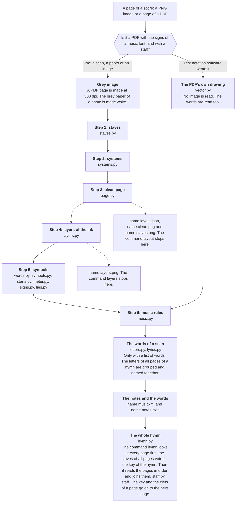

### Steps 1 to 3: staves, systems and the clean page

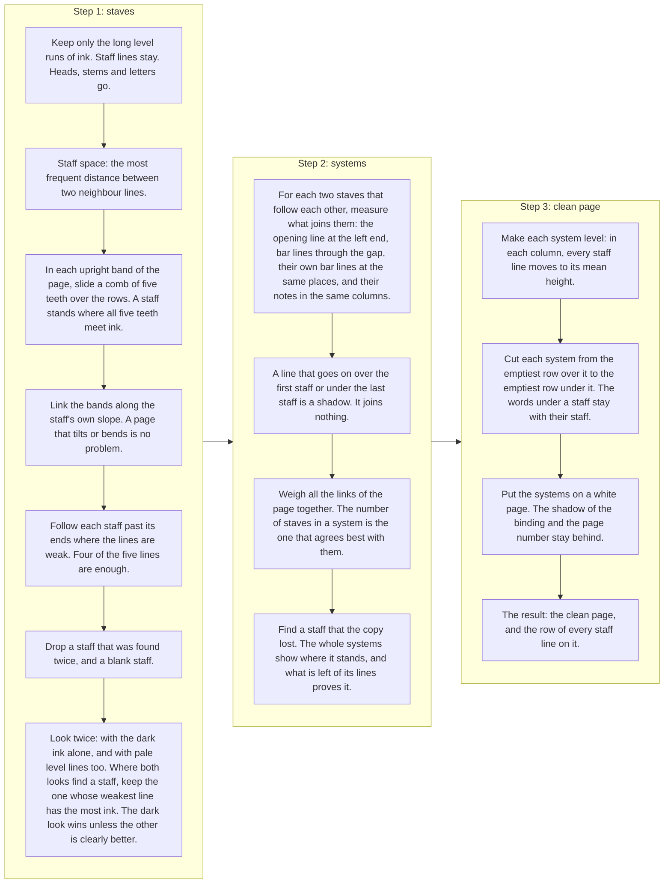

### Step 4: the layers of the ink

On the clean page the row of every staff line is known, so each layer comes from a plain measure of the ink. The
colours are those of `name.layers.png`.

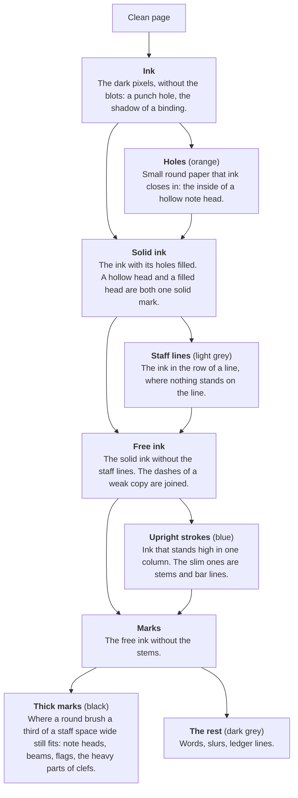

### Step 5: from the layers to the symbols

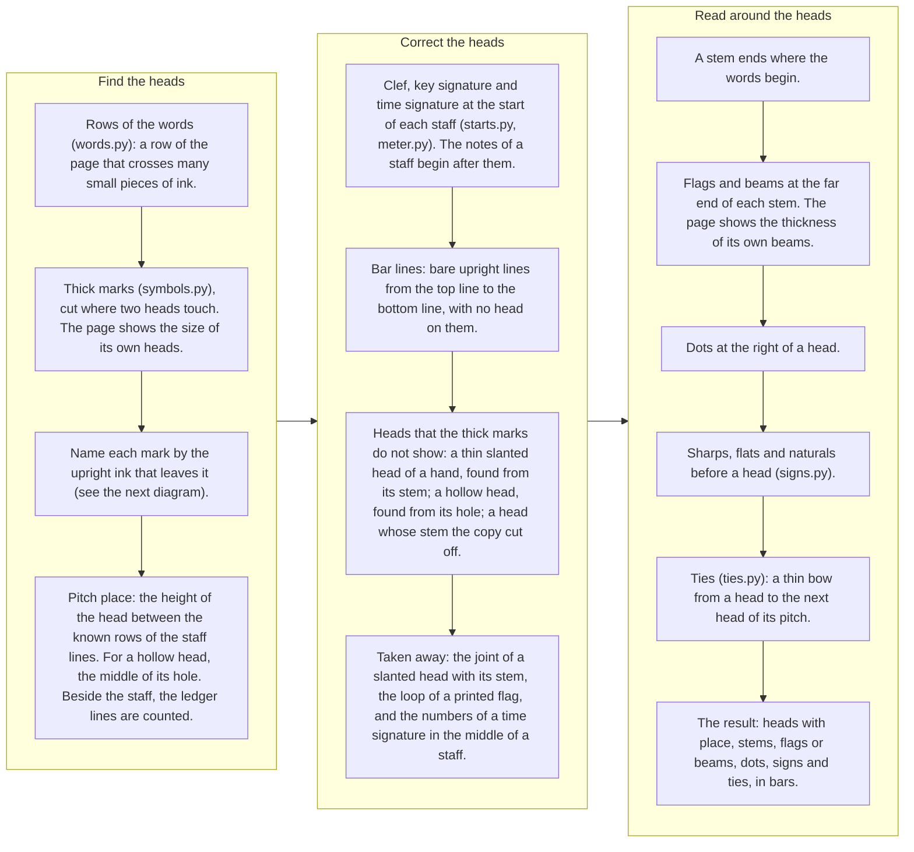

What a thick mark is. Each mark is asked where upright ink leaves it.

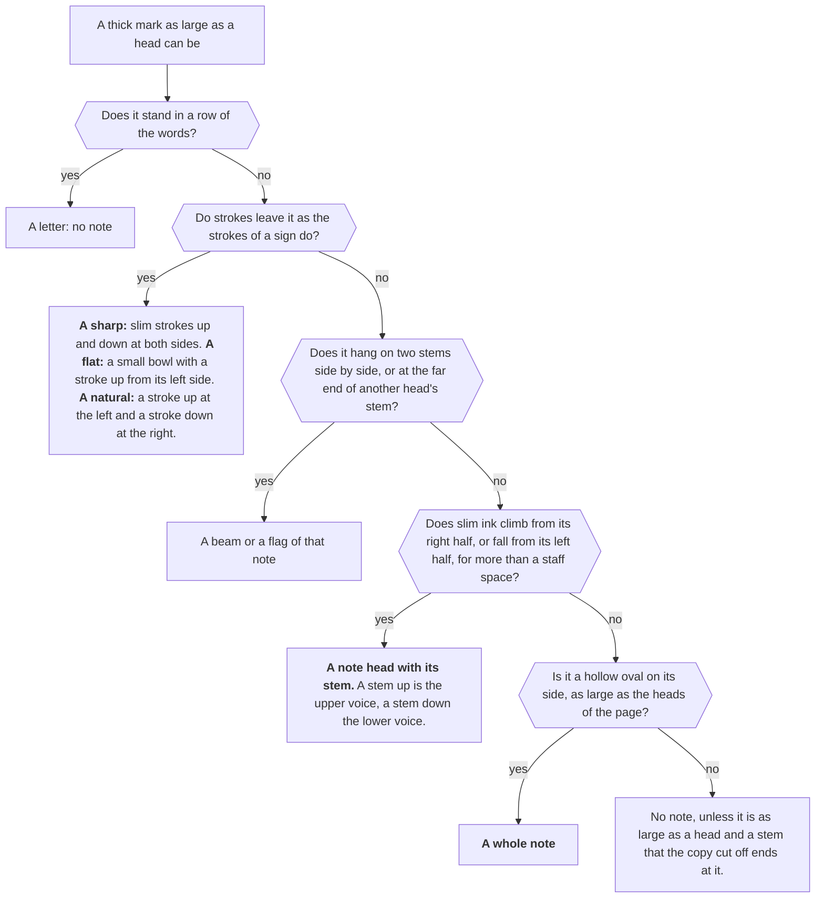

### The clef, the key signature and the time signature

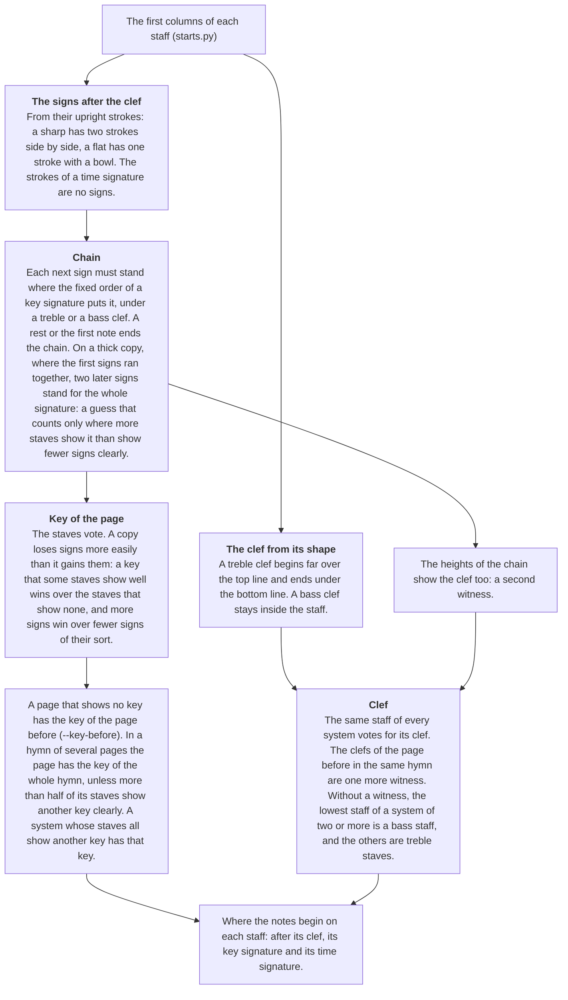

A time signature is found so that its numbers are not read as notes or as sharps. The numbers themselves are not
read yet. The C of common time at the start of a staff is found by its bow: one thin stroke about two staff spaces
high around the middle line, with an end that turns to the right, nothing beside it, and no spot as thick as a note
head. A flat after it is the flat of the first note, not a key signature.

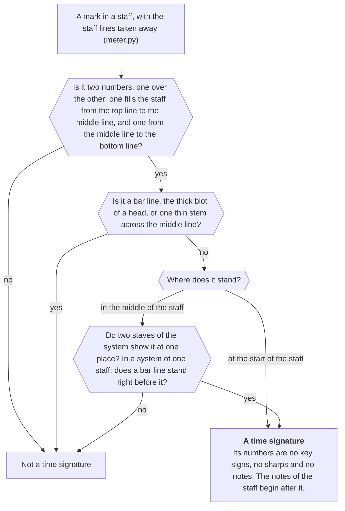

### Step 6: the music rules

How long a note is:

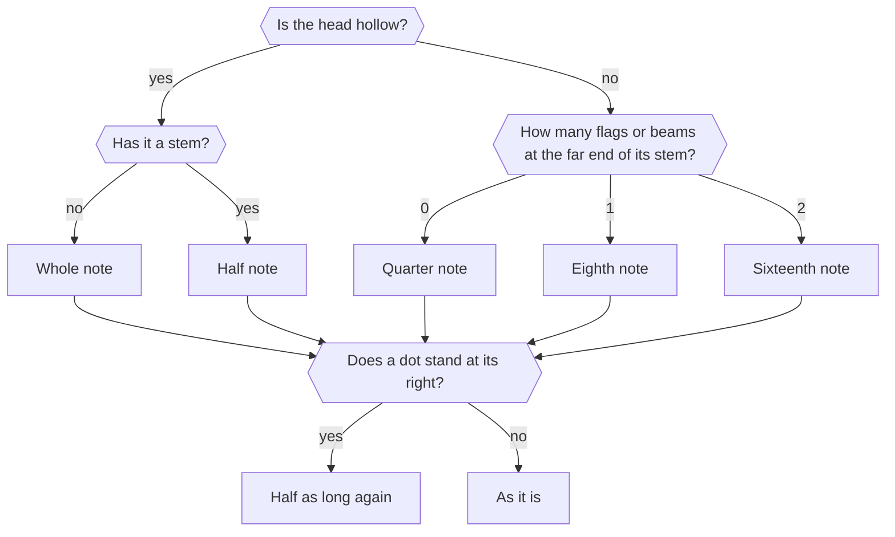

From the symbols to the notes:

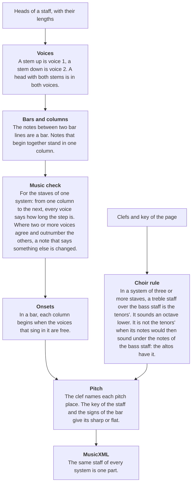

### A PDF that notation software wrote

Such a PDF holds each sign as a character of a music font at its exact place (Maestro, Petrucci, Anastasia, Leland,
Bravura and fonts like them), so nothing has to be recognised.

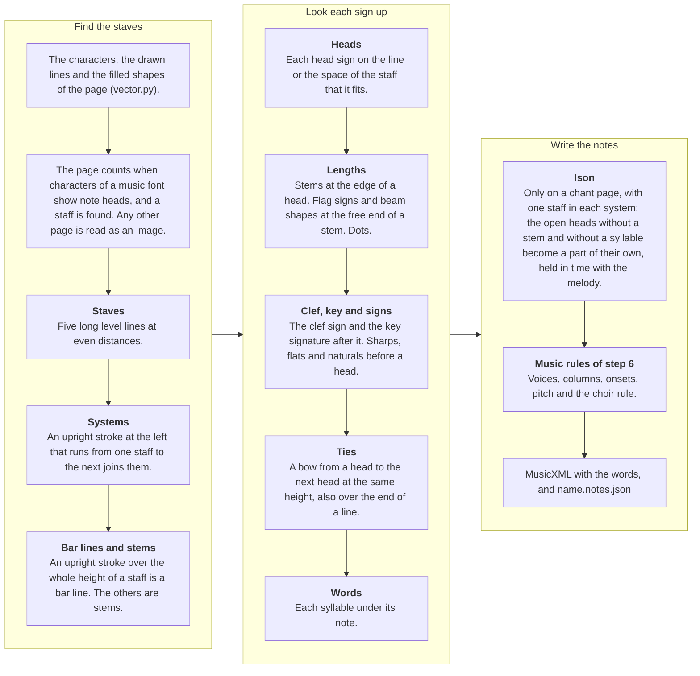

### The words of a scan

```mermaid
flowchart TD
    rows["The rows of the words of every page of the hymn (words.py)"] --> cut["<b>Letters</b> (letters.py)<br/>Each free piece of ink of a row. The dot of an i joins its stroke."]
    cut --> line["The line that the letters stand on, and the height of the small letters, for each row"]
    line --> canvas["Each letter on one canvas: scaled by the height of the small letters, set on the line"]
    canvas --> groups["<b>Groups of one shape</b><br/>A letter joins the group that it differs from by no piece of ink (the bar of an e is such a piece: a c lacks it). The groups have no names yet."]
    groups --> kinds["<b>What each piece is by size and place</b> (lyrics.py)<br/>Letter, hyphen, comma, dot, apostrophe, or a stem that reaches into the words"]
    kinds --> syllables["<b>Syllables and words</b><br/>A gap or a hyphen ends a syllable. Syllables that hyphens join are one word."]
    syllables --> classes["<b>What a group can be</b><br/>It rises over the small letters (b, d, h, a capital), goes under the line (g, p, y), has a dot (i, j), or none of these (a, c, e, n, o). Its holes cost a little: an o has one, a c has none."]
    classes --> vote["<b>First names</b><br/>A word of the page can be each word of the list in which the same shape is the same letter. The group that the words agree on best is named, and so on."]
    vote --> shake["<b>The best names</b><br/>The names are shaken, much at first and then less. A word of the list counts, and so does each run of three letters that the words of the list often have. The names under which the hymn reads most like the list stay."]
    shake --> rest["<b>The shapes that come once</b><br/>A broken letter gets the name of the named shape that it is near. Letters that touch are read as a row of named shapes side by side."]
    rest --> under["<b>Under the notes</b><br/>A row belongs to the staff over it. Its syllables and the notes of that staff keep their order, and each syllable stands under the note that it is nearest to. A syllable with no note of its own is written after the syllable of the note before it, as on a reciting note. A letter with no name is written as a question mark."]
```

Not in the diagrams: the brackets of triplets (`triplets.py`, after the dots), and what the reader of scans does not
do yet: rests, slurs, and the numbers of a time signature (see "Limits").

## Results on every score of LitChoir (the wide test)

The wide test reads every score of the app that has a typed hymn to compare with: 366 scores on 657 pages, 516 of
them scans. Notes right means pitch and length both right. The count is of the notes that the pages show: 6,094
typed notes that no page prints are listed apart. Most are recited syllables; 342 are a refrain or a repeat that
the page prints once and the typed hymn writes out again. Each score is read as the `hymn` command reads it: its
pages in order, with one vote for its key.

| Kind of score | Scores | Notes right | At 99 % or more | At 90 % or more | Under 50 % |
|---|---:|---:|---:|---:|---:|
| PDFs that notation software wrote (read from their drawing) | 70 | 99.1 % (19,916 of 20,104) | 51 | 68 | 0 |
| Scans | 296 | 77.9 % (54,238 of 69,666) | 10 | 80 | 27 |
| All | 366 | 82.6 % (74,154 of 89,770) | 61 | 148 | 27 |

The first milestone is 99 % on clean copies: the 81 scan scores with printed notes and words and crisp ink. The
other scans come after it: 26 printed but thick, blurred or grey copies, and 189 with notes or words by hand.

| Scans by copy | Scores | Notes right | At 99 % or more | At 90 % or more | Syllables right, own letter reader | Syllables right, with Tesseract | Whole words right, with Tesseract |
|---|---:|---:|---:|---:|---:|---:|---:|
| Clean print | 81 | 88.8 % (20,526 of 23,112) | 9 | 55 | 49.9 % (3,286 of 6,584) | 80.8 % (5,322 of 6,584) | 76.3 % (3,626 of 4,753) |
| Thick or grey print | 26 | 71.3 % (5,935 of 8,329) | 0 | 4 | 32.9 % (658 of 2,000) | 69.0 % (1,379 of 2,000) | 64.6 % (893 of 1,383) |
| By hand | 189 | 72.7 % (27,777 of 38,225) | 1 | 21 | 37.7 % (5,401 of 14,345) | 70.3 % (10,087 of 14,348) | 64.2 % (6,637 of 10,332) |

- Words with the optional Tesseract step: 22,443 of 29,037 syllables are right (77.3 %): 93 % on the software-made
  PDFs (their words are text in the PDF; Tesseract is not used there), and 73.2 % on the scans (16,788 of 22,932).
  With the own letter reader, which uses no model, the scans have about 40 %.
- The words are counted in three ways. Syllables right: the typed syllables that the reader wrote, in the typed
  order. Whole words right: the same for words, each joined from its syllables at the hyphens that the reader
  read; a word counts only when all of it is right, and a word that the page prints with no hyphen over two notes
  is still one word. Letters in order (85 % on the scans with Tesseract, 90 % on the clean copies): a lenient
  count, since two unlike hymn texts of one length share two fifths of their letters in order. Under which note a syllable stands is not
  scored yet.
- A note can hold several syllables (a reciting note, or a syllable whose note was not read), and the words of
  such a note are counted one by one, in the reading and in the typed hymn. The figures of the own letter reader
  on the thick copies and the copies by hand are from before this count.
- Some typed syllables stand on no page: a refrain that the page prints once and the typed hymn writes out after
  each verse. The two clean scores that miss the most syllables are of this kind. Such syllables are not counted
  apart yet, as the notes of a repeat are.
- The sorting into clean, thick and by hand was done by eye from the first system of each score. Of the 81 clean
  scores, 5 cannot reach 99 % as they are counted now: one page holds another version than the typed hymn, one
  typed bass stands an octave over the page, two typed hymns differ from the page in refrains and repeats, and one
  score has hand lettering and was sorted wrongly.
- The small 8 under a treble clef is read since the last round. On LitChoir it changes no figure: two hymns show
  it, one was read as the tenors' staff already, and the other is typed an octave above what its page sounds (the
  scorer was told). On the fresh test set it is the largest single gain so far (see below).
- The round before, each rule scored alone: a narrow printed flag that hugs its stem 96 notes on the clean copies
  (7 lost) and 112 on the other scans (43 lost); two heads one over the other on a stem, which were read as a
  stem, 209 on the clean copies (5 lost) and 207 on the other scans (15 lost).
- Before that, on the clean copies, each rule scored alone: half-note chords on staff lines 11 notes (none
  lost), the column of a stem that ends in a letter 10 (1 lost), a letter beside a stem's end that was taken for a
  slur 7, a false staff in an ornament 33 (4 lost on a photo page), and the brackets of triplets 98 (none lost).
  A rule for beams inside the rows of the words lost 3 notes to slurs and is off.
- The last rounds on the scans: new rules for the systems brought 1,511 notes, the rules for keys and time
  signatures 713 (4 lost), staves in pale lines 695 (6 lost), and a flat that a staff line cut off 105 (27 lost).
  Then, with none lost: the rule for the tenors' staff 402, and one key for the whole hymn 121. The sign of common
  time is found now: about 40 notes that were read from it are gone.
- The repeats that are listed apart since then raise the share by 0.3 points: with the older count the same reading
  has 81.5 % (73,447 of 90,122).
- 4 more scans are not counted: their page holds another version than the typed hymn.

## Results on a fresh test set (pages that no rule was set on)

The rules above were set on LitChoir's own pages, so its figures are the best case. The fresh test set measures
what the reader does on pages it has never seen: 228 choir pieces from four open collections (English Orthodox
music, the Romanian liturgy, Romanian choral pieces, Church Slavonic pieces), each engraved with LilyPond together
with an exact list of every note and syllable on the page. The set is outside git. The pages are read as images
at 300 dpi, never from the PDF's drawing, and the words by Tesseract in the language of the piece. 214 pieces
are scored (258 pages, 40,906 notes); 14 have a staff with three voices or more, which the scorer cannot split yet.

| | Pieces | Notes right | At 99 % or more | At 90 % or more | Syllables right | Whole words right | Letters in order |
|---|---:|---:|---:|---:|---:|---:|---:|
| First reading, with the rules as LitChoir left them | 214 | 86.8 % (35,486 of 40,906) | 63 | 152 | 54 % | | |
| With the small 8 under a treble clef | 214 | 91.9 % (37,612 of 40,906) | 65 | 161 | 54.6 % (6,194 of 11,341) | 64.7 % (4,303 of 6,647) | 97.1 % |
| of these, English (Orthodox Liturgics) | 109 | 94.2 % (13,495 of 14,324) | 39 | 82 | 62.7 % | 68.0 % | 96.7 % |
| Romanian | 88 | 90.0 % (16,380 of 18,209) | 26 | 66 | 52.6 % | 60.0 % | 98.2 % |
| Church Slavonic | 17 | 92.4 % (7,737 of 8,373) | 0 | 13 | 40.2 % | 66.1 % | 95.4 % |

- These are crisp engraved pages, not scans: they say how well the rules hold on print they were not made for,
  and nothing about thick or faded copies.
- The first reading found a rule that LitChoir's pages could not teach: 63 pieces set the tenors under a treble
  clef with a small 8, and 2,178 notes were right but an octave too high. The rule for the 8 was written with
  LitChoir's two hymns that show one; on the fresh set it gained 2,126 notes and lost none.
- Almost no note is missed (166 of 40,906). What is lost, counted on the comparison of each piece: a sixteenth
  note read as an eighth (about 420: the second beam or flag), an eighth read as a quarter or a half (about 360),
  the long reciting note (a breve) read as a whole note (about 240), a triplet with no bracket (about 60), and
  about 1,200 notes with a wrong pitch.
- The reader writes 6,301 notes that are not there, most of them rests: these pages have many rests, and the
  reader of scans does not know a rest yet.
- The words: Tesseract reads the letters (97 % in order), but the words are cut wrongly. A fifth of the words are
  two words that it read as one, because the engraving sets the words of a row close together; and the engraving
  prints a word whole where its syllables stand close, so a count by syllables cannot be met without cutting such
  a word over its notes. The Church Slavonic pieces are in the old spelling, which Tesseract's Russian does not
  know.
- The set is for measuring. No rule or limit is set on one of its pages; a cause that it shows is worked on with
  LitChoir's pages and then measured here.

## Results on the reader test (31 typed hymns, 38 pages, 6901 notes)

The kit is the small test that each rule is checked on. Notes right is counted by the kit's `score.py` against the
typed hymns, of all typed notes.

| Kind of score | Hymns | copisteria alone | homr alone | scoreread 0.4 (copisteria's network) | scoreread now (no model) |
|---|---:|---:|---:|---:|---:|
| Printed | 12 | 67 % | 82 % | 76 % | 91 % |
| Old copy (notes drawn by hand) | 9 | 76 % | 37 % | 88 % | 86 % |
| By hand | 5 | 65 % | 70 % | 79 % | 86 % |
| Poor (faded or broken) | 2 | 93 % | 49 % | 95 % | 80 % |
| Digital PDF | 3 | 81 % | 72 % | 81 % | 99 % |
| All 31 hymns | 31 | 71 % | 66 % | 81 % | 89.1 % (6149 notes) |

- Over all hymns the own rules read more notes right than the network they replaced: 89.1 % against 81 %.
- They are behind the network on two kinds: old copies (86 % against 88 %) and the two poor pages (80 % against 95 %).
- 8 of the 31 hymns are at 95 % or more, and 19 are at 90 % or more. 6 are under 80 %.

## Limits

- The reader is not accurate enough yet to put a scanned hymn into the app without a check. Only 10 of the 296
  scanned scores are at 99 % (9 of the 81 clean ones), and 27 are under 50 %: thick copies where signs and heads ran together, pages
  where a clef is hidden, and pages of a service book with a few lines of music among the text.
- The rules and their limits were set on the same pages that test them. Those figures are therefore the best
  case. On the fresh test set, crisp engraved pages that no rule was set on, the reader has 91.9 % of the notes.
- The wide test compares with typed hymns that were made for singing, not for testing. Some differ from the page
  (another key, an octave, a repeat written out). Known cases are told to the scorer; others count as wrong.
- About 16,100 drawn notes of the scans are wrong (a note can be wrong in two ways): about 5,100 are not read at
  all, about 7,300 have a wrong pitch (a wrong key or clef, or one or two places off; no single cause stands out),
  and about 7,000 a wrong length (a half note read as a quarter because the copy filled its hole, an eighth read as
  a quarter because its flag or beam was not seen, dots). A rule of the bar length does not mend the filled half
  notes: most of them stand in hymns with no steady bar, and tested on all scans it lost 656 notes for 57.
- Some scores cannot reach the typed hymn by reading the notes alone: a psalm that gives a treble staff to the men
  by a word ("Men:"), and a typed hymn that sets a part an octave from the page.
- The score counts each part. A staff of two parts is split by the stem direction (stem up is the upper part). One
  stem read wrong, or one head of a chord missed, gives the note to the wrong part.
- Not read yet on scans: rests and slurs. A rest can be read as a note (6,301 such notes on the fresh test set,
  beside 40,906 true ones). A reciting note drawn as a breve is read as a whole note. A triplet is read from its bracket only: a
  3 over a beam without a bracket is not seen, and the number in the bracket is not read (it is taken for a 3).
- The words of a scan are right for 4 syllables of 10 with the own letter reader. On clean type its limit is the
  grouping of the letter shapes (n and u, h and b fall into one group), not the list of words. With the optional
  Tesseract step they are right for 7 of 10 (8 of 10 on the clean copies). What it still loses there: words in
  capitals with long lines after held syllables, a word that the page prints without a hyphen over two notes, two
  words that it reads as one, and a row of words that the reader does not find. Tesseract is not our own step and
  it holds a small neural network: the own letter reader must catch up with it before the goal is met.
- Time signatures are
  found so that they are no notes (the numbers, and the C of common time; not the sign of cut time, and not a small
  C), but they are not read into the result. A tie is read when its bow runs from head to
  head on one line of the page.
- The reader also writes notes that are not there (about 490 on the kit), from rests, letters of the words,
  ornaments and slurs. They are counted apart and do not lower notes right, but a singer would see them.
- `hymn` joins the pages of a score into one MusicXML file, staff by staff. It does not know repeats, its joined
  file is not scored as a whole yet (the wide test reads the pages as `hymn` does and joins them itself), and the
  reader does not write the app's hymn format yet.

## Next steps

1. The clean copies to 99 %, notes and words. Notes: the key signature on faint print, patches of a staff that the
   clean-page step erases, the numbers of a time signature, dynamics and slur ends that are read as notes, a hollow
   head on a ledger line, the thin beams of an engraving, long ties over whole notes. Words: count the syllables
   that no page prints apart, score under which note a syllable stands, and bring the own letter reader up to
   Tesseract (name each letter by its nearest known shape, taught by hymns whose text is typed).
   The fresh test set is read beside the clean copies after each round. What it shows first: rests, the second
   beam or flag of a sixteenth note, the breve of a reciting note, and two words that Tesseract reads as one.
2. Then the thick copies and the copies by hand: clefs hidden behind a bracket, and the pages where almost nothing
   is read.
3. Score the joined hymn of the `hymn` command, and let the hymn teach the page more (parts, time).
4. Half notes whose hole the copy filled, by the notes that sound with them. Flags and beams that are not seen.
5. Rests, with a check of each bar's length.
6. The app's hymn format.

## Tests

```
export SCOREREAD_KIT="$HOME/Projects/LitChoir/tmp/omr-test"     # the test kit, see below
PY="$SCOREREAD_KIT/tools/copisteria/.venv/bin/python"           # or any Python with opencv-python and numpy
$PY bench/drawn_check.py                                      # the whole reader on a page the script draws; needs no kit
$PY bench/staves_check.py "$SCOREREAD_KIT/pages" out/staves   # 38 of 38 pages right
$PY bench/systems_check.py "$SCOREREAD_KIT"                   # 37 of 38; on the other page the copy lost a staff
bash bench/kit.sh own                                         # reads all 38 pages (rules only)
bash bench/kit.sh v04 --yardstick                             # the yardstick: the same clean pages with copisteria's network
python3 "$SCOREREAD_KIT/score.py" --results out/kit --tools own v04
```

`bench/kit.sh` takes its Python from `SCOREREAD_PYTHON`, or the kit's copisteria environment without it.

The yardstick (`bench/yardstick`) reads the reader's clean pages with copisteria's network, to measure the own rules
against it. It is a test tool: the reader does not load it, and nothing of it ships with the reader.

The wide test (every score of LitChoir) is run with scripts outside this repository, because it needs the app's
scans and typed hymns.

## The test kit

The tests need the test kit, which is not in this repository. The reader itself does not need it.

- `pages/`: 38 page images of 31 hymns. They are scans of the choir's scores, so they stay out of git.
- `truth/`: the same hymns typed by hand, as the answer key.
- `score.py`, `cases.json`, `env.sh`: the scoring script, the list of hymns and the settings of the tools.
- `tools/copisteria`: copisteria with its own Python and its model files (about 4 GB with the other readers), for
  the yardstick (`bench/yardstick`).

`SCOREREAD_KIT` names the kit's folder. Without it, the tests look in `~/Projects/LitChoir/tmp/omr-test`.
`SCOREREAD_COPISTERIA` names another copy of copisteria.

## History

`experiments/2026-11-09-hard-scans/` holds the first tests on one difficult hymn, with a report. They found the three
causes that this reader removes: wrong systems from ink in the margin, staves found twice on bent pages, and the
ledger lines of one copyist.

Version 0.5 replaced copisteria's network with the own symbol step (layers, symbols, music). Each rule was switched
on alone and scored on all 38 pages, and a rule that did not gain notes was dropped.

Version 0.6 (in work) reads software-made PDFs from their drawing with their words, groups the staves of scans by
three more checks, votes for the key of a page and of a whole hymn, finds time signatures and staves in pale
lines, tells the altos' staff from the tenors' by its place over the bass staff, joins the pages of a hymn
(`hymn`), and moved the yardstick out of the reader. It reads the words of a scan with no model, the brackets of
triplets, and drops false staves; the clean copies are scored apart since then. The words of a scan can be read
by Tesseract instead (`--tesseract`), as an optional step that the owner allowed on 11 November 2026.
