# scoreread: a local reader for choir scores

Version 0.6 (in work), 11 November 2026. One command reads a page of a score and writes its notes. Everything runs
on this computer: no network, no assistant and no cloud model. The notes are read by rules on the ink of the page
alone, written in this repository, with OpenCV and NumPy: no neural network and no other music reader is a part of
it. The words of a scan are read by rules too, or, when you ask for it, by Tesseract: a small text reader that runs
on this computer and that holds a small neural network for letters. It is the one optional step that is not our own.

```
python -m scoreread read "path/to/score.pdf" --page 1 --out out/my-hymn
python -m scoreread read page.png --out out/my-hymn
python -m scoreread hymn "path/to/score.pdf" --out out/my-hymn    # all pages of a hymn, joined into one file
python -m scoreread hymn "path/to/scan.pdf" --out out/my-hymn --words words.txt    # with the words of a scan
python -m scoreread hymn "path/to/scan.pdf" --out out/my-hymn --tesseract          # the words read by Tesseract
python -m scoreread layers page.png --out out/check       # the page with each layer of ink in its own colour
python -m scoreread layout page.png --out out/check       # only staves and systems, 2 seconds
```

`read` writes `<name>.musicxml` (the notes), `<name>.notes.json` (each note, its place and what it was read from),
`<name>.layout.json` (the staves and systems), `<name>.clean.png` (the page that was read), `<name>.staves.png` (the
scan with the staves drawn on it, as a check) and `<name>.layers.png` (the layers picture). One page takes about 14
seconds on one processor core. Python needs `opencv-python` and `numpy`; a PDF also needs `pdftoppm` (poppler), and
a PDF that notation software wrote is read from its own drawing with `pdfplumber`.

The words of a scan are read with a list of words that you give (`--words`, or `SCOREREAD_WORDS`): a text file
with the words of other hymns, as plain text or as lines of a word and its count. The reader has no letters of its
own: it groups the letter shapes of the hymn and names the groups so that the page reads like the words of the
list. `bench/wordlist.py` makes the list from typed hymns. Without a list, a scan gives its notes only.

With `--tesseract` (or `SCOREREAD_OCR=tesseract`) the rows of the words are read by Tesseract instead, when it is
installed (`apt install tesseract-ocr`, version 5; Apache-2.0 licence). It reads far more of the words right than
the own letter reader does today (see the results), and it needs no list of words. With a list (`--words`) it
reads more: the list mends a word that Tesseract read with one wrong letter, it sets where a word ends, it keeps
a short word and a row that Tesseract was not sure of, and it chooses between the readings of a row at three sizes.
A list that writes its words with hyphens between their syllables (`mer-cy 160`, as `bench/wordlist.py` does) also
teaches how a word is parted: where a scan shows no hyphen, the word is parted as the list parts it. The reader finds the rows of the
words itself and gives Tesseract one row at a time: Tesseract never sees the notes. `SCOREREAD_TESSERACT` names the
program when it is not on the path, and `--language` (or `SCOREREAD_OCR_LANGUAGE`) its language file: `eng` when
nothing is given, `ron` for Romanian (`apt install tesseract-ocr-ron`).

## The goal

Every score of the choir's app (LitChoir) must be read on this computer, with no AI in the reader, and none of them
under 99 % of the notes that its pages show. The words under the notes belong to the result. This is not reached:
see the results and the limits below. The first milestone is 99 % on clean copies (printed notes and words, crisp
ink); the thick copies and the copies by hand come after it.

## What the reader does

| Step | File | Model used? | What it does |
|---|---|---|---|
| 1. Staves | `scoreread/staves.py` | No | Finds each staff and follows its five lines along the page, also where the page bends, tilts or the lines are weak. Looks twice, with the dark ink alone and with pale level lines too (some copies print the staff in grey hair lines), and keeps the better staff at each place. Drops blank staves, and a find in an ornament, a title or a photo: its five lines are uneven and one of them is mostly missing. |
| 2. Systems | `scoreread/systems.py` | No | Puts the staves into systems from the page's ink: the opening line, bar lines through the gap, and bar lines at the same places. Ink in the margin does not count. Finds a staff whose lines the copy lost. |
| 3. Clean page | `scoreread/page.py` | No | Makes each system level and puts the systems on a white page. The shadow of the binding and the page number stay behind. |
| 4. Layers | `scoreread/layers.py` | No | Splits the ink into staff lines, upright strokes (stems and bar lines), thick marks (note heads, beams, flags), the holes of hollow heads, and the rest. `layers` draws them in colours. |
| 5. Symbols | `scoreread/symbols.py`, `starts.py`, `meter.py`, `signs.py`, `ties.py`, `words.py`, `triplets.py`, `drone.py`, `rests.py` | No | Reads the note heads (filled, hollow, and the thin slanted heads of a hand), their stems, flags, beams and dots, the ledger lines, the bar lines, the clef and key signature of each staff, the sharps, flats and naturals before a note, and the ties. The key of a page is a vote of its staves (a copy loses signs more easily than it gains them), and a page without a key signature has the key of the page before. Finds the time signatures, so that their numbers are no notes and no sharps. Finds the rows of the words, so that a stem ends where they begin and a letter is no note. Finds the brackets of triplets: two flat arms with a hook at each outer end and a number in the break between them. Reads the small 8 under a treble clef (the tenors' clef, an octave lower) by its two holes. On a chant page, reads the letters over the staff that name the ison (the held note), and "Un." where the ison joins the melody. Finds the printed quarter rests by their shape, so that a rest is no note. |
| 6. Music | `scoreread/music.py`, `reader.py` | No | Pitch from the clef, the key and the signs of the bar. Two voices on a staff from the stem direction. Notes that begin together stand in one column. The voices of a system must agree on the length of each step, and a note that disagrees is changed; a long note in one voice is a witness for the short notes of the others, and a voice with a rest after its note makes no voice that sings on shorter. A note under the bracket of a triplet has two thirds of its drawn length. Choir rule: a treble staff over the bass staff is the tenors'. Writes MusicXML. |
| Words of a scan | `scoreread/letters.py`, `lyrics.py` | No | Cuts the rows of the words into letters and groups the letters of the whole hymn by shape (one copyist or one type draws a letter the same way each time). Names the groups with the list of words: the same shape is the same letter in every word, and the names under which the page reads most like the words of the list stay. The height of a letter, its dot and its holes say what a shape can be. Sets each syllable under its note. |
| Words of a scan, by choice | `scoreread/ocr.py` | Yes: Tesseract, when `--tesseract` is given | Cuts each row of the words out of the scan and gives it to Tesseract as one line of text. Takes the lines of held syllables out of the row first, and reads the row at three sizes. Cuts the line into syllables at its hyphens, cuts two words that Tesseract read as one at a wide gap, drops a row that Tesseract is not sure of (stray ink under a staff), and sets the syllables under the notes as the own letter reader does. With a list of words it mends a word that is one letter away from a word of the list, sets where the words end, keeps a short word and a row that Tesseract was not sure of when the list holds them, keeps the reading of a row that the list holds the most letters of, and parts a word into its syllables as the list parts it where the scan shows no hyphen. |
| Drawing | `scoreread/vector.py` | No | A PDF that notation software wrote holds each sign as a character of a music font at its exact place, and its words as text. Such a page is read from that drawing, with its words; no image is read. |
| Hymn | `scoreread/hymn.py`, `cli.py` | No | Reads the pages of a hymn in order and joins them into one score: the same staff of every system of every page is one part. The key and the clefs of a page go on to the next page. |

Steps 4 to 6 are the own symbol step. They replaced copisteria's network of version 0.4, which is only a yardstick
now: it lives in `bench/yardstick`, outside the reader (see "Tests").

## How the reader works, in diagrams

The diagrams show the logic of the reader as the code runs it. No box holds a model, but for one: the box
"Tesseract reads the row" in the last diagram, which is the optional step. Each other box is a rule on the ink, on
the signs of a PDF, or on the text that was read. The yardstick in `bench/yardstick` is a test
tool, not a part of the reader, and is not shown. GitHub draws the diagrams from the text below (Mermaid).

### The whole reader


### Steps 1 to 3: staves, systems and the clean page

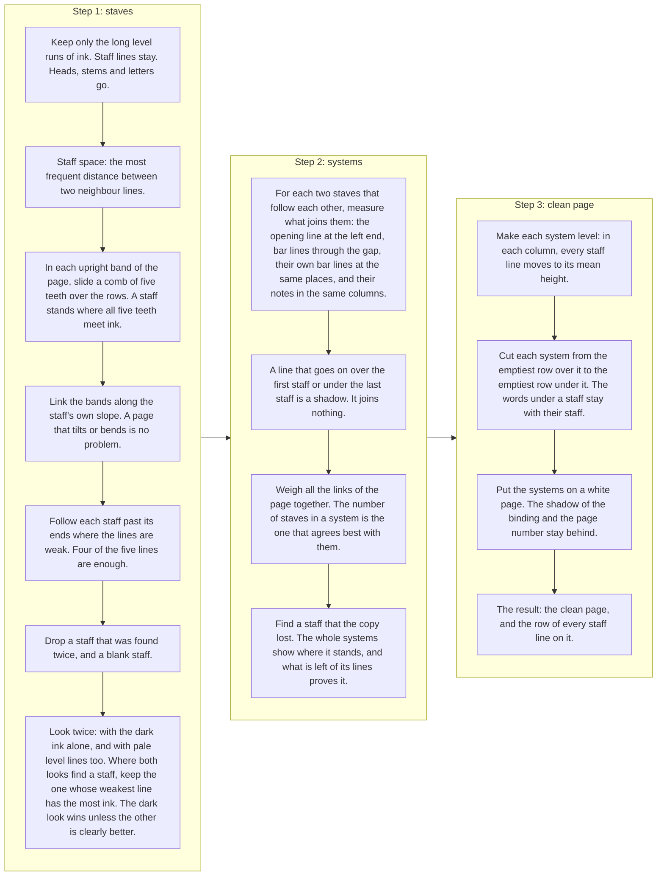

### Step 4: the layers of the ink

On the clean page the row of every staff line is known, so each layer comes from a plain measure of the ink. The
colours are those of `name.layers.png`.

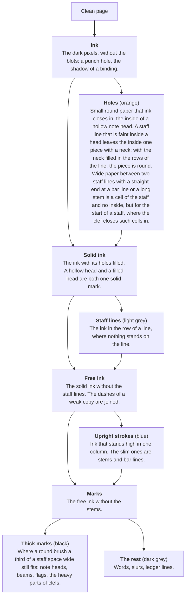

### Step 5: from the layers to the symbols

```mermaid
flowchart LR
    subgraph find["Find the heads"]
        direction TB
        f0["Rows of the words (words.py): a row of the page that crosses many small pieces of ink."]
        f1["Thick marks (symbols.py), cut where two heads touch, where two heads a second apart stand at the two sides of one stem, and where the flag of an eighth note closes in paper beside its head (the head is the solid ink beside that room). The page shows the size of its own heads."]
        f2["Name each mark by the upright ink that leaves it (see the next diagram)."]
        f3["Pitch place: the height of the head between the known rows of the staff lines. For a hollow head, the middle of its hole. Beside the staff, the ledger lines are counted. Where no ledger line is found, thin level ink at one side of the foot of a head, about a staff space from the staff, shows that the head sits on its ledger line."]
        f0 --> f1 --> f2 --> f3
    end
    subgraph more["Correct the heads"]
        direction TB
        m1["Clef, key signature and time signature at the start of each staff (starts.py, meter.py). The notes of a staff begin after them."]
        m2["Bar lines: bare upright lines from the top line to the bottom line, with no head on them."]
        m3["Heads that the thick marks do not show: a thin slanted head of a hand, found from its stem (it is hollow when its ink goes around paper, also where a small break of the rim or a line through the head opens that paper); a hollow head, found from its hole; a head whose stem the copy cut off."]
        m4["Taken away: the joint of a slanted head with its stem, the loop of a printed flag (also where the flag covers most of a short stem, so that little of the stem is slim), the bow of a flag at a stem down (a thin head in the far half of that stem), the numbers of a time signature in the middle of a staff, and a printed quarter rest (rests.py): a piece of ink of its own about three staff spaces high that closes in no paper, has no straight edge and swings right, left, right and left from top to bottom."]
        m1 --> m2 --> m3 --> m4
    end
    subgraph around["Read around the heads"]
        direction TB
        a1["A stem ends where the words begin. A letter can stand before the rows of the words, in the stem's column: then the stem ends at the paper before the letter."]
        a2["Flags and beams at the far end of each stem. A beam that goes on past a stem is one beam: its piece at the left of the stem and its piece at the right lie less than its thickness apart, and two beams lie farther apart. The page shows the thickness of its own beams: on a page without thick beams, slim straight ink from one stem to the next is a beam. A thin beam meets a stem that the words cut at the stem's own end. Where a stem was followed into a slur, its thin beam leaves it before the end that was found: long ink at the side of the stem, half as thick as the page's beams or more. A slur from the end of one stem to the end of the next is no beam: both stems bend toward each other there, and the stroke is thin and round at both ends. The flag of a stem down can be a bow that comes back to the stem: ink at the right of the stem with paper between."]
        a3["Dots at the right of a head: round pieces of ink of a dot's size. A speck is no dot. A full dot can stand close against its head, when no other head has it."]
        a4["Sharps, flats and naturals before a head (signs.py). The cut end of the clef at the start of the notes is no sign. A flat whose bowl has a second stroke down at its right is a natural. The right stroke of a natural can stand against the stem of its note. A natural can be 1.9 staff spaces high; two nearly level strokes are a natural and no sharp when the right one stands lower at both ends and no bar sticks out at the left. A flat or a natural against a bar line is no half note with the bar line as its stem: the line goes through the whole staff, the mark is narrower than a head, and its note follows at once. A heavy sharp whose middle closed is no hollow head, at any size when its stems are the sharp's own strokes. Two strokes that touch are a pair, unless they lie on a full head. On a faint print the two bars of a sharp can be all that is left: two thin marks of one width, one over the other, before a head."]
        a5["Ties (ties.py): a thin bow from a head to the next head of its pitch, also where it begins in a staff line or runs through one. A tie can go over the end of a line: a bow leaves the last note of its voice for the end of the staff, and the voice begins the next line at the same place. A chord is tied note by note: the other heads of the second chord are not in the way. A head of two voices is tied to both heads where the next moment prints the two voices side by side. The paper that a tie closes in where it crosses a bar line is no head, and its line stays a bar line."]
        a6["On a chant page (drone.py): a capital letter that stands alone close over the staff names the ison, and 'Un.' ends it: from there the held part sings one line through the notes of the staff. A letter far over the staff is a section letter."]
        a7["The result: heads with place, stems, flags or beams, dots, signs and ties, in bars."]
        a1 --> a2 --> a3 --> a4 --> a5 --> a6 --> a7
    end
    find --> more --> around
```

What a thick mark is. Each mark is asked where upright ink leaves it.

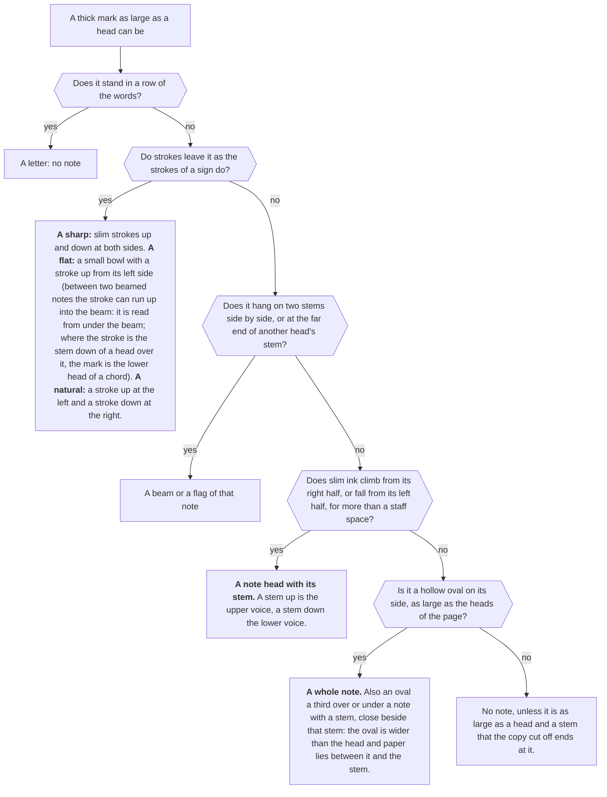

### The clef, the key signature and the time signature

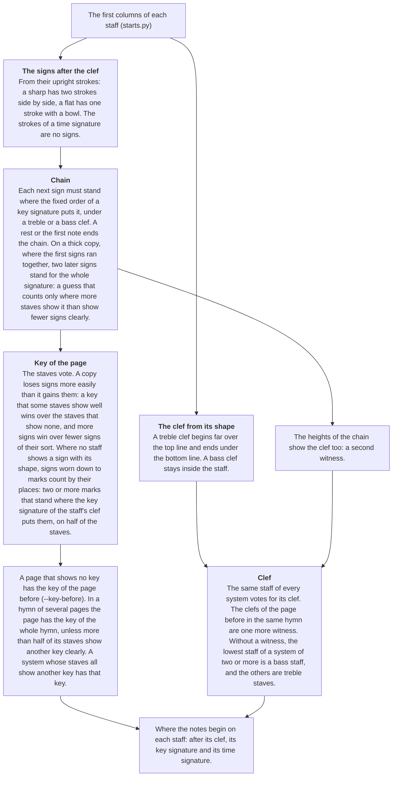

A time signature is found so that its numbers are not read as notes or as sharps. The numbers themselves are not
read yet. The C of common time at the start of a staff is found by its bow: one thin stroke about two staff spaces
high around the middle line, with an end that turns to the right, nothing beside it, and no spot as thick as a note
head. A flat after it is the flat of the first note, not a key signature. Two numbers that touch have a column of
ink along the whole height of the staff, like a bar line, and bold numbers are as thick as heads: they are known
by their width together and by where their long columns stand. Where no column runs the whole height, such
numbers are still checked for one thin stem across the middle line.

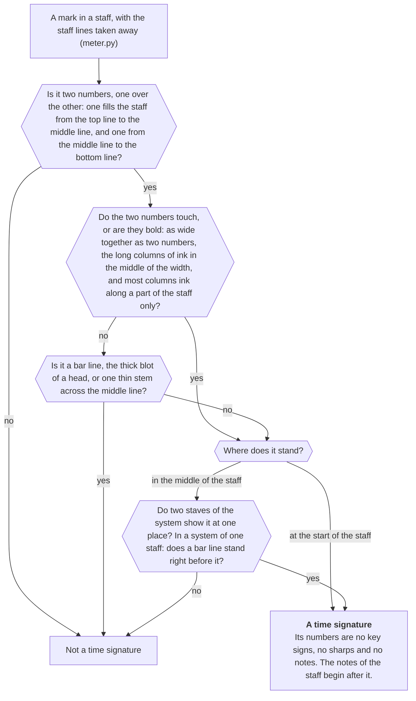

### Step 6: the music rules

How long a note is:

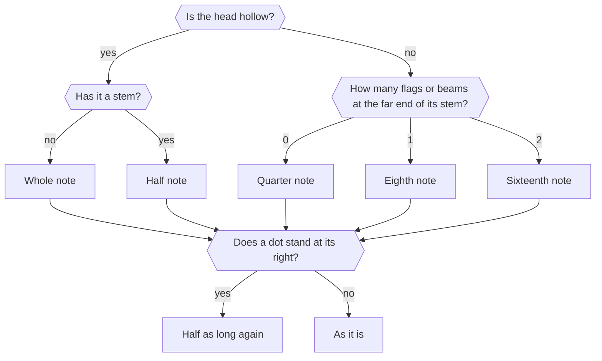

From the symbols to the notes:

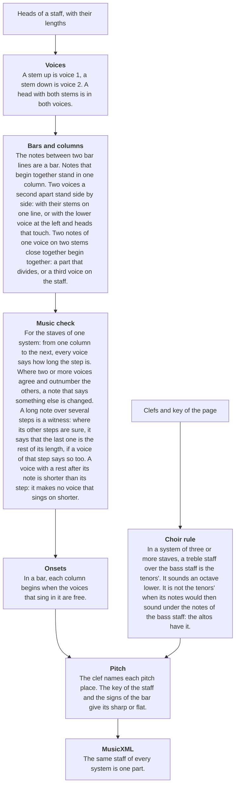

### A PDF that notation software wrote

Such a PDF holds each sign as a character of a music font at its exact place (Maestro, Petrucci, Anastasia, Leland,
Bravura and fonts like them), so nothing has to be recognised.

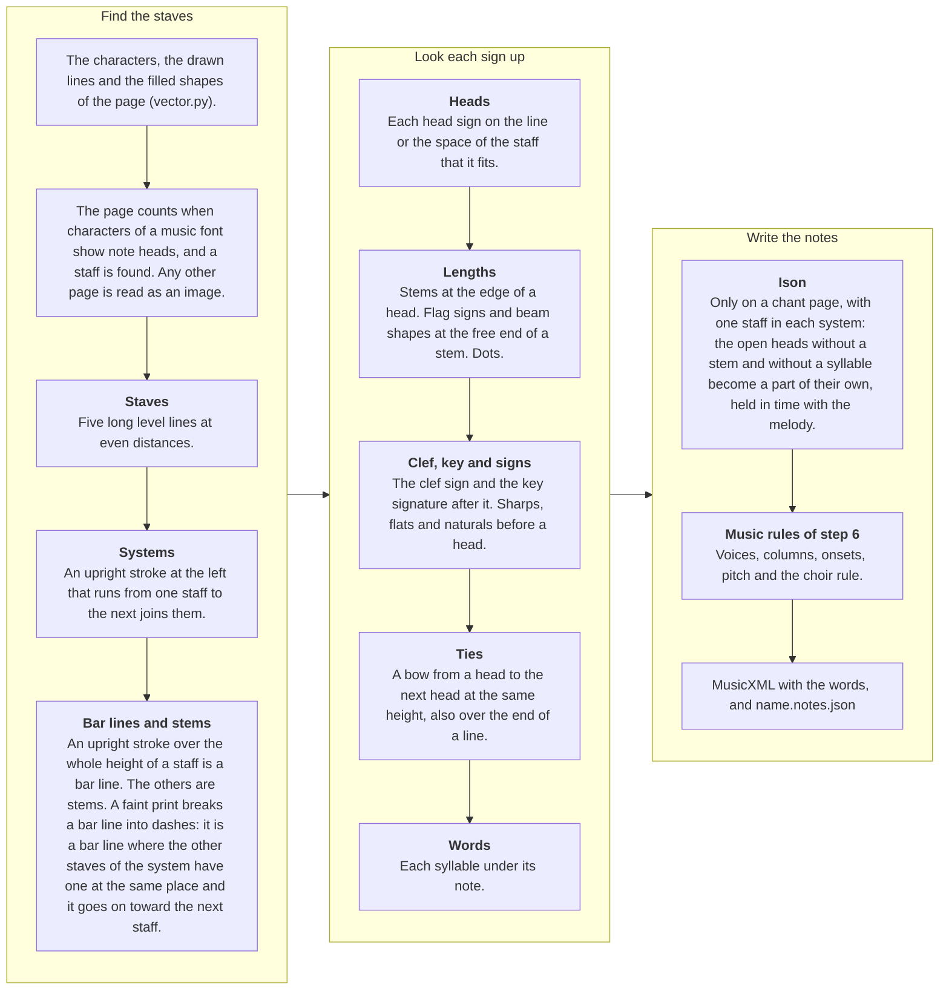

### The words of a scan

```mermaid
flowchart TD
    rows["The rows of the words of every page of the hymn (words.py)"] --> cut["<b>Letters</b> (letters.py)<br/>Each free piece of ink of a row. The dot of an i joins its stroke."]
    cut --> line["The line that the letters stand on, and the height of the small letters, for each row"]
    line --> canvas["Each letter on one canvas: scaled by the height of the small letters, set on the line"]
    canvas --> groups["<b>Groups of one shape</b><br/>A letter joins the group that it differs from by no piece of ink (the bar of an e is such a piece: a c lacks it). The groups have no names yet."]
    groups --> kinds["<b>What each piece is by size and place</b> (lyrics.py)<br/>Letter, hyphen, comma, dot, apostrophe, or a stem that reaches into the words"]
    kinds --> syllables["<b>Syllables and words</b><br/>A gap or a hyphen ends a syllable. Syllables that hyphens join are one word."]
    syllables --> classes["<b>What a group can be</b><br/>It rises over the small letters (b, d, h, a capital), goes under the line (g, p, y), has a dot (i, j), or none of these (a, c, e, n, o). Its holes cost a little: an o has one, a c has none."]
    classes --> vote["<b>First names</b><br/>A word of the page can be each word of the list in which the same shape is the same letter. The group that the words agree on best is named, and so on."]
    vote --> shake["<b>The best names</b><br/>The names are shaken, much at first and then less. A word of the list counts, and so does each run of three letters that the words of the list often have. The names under which the hymn reads most like the list stay."]
    shake --> rest["<b>The shapes that come once</b><br/>A broken letter gets the name of the named shape that it is near. Letters that touch are read as a row of named shapes side by side."]
    rest --> under["<b>Under the notes</b><br/>A row belongs to the staff over it. Its syllables and the notes of that staff keep their order, and each syllable stands under the note that it is nearest to. A syllable with no note of its own is written after the syllable of the note before it, as on a reciting note. A letter with no name is written as a question mark."]
```

With `--tesseract` the words take another way, and only its second box is a model:

```mermaid
flowchart TD
    row["A row of the words of a page (words.py), cut out of the scan"] --> held["<b>Lines of held syllables taken out</b> (ocr.py)<br/>A long, thin, level line at the foot of the letters, with no letter standing on it. Tesseract reads such a line as a row of signs, and the word beside it wrongly."]
    held --> sizes["<b>Tesseract reads the row</b> (the optional step)<br/>As one line of text, with the small letters 40 px high. It gives words, their places, and how sure it is of each."]
    sizes --> rowsure{{"Is it sure of the letters of the row?"}}
    rowsure -- "no" --> rowheld{{"Does the list of words hold the words of half the letters of the row, read as the boxes below read it?"}}
    rowheld -- "no, or no list" --> drop["No row of words: stray ink under a staff"]
    rowheld -- "yes" --> gap
    rowsure -- "yes" --> gap["<b>Two words read as one</b><br/>Where each sign of a word is one piece of ink, the gaps between the pieces are counted. A gap twice as wide as the usual one, and a third of the row's height, parts the word. A gap beside a hyphen does not count. In a row from a typewriter (its letters stand evenly apart, centre to centre) the gap beside a thin letter is wide in any word: there two words are parted only where their letters stand further apart than a letter's box."]
    gap --> syl["<b>Syllables</b><br/>A hyphen joins two syllables. A dash after a comma or a full stop is the line of a held syllable. A 0 or a 1 among letters is the letter that it stands for (O, I, l). A word of one or two letters that Tesseract is not sure of is left out, unless the list of words holds it."]
    syl --> list{{"Is there a list of words?"}}
    list -- "yes" --> ends["<b>Where the words end</b><br/>A word that the list does not hold is parted at the one place where the list holds both sides ('Thy-church', 'thelord'), a word of one letter being one of them only when it is a common word of the list ('odrink'). On a page in the list's language three common words that were read as one are parted too ('mercyonus'). Two words are joined that the list holds only as one ('re joice')."]
    ends --> mend["<b>One wrong letter</b><br/>A word of four letters or more that the list does not hold, and that Tesseract was not sure of, becomes the one word of the list that is a letter away ('tnose' is 'those'). A missing vowel between two syllables is a syllable of its own. Only on a page of whose letters a fifth or more stands in words of the list: else the page is in another language than the list."]
    mend --> again{{"Does the list hold every word of the row?"}}
    list -- "no" --> again2["<b>A second look</b><br/>The row is read again with the letters 32 and 50 px high. The reading that Tesseract is surest of stays."]
    again -- "no" --> look["<b>A second look</b><br/>The row is read again with the letters 32 and 50 px high. The reading of which the list holds the most letters stays."]
    again -- "yes" --> parts["<b>Syllables that the scan does not show</b><br/>A list that writes its words with hyphens between their syllables knows how each word is parted. A word that was read in fewer syllables than the list parts it into ('mercy' under two notes, 'glo-rious' under three) is parted as the list parts it most often. Each letter keeps its place in the row."]
    look --> parts
    parts --> under2["Under the notes, as in the diagram before"]
    again2 --> under2
```

Not in the diagrams: the brackets of triplets (`triplets.py`, after the dots; a bracket in the rows of the words
with words at both of its sides and broken arms is a piece of the words), and what the reader of scans does not
do yet: the rests that are no printed quarter rest, and slurs (see "Limits").

## Results on every score of LitChoir (the wide test)

The wide test reads every score of the app that has a typed hymn to compare with: 369 scores on 657 pages, 516 of
them scans. 364 are counted: the page of 5 scans holds another version than the typed hymn. Notes right means pitch
and length both right. The count is of the notes that the pages show: 5,961 typed notes that no page prints are
listed apart. Most are recited syllables and the held notes of an ison that the page does not mark; 356 are a
refrain or a repeat that the page prints once and the typed hymn writes out again. 218 typed notes that a part
sings from another part's staff are not compared. Each score is read as the `hymn` command reads it: its pages in
order, with one vote for its key.

| Kind of score | Scores | Notes right | At 99 % or more | At 90 % or more | Under 50 % |
|---|---:|---:|---:|---:|---:|
| PDFs that notation software wrote (read from their drawing) | 70 | 99.3 % (20,016 of 20,163) | 53 | 70 | 0 |
| Scans | 294 | 81.6 % (56,799 of 69,579) | 23 | 103 | 22 |
| All | 364 | 85.6 % (76,815 of 89,742) | 76 | 173 | 22 |

The first milestone is 99 % on clean copies: the scan scores with printed notes and words and crisp ink. 81 were
sorted as clean and 78 are counted: one has words lettered by hand, was sorted wrongly and counts with the copies
by hand now, and the page of two holds another version than the typed hymn. The other scans come after the
milestone: 26 printed but thick, blurred or grey copies, and 190 with notes or words by hand.

| Scans by copy | Scores | Notes right | At 99 % or more | At 90 % or more | Syllables right, own letter reader | Syllables right, with Tesseract and a list of words | Whole words right, with Tesseract and a list of words |
|---|---:|---:|---:|---:|---:|---:|---:|
| Clean print | 78 | 95.1 % (21,490 of 22,589) | 22 | 70 | 49.9 % (3,286 of 6,584) | 92.6 % (5,779 of 6,240) | 90.8 % (4,115 of 4,531) |
| Thick or grey print | 26 | 79.4 % (6,687 of 8,426) | 0 | 7 | 32.9 % (658 of 2,000) | 81.4 % (1,619 of 1,990) | 81.2 % (1,118 of 1,377) |
| By hand | 190 | 74.2 % (28,622 of 38,564) | 1 | 26 | 37.7 % (5,401 of 14,345) | 77.7 % (11,155 of 14,357) | 74.7 % (7,722 of 10,344) |

- The figures count every typed note of a part since four rounds before the last, the notes of a chord too; until
  then one note of a chord was counted for each part of a staff. The rounds below it give their figures by the
  count of their time. Of the clean scores, 48 are at 95 % or more. About 930 more notes are needed
  for 99 % of each clean copy; 9 scores lack one to three notes. The mistakes that are left are many small causes;
  the largest that was found
  since, two voices a second apart that the print sets as one blot of ink, brought 41 notes on the clean copies
  three rounds before the last. The reader also writes 944 notes on the clean copies that are not there (5,726 on
  all scores); the last three rounds took 49, 67 and 35 of them away. Of 30 mistakes drawn by lot and looked at
  on the page ten rounds ago,
  8 are a hollow head and a filled head mixed up, 4 a dot, 4 a tie or a slur, 4 a beam, 4 a sign, and 6 one of a
  kind (a note that a pencil crossed out, a typed hymn that differs from its page). Two fine engravings held about
  240 of the 1,269 notes that were lost then (1,099 now, with the notes of chords counted). An earlier count said that a quarter of the mistakes are
  the scorer lining a staff up with the wrong part: the tool behind that count lined the notes up in its own way,
  and it is not held any more.
- Words with the optional Tesseract step and a list of words: 24,206 of 28,692 syllables are right (84.4 %):
  92.6 % on the software-made PDFs (their words are text in the PDF; Tesseract is not used there), and 82.1 % on
  the scans (18,553 of 22,587). These are 11 syllables fewer than five rounds ago with the same words read: the
  words are compared in the layout that the count of the notes chooses for a score, and the scorer sets a few
  scores in another layout or on another part of their pages now. On the clean copies 92.6 % of the syllables and 90.8 % of the whole words are
  right, and 19 of the 78 scores have 99 % of their syllables (15 twelve rounds ago, 4 thirteen rounds ago). The
  list of words is made from the typed hymns of the app without the hymn that is read and its other scores, so no
  score is read with its own text. Without a list the scans have about 910 fewer of these syllables and
  about 1,170 fewer whole words (quick count, see the rounds of the words below).
  With the own letter reader, which uses no model, the scans have about 40 %; its column in the table was measured
  fifteen rounds ago and not again since.
- The count of the syllables changed twelve rounds ago, and that alone moved the figures: the syllables of a refrain
  that the page prints once and the typed hymn writes out again are listed apart now, as the notes of such a
  refrain already were (150 syllables on 2 scores). Counted the new way, the clean copies stood at 85.0 % before
  that round (5,302 of 6,240; 83.3 % by the old count) and all scores at 78.2 % (22,449 of 28,697).
- The words are counted in three ways. Syllables right: the typed syllables that the reader wrote, in the typed
  order. Whole words right: the same for words, each joined from its syllables at the hyphens that the reader
  read; a word counts only when all of it is right, and a word that the page prints with no hyphen over two notes
  is still one word. Letters in order (90 % on the scans with Tesseract, 96 % on the clean copies): a lenient
  count, since two unlike hymn texts of one length share two fifths of their letters in order. Under which note a syllable stands is not
  scored yet.
- A note can hold several syllables (a reciting note, or a syllable whose note was not read), and the words of
  such a note are counted one by one, in the reading and in the typed hymn. The figures of the own letter reader
  on the thick copies and the copies by hand are from before this count.
- Some typed syllables stand on no page: a refrain that the page prints once and the typed hymn writes out after
  each verse. The two clean scores that miss the most syllables are of this kind. Such syllables are not counted
  apart yet, as the notes of a repeat are.
- The sorting into clean, thick and by hand was done by eye from the first system of each score. Some typed hymns
  differ from their page in ways that the scorer was not told, and count as wrong: a tie that the page prints and
  the typed hymn does not, a refrain, a note that a pencil changed.
- The scorer gives each staff of a page the typed parts that it lines up with best. A small change in the reading
  can turn that choice: one hymn lost 16 notes in an earlier round because one wrong note was no longer
  read, and the scorer then took its staff for one part and not for two.
- The figures count parts, not staves. A staff that holds two parts is split: the top note of each chord goes to
  the upper part and the bottom note to the lower. Until five rounds ago that was all: of a typed part that
  divides only the top or the bottom note was counted, and a false note in a chord took the place of the true
  one. Now the other notes of a chord are counted after that line-up (see the round of the count below). The line-up itself
  has no sense of time: it compares the notes of a part in their order.
- The last round: the lengths that the voices say to each other, and the printed quarter rest. Of the 1,124
  notes that the clean copies lacked after the round before it, 452 had only a wrong length, 259 only a wrong
  pitch and 101 both. The largest kinds of wrong lengths: an eighth read as a quarter (55), a quarter read as an
  eighth (42), a quarter read as a half (40), a half read as a quarter (36), a dotted half read as a half (34)
  and a whole note read as a half (20). Five rules were written and stand. The clean copies went from 21,465 to
  21,490 of 22,589 notes (95.1 %; 26 gained, 1 lost; 22 scores at 99 %, 21 before; 48 at 95 %, 70 at
  90 %), all scores from 76,758 to 76,815 of 89,742 (85.6 %; 63 gained, 6 lost; 76 scores at
  99 %, 75 before), and the fresh test set from 39,559 to 39,576 of 41,761 (94.8 %; 18 gained, 1 lost;
  86 pieces at 99 %, 85 before). The reader writes 35 fewer notes that are not there on the clean copies
  (944), 44 fewer on all scores (5,726) and 83 fewer on the fresh test set (5,032).

  | Rule, switched off alone in the final reading; notes gained, lost by parts | Clean copies | All of LitChoir | Fresh test set |
  |---|---:|---:|---:|
  | A long note is a witness for the steps under it (`music.SPAN_VOTE`, with the two rules under it) | 27, 1 | 62, 6 | 15, 1 |
  | ... where it can say the lengths of several open steps at once (`music.SPAN_SUM`) | 2, 0 | 4, 0 | 0, 0 |
  | ... and only a length that a voice of the step says too (`music.SPAN_SIDE`) | 0, 2 | 0, 3 | 6, 0 |
  | A printed quarter rest is no note (`rests.QUARTER`, with the rule under it) | 0, 1 | 2, 1 | 4, 1 |
  | A voice with a rest after its note makes no voice that sings on shorter (`music.REST_SPAN`, read off on every page) | 0, 0 | 1, 0 | 0, 0 |

  Counted staff by staff the round gains 29 notes and loses 1 on the clean copies, 70 and loses 5 on all scores, and
  15 and loses 1 on the fresh set. By staves the long note as a witness gains 61 notes and loses 5 on all scores, the rule for
  several steps 4 and none, the rule for the length that a voice says none and loses 3, the reader of rests 4 and loses 1 and the
  rule for the voice that rests 3 and none.
- The music check before this round. The columns of the staves of a system are lined up, and from one column
  to the next every voice that has a note in both says how long that step is. Where two or more voices agree
  and outnumber the others, a note that says something else is changed. A note that reaches over several
  columns said nothing, and was only made shorter. The length mistakes of the clean copies were listed by how
  the voices had voted: 133 are notes over several steps (beside 2,641 such notes that are right), 66 stand
  where one voice says one length and one voice another (115 right notes stand there too), 58 where the note is
  the only voice of its step, and 26 where two voices stand against two.
- The first rule: a long note is a witness. A half note in the bass under two quarters of the tenor says
  nothing about either quarter. But where one of the two steps is sure, the half note says that the other
  step is what is left of it. Such a note counts as one more voice of that step; two or more voices must still
  agree and outnumber the others. When a step has become sure, the long notes are asked again. The second
  rule: where several steps under a long note are open, each has one length said, and these lengths and the sure
  steps add up to the long note, it says each of them.
- The third rule came from the fresh test set. The first two rules gained 14 notes there and lost 6. The
  cause was read on its pages: a staff with one line of melody draws its stems up and down with the height of
  the notes, the reader takes each direction for a voice, and a quarter with its stem down then seems to last
  until the next stem down. And where another step under a long note is sure but wrong (the second beam of a
  sixteenth is not read), what is left of the long note is no length at all. Both give a length that no voice
  of the step says. So the long note only takes a side now: its length for a step counts when a voice of that
  step says the same. On LitChoir that costs 3 of the gained notes (2 on the clean copies, in the two scores
  of one hymn); on the fresh set it gains 6 notes and loses none. One note of the fresh set is still lost: a
  dotted eighth before a sixteenth is made an eighth, and a voice of its step says so too.
  A second guard was written for the first cause and dropped: the long note had to be a voice of its own (its
  staff shows two voices in its column, or in its bar). With the third rule on, it changed nothing on the
  fresh set, and on LitChoir it cost 2 more gained notes in its first form and 1 note in its second.
- What the long note loses on LitChoir: 6 notes, each in another score. On the clean copies one: a pencil
  circle around three notes is read as a half note, and as a long note it is a false witness
  (nativity-god-is-with-us, which falls from 95.0 % to 94.2 %). The other five are single notes on other scans
  (a half note cut to a quarter, a dotted half to a half, an eighth made a quarter); their votes were not
  traced.
- The fourth rule: the printed quarter rest. The reader of scans knew no rest. The thick middle of a quarter
  rest is as fat as a head and its thin strokes stand like a stem, so the rest was read as a quarter note, and
  that note was a false voice in the music check. Every piece of ink without the staff lines that is 2.0 to
  4.0 staff spaces high and 0.5 to 1.8 wide and lies in a staff was listed on the clean copies with its
  measures and with the note that was read there: 6,968 pieces. The height, the width and the thickness of its
  strokes do not tell a rest: 33 quarter notes with short stems and slanted heads pass such a test beside the
  rests, and so do the pairs of sharps of a key signature. Three measures of the shape do. The piece closes in
  no paper (a pair of sharps, a natural at its head and a clef do). Neither its left nor its right edge is
  straight (the stem of a note is: one edge stays within 0.15 staff space over more than 0.85 of the rows). And
  the middle of its ink, taken in eight parts from top to bottom, swings to the right, back to the left, to the
  right again, and to the left at the hook (by 0.12, 0.12, 0.03 and 0.08 staff space at least; the rests of the
  list have 0.13, 0.14, 0.04 and 0.10 at least). The rule takes a piece that is 2.0 to 3.6 staff spaces high
  and 0.7 to 1.3 wide. 91 pieces pass: 62 that were read as nothing, 29 that were
  read as a note that is not there, and none with a right note. A head whose middle lies in such a piece is no
  note. Rests that stand over or under the staff, where two voices share it, are found too. On LitChoir the
  reader of rests, with the fifth rule, gains 2 notes and loses 1 and takes away 38 notes that are not there (30
  on the clean copies). The lost note is on a clean copy (wedding-isaiah): the faint, bent stem of a quarter
  reads as a flag, and the rest in the staff under it, read as a quarter note, had voted for a quarter and
  mended it by chance. On the fresh set it takes away 85 notes that are not there of about 5,100: it finds few
  of the rests of those pages. Its limits were set on LitChoir's prints, and it was not looked at which rests
  it misses there.
- The fifth rule: what a rest says about lengths. It took three forms. A note with a rest after it is shorter
  than the step to the next note of its voice. First form: such a note does not vote. It gained 1 note and lost
  2 on LitChoir: on two pages every voice has a dotted half and a quarter rest, one dotted half is read as a
  dotted quarter, and the votes of the other voices had mended it; the rest of its own staff touches the bar
  line and is not found. Second form: it votes, and is only not made longer. It changed no count, and with the
  rest no longer read as a note, two resting voices on one page cut a whole note of the basses to their own
  length (2 notes lost staff by staff). Third form, which stands: the voices that rest together are as long as
  each other, so they vote; but a length that fewer than two voices without a rest say is the length of the
  resting voices and not of the step. It makes no note without a rest shorter (that voice sings on), it can
  make one longer (its own rest was not found), and it is no part of the sum of a long note. A long note with a
  rest after it is no witness. On a staff of two voices a rest that stands a staff space or more over the middle
  line is the upper voice's, and one as far under it the lower voice's.
- A rule that guards is in no list of changed pages: where it stops a wrong change, its page reads as on main.
  The fifth rule was therefore read off on every page of LitChoir and of the fresh set, not only on the pages
  that the round changes: 2 pages of LitChoir differ (a whole note and a half note that are no longer cut
  short), and none of the fresh set. That reading was made before the third rule was written; with it the
  rule was read off on the pages that the round changes, with the same counts.
- Counted and dropped. The width of a step as a witness for its length: on the clean copies an eighth takes
  0.69 of the width of a quarter in the middle of the list, but a quarter takes 0.68 to 1.63 of it; as a
  tie-break between two voices it mends 15 to 18 notes and breaks 7 to 9. And making a long note longer where
  the sure steps under it add up to more than it: 16 notes of the clean copies would gain, and 114 right notes
  stand in the same case, because a rest follows them; that needs every rest read first.
- The words. No word is read differently, and no score changes its count of syllables: 24,206 syllables are right
  on all scores and 5,779 on the clean copies, as before. The kit gained 3 notes (6196 to 6199), in two hymns
  where a long note is a witness.
- Left for the next rounds: a quarter rest that touches a bar line or a slur (it is no piece of ink of its
  own), eighth, half and whole rests, the rests of a hand, a letter of the dynamics and a pencil mark that are
  read as notes and then vote on lengths, and the long note that could be made longer where no rest follows.
- The round before it: the clean scores that lack one to three notes. After the round before it, 14 of the 78 clean
  scores lacked one to three notes for 99 % (5 lacked one, 4 two, 5 three). Their mistakes were looked at on the
  page, one by one. Five rules were written, and all five stand. 21 clean scores are at 99 % now (16 before), and
  9 lack one to three notes. The clean copies went from 21,432 to 21,465 of 22,589 notes (95.0 %; 38 gained, 5
  lost; 49 scores at 95 %, 70 at 90 %), all scores from 76,577 to 76,758 of 89,748 (85.5 %; 239 gained, 58 lost;
  75 scores at 99 %, 70 before), and the fresh test set from 39,500 to 39,559 of 41,761 (94.7 %; 60 gained, 1
  lost; 85 pieces at 99 %, 83 before). The reader writes 67 fewer notes that are not there on the clean copies
  (979), 196 fewer on all scores (5,770) and 159 fewer on the fresh test set (5,115).

  | Rule, switched off alone in the final reading; notes gained, lost by parts | Clean copies | All of LitChoir | Fresh test set |
  |---|---:|---:|---:|
  | A cell of the staff with a straight end at a bar line or a stem is no inside of a head (`layers.HOLE_SIDE`) | 29, 5 | 224, 57 | 60, 1 |
  | The inside of a whole note of a heavy print has a little more paper in its corners (`layers.WHOLE_INSIDE`, 0.3 to 0.33) | 2, 0 | 7, 1 | 0, 0 |
  | A head that two voices share is tied to both heads of the next moment (`ties.TIE_BOTH`) | 2, 0 | 2, 0 | 0, 0 |
  | The lower head of a chord with its stem down is no flat (`symbols.FLAT_STEM`) | 1, 0 | 4, 1 | 0, 0 |
  | After "Un." the held part sings one line through the notes of both voices (`music.UNISON_LINE`) | 4, 0 | 4, 0 | 0, 0 |

  Counted staff by staff the round gains 34 notes and loses 5 on the clean copies, gains 249 and loses 71 on all
  scores, and gains 47 and loses 2 on the fresh set. By staves the first rule gains 228 and loses 72 on all
  scores, the second 8 and 1, the third 2 and 0, the fourth 5 and 0, and the fifth 4 and 0. On the fresh set the
  first rule changes 69 pages and the second one page; the other three change none.
- The first rule and its census. The layer of the holes fills small paper that ink closes in: the inside of a
  hollow head. The paper between two staff lines is closed in too, where a bar line or a stem stands at one of
  its ends and the round side of a head, a second stem or the end of a beam at the other. Such a cell was filled
  like the inside of a head. A filled head beside it became one mark with a hole and was read as a half note, and
  the cell under a beam between two stems was read as a hollow head of its own. Every filled hole of the clean
  copies was listed with its measures and with the note that was read there: 21,346 holes, 7,147 of them with a
  right note (most of the others are letters of the words). The inside of a right hollow note is 0.62 staff
  spaces wide in the middle of the list, 0.89 at 90 of 100, 1.05 at 99 of 100 and 1.63 at most. 279 holes are
  1.1 staff spaces wide or more and have a straight end (the outer tenth of their columns is 0.7 of their height
  or more) that lies against an upright stroke 2.0 staff spaces long or more. None of the 279 holds a right
  hollow note, 6 stand beside a right filled note, and 32 hold a note that is not there. With a stroke of 1.2 to
  1.6 staff spaces there are 2 right hollow notes, so the stroke must be 2.0 long. The rule: such paper is a cell
  of the staff, and it is not filled.
- The first form of that rule lost 115 notes on the clean copies beside 30 gained, 100 of them in one score. The
  clef and the end of the key signature are read from the solid shapes at the start of a staff, and a clef
  closes cells in against the line at the left end of the staff. On one page four such cells were no longer
  filled, the found end of the clef moved in two staves, and the hymn's key was voted with 2 flats where it has
  4. The rule now leaves the first 4.5 staff spaces of every staff alone. That page has the key and the ends of
  main again, and two holes differ.
- What the first rule loses. It was kept with these losses, because it gains about four times as many notes and takes
  away most of the round's notes that are not there. On the clean copies 4 notes of one score
  (communion-lords-prayer, which falls from 90.8 % to 89.8 %): half notes of a heavy print whose own inside has
  a speck of ink and is not found as a hole. They were read as half notes only because the cell beside them was
  filled; they are quarters now. And 1 whole note on a ledger line: the page measures the usual hole of its
  hollow heads, four cells under beams no longer count among them, the limit for a hollow head rose from
  0.057 to 0.084 of the mark, and that whole note has 0.08. On the other scores: 20 notes of one copy by hand
  that is half right (the rule changes 11 notes on its two pages; of seven places looked at, four are cells or
  scribbles that were read as notes; the scorer then lines its staves up with other parts, and staff by staff
  it loses 31); 4 notes
  of a copy by hand that draws its flags as closed loops (the loop was filled as a hole and known as a flag; now
  it is open and is read as a thin hollow head); and one to three notes in 18 scores. Six of these were looked
  at on the page: the numbers of a time signature in the middle of a staff close to a bar line (two scores), a
  large flat, the signs of a thick copy and two copies by hand are read with other false notes than before.
  Which note was right before, and why, was not traced there, nor in the other twelve.
- The second rule. A whole note between two staff lines is as high as a cell of the staff, and a rule tells its
  inside from a cell by its four corners: paper fills less than 0.3 of them, because the inside is an oval. All
  8,209 pieces of paper of the clean copies that are as high as a cell were listed. 153 pass the rule, 97 of
  them with a right whole note (their corners are 0.25 at most). 13 narrow pieces fail at the corners alone: 7
  have 0.31, which is 5 of 16 corner pixels (four whole notes of two heavy prints, two of them a third from
  another whole note, and the letters P, B and g of the words, which are no notes in either case), the flats
  of two key signatures have 0.36 and 0.58, and a treble clef has 0.47. The limit is 0.33 now. One pair of whole
  notes a third apart is still not read: two heavy ties run into it.
- The third rule. A head with a stem up and a stem down is the note of two voices. When it is tied and the next
  moment prints the two voices as two heads side by side (a half note and a quarter of the same pitch), the
  print draws a bow over and a bow under. The reader tied the first of the two heads only, and the other was a
  new note. Now a head of the other voice that stands at most half a staff space to the right of the tied one,
  at the same place, is tied too when a bow reaches it. One printed score has this (megalynarion-bulgarian, 2
  notes, now at 99 %). A tie of this kind over the end of a line is not read.
- The fourth rule. A chord with its stem down has the stem at the left of its heads. The lower head, with the
  stem going up from its left side to the upper head, is the shape of a flat: a bowl with a stroke up from its
  left. The rule for a flat by hand named it one. Now a filled mark as large as a head that is named a flat is a
  head when a head over it has a stem down in the column of that stroke (0.35 staff space at most apart), the
  stroke ends at that head, and the head's stem was followed down to the mark. On LitChoir it gains 4 notes (5
  staff by staff) and loses 1 by parts, none by staves: on a copy by hand a scribble under a whole note is a
  note now, and the scorer lines the staff up otherwise.
- The fifth rule. On a chant page the letters over the staff name the held note of the ison, and "Un." ends it:
  from there the held part sings the melody. The reader copied the notes of the first voice of the staff. But
  the melody is one line whose stems go up and down with its height, and a note with its stem down is read as a
  second voice: the held part had gaps. Now the held part takes the notes in the order of their beginning, each
  one that begins when the one before has ended: one line through both voices. One clean score gains 4 notes and is at 100 % (hierarchical-xenia-apolytikion). The held notes are
  written into the music of a page and are not among the notes of the page that the tools compare, so the list
  of pages that a round changes did not hold this page; the list compares the written music too now.
- The words. 24,206 syllables are right on all scores (24,200 before) and 5,779 on the clean copies (5,780). The
  rules do not touch the reading of the words. A syllable hangs on a note, and where a note that is not there
  is gone, or a note is new, a syllable can hang on another note or count for another part. Nine scores change by one to three
  syllables (six gain, three lose). The one syllable of the clean copies is the last of a hymn whose final
  chord lost two notes that are not there. The kit gained 21 notes (6175 to 6196): 19 by the first rule, 15 of
  them on one copy by hand (11 staff by staff), and 2 by the third. The figures of this round are of its time.
- Looked at in this round and left without a rule. A score whose page crosses two voices by their stems where
  the typed hymn does not (megalynarion-bulgarian, 2 notes). Pencil marks that are read as notes (two scores).
  Half notes with an open rim that are read as quarters (trisagion-obleschuk). A dash after a note that is read
  as a dot (memorial-troparia). Filled heads of a speckled print that are read as hollow
  (forerunner-nativity-apolytikion). The lengths of a bold print (transfiguration-hymn-theotokos). The letter of
  an ison that stands right at the clef, with a breve that is not read (pascha-hypakoe; 16 marks of an ison are
  missed on the clean copies). A typed hymn in four parts with divided voices against a page of two staves
  (liturgy-what-shall-i-render, 13 notes).
- Two rounds before: notes that are not there. The reader wrote 1,095 notes on the clean copies that the typed
  hymns do not hold. 80 of them were drawn by lot and looked at on the page. About 4 of 10 are true notes that
  the count cannot place: the second half of a long note whose tie is not read, or a note that the scorer lines
  up with another. Of the rest the numbers and signs of time signatures are the largest kind (12 to 22 of 100),
  then the letters p and f between the staves (10), quarter rests (8) and paper closed in by a slur (8). Two rules were written and both stand. The reader writes 49 fewer notes that are not
  there on the clean copies (1,046), 107 fewer on all scores (5,966, from 6,073) and 212 fewer on the fresh test
  set (5,274, from 5,486). The notes right moved little: the clean copies went from 21,427 to 21,432 of 22,589
  (94.9 %; 5 gained, none lost; 16 scores at 99 %, 47 at 95 %, 71 at 90 %), all scores from 76,563 to 76,577 of
  89,747 (85.3 %; 15 gained, 1 lost; 70 scores at 99 %), and the fresh test set from 39,494 to 39,500 of 41,761
  (8 gained, 2 lost).

  | Rule, switched off alone in the final reading; notes gained, lost by parts | Clean copies | All of LitChoir | Fresh test set |
  |---|---:|---:|---:|
  | The two numbers of a time signature that touch, or that a bold print sets (`meter.TIME_STACK`) | 2, 0 | 12, 1 | 8, 2 |
  | A bracket of a triplet that is made of the hyphens of the words (`triplets.IN_WORDS`) | 3, 0 | 3, 0 | 0, 0 |

  All of the fall of the notes that are not there is the first rule's. Counted staff by staff the round gains 6
  notes and loses none on the clean copies, gains 22 and loses 1 on all scores, and gains none and loses 2 on
  the fresh set. The scorer lists 8 more typed notes apart than before (1 on the clean copies), so the notes
  drawn are 89,747 now. The notes gained by the first rule were not traced one by one.
- The census behind the first rule. A time signature was found as two numbers, one over the other, that are no
  bar line (no column of ink along the whole height of the staff) and no thick blot of a head. A close print
  sets the two numbers so that they touch: a 4 over a 4 has a column of ink from the top line to the bottom
  line, like a bar line. A bold print makes blots as thick as heads of them. Every piece of ink on the clean
  copies that is two halves of the right size was listed with its measures: 270, of which the old rule found 23.
  The new rule takes 44 more, and each is a time signature on its page (4/4, 3/4, 2/4, 6/4, 3/2). What separates:
  the two numbers are 1.30 to 1.81 staff spaces wide together, their full columns lie between 0.10 and 0.81 of
  the width, and 0.50 to 0.85 of their inked columns are ink along a part of the staff only. A bar line with what
  stands beside it has its full columns at 0.04 to 0.17 or at 0.83 to 0.93 of the width, is 1.21 wide at most and
  has few such part columns (0.36 at most, but for a few). An eighth note with its stem down and a flag has its
  longest column in the first 0.13 of the width, and with its stem up it is 2.05 wide or more. The rule: two
  halves that are 1.25 to 1.9 staff spaces wide together, each 1.1 wide or more, whose columns of ink along 0.85
  of the staff's height or more all lie between 0.08 and 0.81 of the width (from 0.25 where no column runs the
  whole height), and of whose inked columns 0.45 or more are ink along a part of the staff only, are numbers.
  Two time signatures of the clean copies are still not found: one stands a quarter of a staff space off the
  lines, and one has its full column at 0.83 of the width.
- The second rule. One hymn of the clean copies sings "Al-le-lu-i-a" under a staff. The two hyphens with the
  syllable between them, and an l at each outer end, look like the bracket of a triplet: two flat arms, a hook
  at each outer end and something in the break. Three true notes were read as a triplet. LitChoir's pages have
  30 brackets, and this is the only false one. Three forms were counted. The first: a bracket whose row lies in
  a band of the words and that has ink at both of its sides is a piece of the words (17 true brackets lie in
  such a band, and none has ink at both sides). It gained the 3 notes and lost none on LitChoir, and lost 2
  notes on the fresh test set: a true bracket there stands between two syllables. The second form added that
  less than 0.8 of the row of the arms is ink (0.66 in the false bracket, 0.88 to 0.94 in the true ones). It
  still lost the 2 notes: that bracket is narrow, and the break for its number is a large share of its width.
  The third form stands: beside its two widest gaps (the break, which the number divides in two), 0.08 or more
  of the row of the arms is bare. The 29 true brackets of LitChoir have 0.02 at most there, and the false one
  has 0.16. It gains the 3 notes on LitChoir, and no page of the fresh set is read differently with it. The
  limit of each form was set on LitChoir's 30 brackets alone, but the fresh page showed why two forms failed, so
  for this rule that page is no longer unseen. One false bracket is thin ground for a rule; it stays because it
  loses nothing on any page that was read, and because it brings that hymn to 99 %.
- What the round loses. On LitChoir one note of a copy by hand: its time signature was not found before, the
  notes of the staff began too early, and the flat of the key signature was read as the flat of one note, which
  was right by chance. Now the time signature is found, the flat stands before the notes, and the hymn's key is
  still voted to have no flat. On the fresh test set 2 notes of one piece: the 2 of the time signature had been
  read as a half note on the middle line, and the typed first note of that part is a half note on the middle
  line, in two staves. The true first note is read with a wrong length, and that shows now. The words did not
  change (24,200 syllables right on all scores, 5,780 on the clean copies). The kit gained 3 notes (6172 to
  6175): the false triplet. The figures of this round are of its time.
- Looked at in this round and left without a rule. The letters p and f between the staves, read as notes with
  short stems outside the staff (14 on the clean copies with a hollow head): the length of the stem, the ledger
  lines and the size of the piece of ink do not tell them from true notes. The printed C of common time (about
  30 on the clean pages, 1 found): a bold C fails three checks of the rule for the thin C of a hand, and two new
  measures of its opening failed, because the layer that they read shows the C partly filled. A quarter rest
  read as a thin head: of the thin heads that stand 0.3 of a place or more off the grid, 12 are right, 5 have a
  wrong pitch and 23 are not there, too close for a limit. A
  slur that ends at the end of a stem and is read as a flag (43 notes on the clean copies), a slur between two
  beamed stems that is read as a hollow head and takes the stem, filled heads of a speckled print that are read
  as hollow, and a dot of the lower voice that is given to the upper head.
- Three rounds before: notes of a chord that are not read on the clean copies. A new tool lists every typed note that
  the reader has no note for while it has another note of the same moment on that staff: 160 on the clean
  copies. The largest shape among them is two voices a second apart with their stems back to back on one line.
  The head of the upper voice stands at the left of the stem and the head of the lower voice at its right, half
  a staff space lower, and the print makes one blot of ink of the two heads and the stem between them. The old
  cut for touching heads asks for a blot that is clearly made of two heads on a diagonal; these blots are too
  full for it. Many were read as one note, and some as no note at all, so the rule gains more notes than the
  list holds for this shape. Four rules were written. Three stand, and one is switched off with its counts. The
  clean copies went from 94.7 % to 94.9 % of the notes (45 gained, none lost: 21,427 of 22,590; 15 scores at
  99 %, 47 at 95 %, 71 at 90 %), all scores from 85.2 % to 85.3 % (76,563 of 89,755; 103 gained,
  1 lost; 69 scores at 99 %). The fresh test set did not change: 39,494 of 41,761 notes as before, and
  no page of it is read differently.

  | Rule, switched off alone with the other three on; notes gained, lost by parts | Clean copies | All of LitChoir | Fresh test set |
  |---|---:|---:|---:|
  | Two heads a second apart at the two sides of a stem are cut at the stem (`symbols.PAIR_STEM`) | 41, 0 | 99, 1 | 0, 0 |
  | The lower of two heads that touch was named a flat: it is a head (`symbols.FLAT_HEAD`) | 3, 0 | 3, 0 | 0, 0 |
  | A head that gets back the stem it lost shares it with the stemless head of its blot (`symbols.LOST_SHARED`) | 4, 0 | 4, 0 | 0, 0 |
  | Off: a stemless head takes the stem that runs through the head it touches (`symbols.STEM_THROUGH`) | 1, 2 | 11, 5 | 0, 0 |

  The fresh set was read in full with all four rules on, and then with each rule off on the 4 pages that differed:
  the rule that is off wrote 2 notes there that are not there, and the other three change no page. Counted staff
  by staff the three rules that stand gain 44 notes and lose none on the clean copies, and gain 110 and lose 5
  on all scores. The notes that are not there go from 1,099 to 1,095 on the clean copies and from 6,072 to 6,073
  on all scores.
- The census behind the first rule. Every filled blot of the clean copies that is wider or higher than one head
  and no larger than two was listed with its measures and with the notes that were read from it: 179 blots on
  151 pages. 17 hide a second of which one note is missed, and about 20 more are seconds that were read as one
  pitch twice or not at all. In the true pairs the stem stands at 0.36 to 0.62 of the width, each side holds
  0.43 of a head or more, the ink at the left of the stem lies 0.11 to 0.41 staff spaces higher than the ink at
  its right, and the blot is 0.33 to 0.69 staff spaces higher than a head. The rule: a filled blot 1.3 to 2.3
  heads wide with a slim stroke in its middle third, 0.4 of a head or more at each side, and the ink at the left
  higher by 0.08 staff spaces or more. A blot that is more than 0.65 staff spaces higher than a head must lean
  by 0.25 or more and may be 1.85 heads high at most: a third is a whole space higher than a head, and a unison
  of a heavy print leans a little too.
- Forms of the first rule that were counted and dropped. Either direction of the lean (the lower voice at the
  left as well): 40 gained and none lost on the clean copies, 101 and 5 on all scores, but 3 notes lost for none
  on the fresh test set and three false cuts seen on LitChoir's pages (a third and a unison of a heavy print,
  a hollow head drawn by hand). The falling form with the one limit of 0.65 staff spaces over a head: 38 and
  none on the clean copies, 89 and 1 on all scores; it left 12 true pairs that are 0.67 to 0.69 higher, which
  the second limit takes back.
- The two small rules. A heavy print sets two heads a third apart on one stem as one blot. The rows cut parts
  them, and then the lower head was named a flat, because the head over it looks like the stroke of a flat. A
  filled mark of the size of a head with a head of its width right over it, in a blot of these two marks only,
  is a head now. Without the last condition the rule made a note of a piece of the heavy end bar of a hymn. And
  where the stem of such a pair is found again only by the rule for lost stems, the stemless mark of the same
  blot shares it.
- The rule that is off. A stemless mark of the size of a head that touches a head takes the stem that runs
  through both. Three forms were counted, and each loses on the clean copies or on all scores: the first gained
  24 and lost 34 on all scores (the flag of an eighth drawn by hand, sharps, quarter rests, the sign of cut
  time and two whole notes that touch became notes with stems), the second lost about as many, and the third,
  for a blot of two marks only, gains 1 and loses 2 on the clean copies, gains 11 and loses 5 on all scores and
  writes 31 more notes that are not there.
- What the round loses. One note on all scores: a blot that the page prints like a second where the typed hymn
  has a unison. Counted staff by staff, 5 notes are lost on all scores beside 110 gained; they were not traced.
  The words did not change (24,200 syllables right on all scores, 5,780 on the clean copies). The kit gained 13
  notes (6159 to 6172). The figures of this round are of its time.
- Seen in this round and not solved: the first note of a line that stands close against the key signature and
  is cut away with it, a whole note on a ledger line whose sides the print made fat (two small marks and no
  head), two whole notes a third apart that touch and look like an 8, a head under a faint ledger line, and
  one heavy print whose half notes have nearly closed holes and are read as quarters (44 notes are missing for
  99 % of that score).
- Four rounds before: the count itself, and a third voice on a staff. The round before that one wrote a rule
  that reads two notes on two stems side by side as notes that begin together, and the count of parts hid what
  the rule does. Since this round every typed note of a part is counted, and the rule is on.

  | The same reading, before the rule | One note of a chord for each part (as before) | Every typed note of a chord (from now on) |
  |---|---:|---:|
  | Clean copies | 94.7 % (21,110 of 22,293), 14 scores at 99 %, 48 at 95 % | 94.6 % (21,377 of 22,586), 14 at 99 %, 46 at 95 % |
  | All of LitChoir | 85.1 % (75,898 of 89,147), 68 at 99 % | 85.2 % (76,448 of 89,756), 68 at 99 % |
  | Fresh test set | 94.2 % (38,548 of 40,906), 79 pieces at 99 % | 94.6 % (39,491 of 41,761), 83 at 99 % |

  No score has fewer notes right by the new count. The clean copies have 293 more typed notes in the count and
  267 more notes right, so their share falls a little.

  | The rule for a third voice, alone | Clean copies | All of LitChoir | Fresh test set |
  |---|---:|---:|---:|
  | Notes gained, lost, by the new count of parts | 7, 2 | 43, 30 | 8, 5 |
  | Notes gained, lost, staff by staff | 57, 2 | 153, 40 | 95, 0 |
  | Notes that are not there | 1,172 to 1,099 | 6,389 to 6,072 | 5,607 to 5,486 |

  With the rule the clean copies are at 94.7 % (21,382 of 22,585; 14 scores at 99 %, 46 at 95 %, 70 at 90 %), all
  scores at 85.2 % (76,461 of 89,747) and the fresh test set at 94.6 % (39,494 of 41,761; 83 pieces at 99 %).
- How the new count works. The line-up of a part stays as it was: on a staff of two parts the top note of each
  typed chord of the upper part and the bottom note of the lower part are lined up with the reader's notes of
  that part. After it, each other typed note of a chord is counted. It is right when the reader has its pitch and
  length at the moment of the note of its chord that was lined up: as a note of the staff that the split gave to
  no part, as a note that the other part of the staff has too (one head for two parts, as a unison is), as a
  note of the part that stands beside it and was lined up with no typed note, or as the note that was lined up
  with the other note of the chord and is not its like. It is counted apart when its chord is (a recited chord
  that the page draws once), and it is a missed note otherwise. Two more cases follow from the notes that no
  part takes. A false note that took the place of a true one: a typed note is lined up with a note of another
  pitch or length, and the staff has the typed pitch and length at that same moment. The typed note is right
  then, and the note that was lined up is a note that is not there. And a note of a staff that no part takes
  and that stands for no typed note was not counted at all: it is a note that is not there now. A score whose
  pages are laid out one by one gets the same notes for its parts.
- What the new count adds, on the same reading. Clean copies: 289 typed notes of chords on staves of two parts
  (221 of them right), 31 true notes whose place a false note had taken, 21 notes of chords on pages that are
  laid out one by one, and 75 notes that no part takes and that are not there (the notes that are not there go
  from 1,082 to 1,172). All scores: 609 more typed notes, 550 more notes right. Fresh test set: 855 typed notes
  of chords, 829 right; 451 of them are heads that two voices share.
- The rule for a third voice. Two notes of one voice, each on its own stem, with their heads at most 0.6 staff
  spaces apart along the staff, begin together: a part that divides with a stem for each note, or the basses in
  octaves under the tenors. One cannot follow the other there, since a note that follows stands a head's width
  or more after it. Before, the second note began after the first, the bar grew too long, and every note after
  it stood at a later moment than the notes of the other staves.
- What the rule loses. On the clean copies 2 notes in one score, at one chord under a fermata whose two notes
  begin together now. On all scores 30 notes in 14 scores. Looked at on the page: in three scores (11 notes) the
  notes that the rule sets together do sound together (a divided soprano with a stem for each note, two voices a
  second apart), and the page-by-page layout of the scorer gives one of them to another part. In one score a
  false dot stays that the agreement of the staves took away before: the column of the two notes moved a little
  and is no longer set beside the column of the other staff. The other 16 notes were not traced. On the fresh test set 5 notes in three pieces; they were not looked at, as no rule may be set there.
- The words. The words that are read did not change (the clean copies stay at 5,780 of 6,240). 17 fewer
  syllables are counted right on the other scans: 9 in 4 scores that the new count sets in the other layout
  (page by page, or as a whole), and 8 in one score whose typed hymn covers a part of its twelve pages, where
  the scorer picks another part of the pages with the rule on.
- Limits of the new count. One head can stand for a typed note of each of two parts, as a unison always did.
  The line-up still compares the notes of a part in their order and not their moments, so a note at a wrong
  moment costs nothing by itself; counted staff by staff, where the notes of two parts are one row in the order
  of their moments, the rule gains far more than by parts. The kit's own scorer, which compares the reader with
  the network on 31 hymns, counts as before: there the rule costs 3 notes (6159, from 6162).
- Five rounds before: notes of the clean copies with a wrong pitch. Six rules were written. Four stand, and two are
  switched off with their counts. The clean copies stay at 94.7 % of the notes (5 gained, none lost: 21,110 of
  22,293; 14 scores at 99 % and 48 at 95 % as before) and have 8 fewer notes that are not there (1,082, from 1,090).
  All scores stay at 85.1 % (14 gained, none lost: 75,898 of 89,147). The fresh test set has 38,548 of 40,906
  notes (38,547 before; 1 gained and none lost by the scorer's count). The words did not change. The gain
  is small because three of the four rules mend one faint engraving and a few heavy sharps; the larger cause
  that the round found, a third voice on a staff, is read right now by a rule that the count of parts cannot
  show, and that rule waits switched off.

  | Rule | Clean copies | All of LitChoir | Fresh test set |
  |---|---:|---:|---:|
  | The sharp of a faint print, of which only the two bars are left | 5, 0 | 5, 0 | 0, 0 |
  | The bar line of a faint print, broken into dashes | 4, 0 | 4, 0 | 0, 0 |
  | The two strokes of a heavy sharp that touch are a pair | 0, 0 | 3, 0 | 0, 0 |
  | The closed middle of a sharp is no head when its stems are the sharp's strokes | 0, 0 | 7, 0 | 1, 0 |
  | Off: a head at the border of two places takes the place of the middle of its ink | 8, 0 | 28, 10 | 0, 6 |
  | Off: two notes of one voice on two stems close together begin together | 5, 7 | 37, 53 | 7, 20 |

  Notes gained, notes lost, by the count of parts. Each rule that stands was switched off alone in the final code,
  on the pages that the round changes, in runs without the words (the full run with the words gains 14 on all
  scores). The 4 notes of the faint bar line are among the 5 of the faded sharp: without the bar line a sharp that
  is read now would hold through the next bar. Each rule that is off was switched on alone.
- How the round began. The scorer's own comparison lines up 414 notes of the clean copies with a typed note of
  another pitch. 229 of them are one place or one sign off: 112 a semitone and 117 a whole tone. They were sorted
  by what the page shows at the note: a sign that is not read, a sign that is not there, a head that is measured
  at the border of two places, and a note of a chord that begins at the wrong moment and so is compared with
  another note.
- The faded sharp. One faint engraving prints its sharps so weakly that the two upright strokes are gone. The two
  slanting bars are left, as two small marks of one width, one over the other, before the head. The reader found
  no sign there, or read one bar as a small note. The rule: two such marks in the room before a head, the head at
  the height of the paper between them, each mark thin (the middle one of its columns holds at most 0.47 staff
  spaces of ink; a bar has 0.42 at most and a head 0.52 or more), and at most one of them read as a note.
- The faded sharp was narrowed twice. Its first form lost 167 notes for 1: the two heads of a chord a third apart
  were its two bars. The thickness of the marks ended that. Then two thin marks on one stem were taken, the worn
  heads of a chord: a mark with a stem is no bar. The first form of that guard (the mark touches the layer of
  the upright strokes) took 6 true sharps away, because the stubs that are left of a faded stroke lie in that
  layer. Now no column of the sign's box may hold a piece of a stem 0.9 staff spaces long: the stubs are 0.58 at
  most, and the stem of the worn chord is 1.18. That limit stands between one case at each side, on one score.
- The faint bar line. The same print breaks its bar lines into dashes, and the reader found none. A sharp then
  held through the next bar: with the faded sharps read, 4 notes after them were a semitone too high. The rule: an
  upright line with ink in 0.38 of the rows of the staff, bare paper at both sides (a stem has its head there),
  no stem and no head on it, and on at least half of the other staves of its system a bar line or such a line at
  the same place. Its first form made bar lines of the crease of a page and of a dotted guide line (2 notes
  lost). A bar line goes on toward the next staff of its system (ink in 0.38 or more of the rows from 1 to 4 staff
  spaces past the staff); the crease and the dotted line have none there. The limit is 0.3.
- The heavy sharp. Where the bars of a heavy sharp fill the room between its two strokes, the strokes touch, and
  the test for a pair had no column between them to look at: two strokes that touch are a pair now (3 notes on
  all scores). The first form lost 2 notes on one page, where a heavy stem through a head on a ledger line was
  cut in two strokes that touch: a touching pair that lies on a full head is no sign. And the closed middle of a
  heavy sharp, which was read as a hollow head with one of the strokes as its stem, was dropped only up to a
  size: now it is no head at any size when its middle lies between the two strokes and each of its stems is one
  of them (7 notes on all scores, 1 on the fresh test set).
- Off: the head at the border of two places. A head whose middle is measured 0.35 of a place or more from the
  middle of its place would take the place of the middle of all its ink, when that lies clearly in the next
  place. On LitChoir it gains 8 notes on the clean copies and loses none (28 and 10 on all scores). On the fresh
  test set it gains nothing and loses 6 notes in one piece (an E flat read as D). A count of every such head of
  the scans shows no measure that tells the mended heads from the broken ones, so the rule is off.
- Off: the third voice. Where a staff holds three voices (the basses in octaves under the tenors), two notes of
  one voice stand on two stems close together, and the reader let the second begin after the first. With the
  rule, two notes of one voice on two stems at most 0.6 staff spaces apart begin together. Counted staff by staff
  against all typed notes of the staff, the rule gains 51 notes on the clean copies and loses 3 (144 and 44 on all
  scores), and on the fresh test set, whose answers are exact, 95 and none. Counted part by part, as every figure of this
  project is, it loses more than it gains (see the table). The cause is the count, not the reading: the count
  keeps one note of a chord for each part, the third note is not counted, and where the chord also holds a false
  note, that note now takes the true note's place. The rule was off until the count of parts held such chords
  (the round after this one). Three mends of the count were tried and
  taken back: the whole chord to its part (29 gained, 19 lost on the clean copies: the added notes upset the
  line-up of the part), a typed chord note credited when the reader has it at the same moment (36 gained, but
  scores then turn to another layout of their staves and their totals grow), and a part that is holding its note
  (0 and 8).
- Not solved: whole notes on a staff line whose hole a heavy print nearly closed (2 clear cases; the hole is 0.03
  of the head against a limit of 0.04), heavy sharps that are one blot (three pages), the upper head of two
  touching heads a second apart, the middle of a sharp read as a head with the true stem of its note, and false
  notes inside chords.
- Six rounds before: long notes of the clean copies that are read in two parts, because their tie is not read. Two
  rules stand. The clean copies went from 94.6 % to 94.7 % of the notes (10 gained, none lost: 21,105 of 22,293;
  14 scores at 99 % and 48 at 95 % as before) and have 36 fewer notes that are not there (1,090, from 1,126). All
  scores stay at 85.1 % (17 gained, 2 lost: 75,884 of 89,147). The fresh test set has 38,547 of 40,906 notes
  (38,539 before; 19 gained and 11 lost by the scorer's count), 79 pieces at 99 % (78 before) and 97 fewer notes
  that are not there. One syllable more is right on a copy by hand; the other words did not change.

  | Rule | Clean copies | All of LitChoir | Fresh test set |
  |---|---:|---:|---:|
  | The paper that a tie closes in at a bar line is no note | 5, 0 | 11, 1 | 6, 7 |
  | A chord is tied note by note | 5, 0 | 6, 1 | 13, 4 |

- How the round began. The scorer's own comparison shows 45 ties of the clean copies that are not read: the typed
  note is long, and the reader has its first part and a second note of the same pitch. By cause: 11 ties are read
  but their notes are not joined, because a false note or a false dot in the bar moves the second note away from
  the end of the first. About 20 bows are not found: the tie is one piece of ink with a slur under it, it lies
  in a staff line and too little of it is seen, or it ends at the top of a stem. 8 go over the end of a line,
  two of them over a page break, and most of the others lie in a staff line. In two places the search stopped at
  the other head of a tied chord.
- The first rule. Where a tie crosses a bar line, the tie, the bar line and a staff line close in a little paper.
  The reader took it for a low hollow head with the bar line as its stem: a half note that is not there, and a
  bar line lost. In one hymn two ties cross each bar line, and the false half note between them kept both ties
  from being joined. Such a mark is at most 0.7 times as high as the heads of its page, it lies in the staff,
  the column of its stem has ink in 0.9 of the rows from the top line of the staff to the bottom line, and the
  line goes on above the mark and below it. A stem ends at its head. Counted on every scan: 33 of 11,385 hollow
  notes with one stem are that low on a line through the whole staff. Half a staff space past the head a stem has
  no ink, and a line that goes on has ink in 0.64 of the rows or more; the limit is 0.5. The mark is no head,
  and its line is a bar line.
- The first rule was narrowed three times. Its first form (13 gained, 4 lost on all scores; 5 and 3 on the clean
  copies) took a true half note under the staff of a copy by hand, whose stem crosses the whole staff: the mark
  must lie in the staff, and the line must go on at both sides. A guard that the mark lies a staff space inside
  the staff lost 7 of the gained notes with it (6 gained, 2 lost) and was dropped for the count of the ink at
  both sides. Then a clean copy lost a half note that has the head of the other voice a third under it, on one
  line with its stem: the rows of another head do not count as ink of the line. On the fresh test set the rule
  lost 10 notes for 6 at first. There the loop of a flag closes in paper at the stem of an eighth note, the false
  head went as it should, but the stem became a bar line, and the sharp of the bar ended there (5 notes of two
  pieces, counted staff by staff). The line is a bar line now only where no head stands on it. LitChoir has such
  a loop on one page, with no false bar line; the guard was tried on the two fresh pages that showed the mistake,
  so for this guard those pages are no longer unseen.
- What the first rule loses. On LitChoir one half note of a heavy copy, whose stem runs through the whole staff
  and past its head to a second head. On the fresh test set the scorer counts 6 gained and 7 lost. Of the 7, 5 are
  in one piece whose staves read 2 more notes right than before (a tie over a bar line is joined now): the
  scorer lines the parts of that piece up in another way. Counted staff by staff, the rule gains 4 notes there
  and loses 2. Those 2 are a bow between two equal notes over a bar line, which the answer writes as a slur: the
  false head had stood between the two notes and kept the bow from being read as a tie.
- The second rule. A tied chord is tied note by note. The search for the second head of a tie stopped at any
  head of the same voice between the two, and the other head of the second chord can stand a little before the
  head that is looked for: chords of whole notes have no stem that holds their heads in one column. A head whose
  middle is at most a staff space from the middle of the second head, and that is of its voice, is not between
  the two now.
- The second rule was narrowed once. Its first form did not ask for the voice (8 gained, 7 lost on all scores; 6
  and 2 on the clean copies): it tied the tenor's note to the same note of the bass under the bass's slur.
- What the second rule loses. On LitChoir one note of a heavy copy: the numbers of a time signature in the
  middle of a line are read as a chord there, and a tie along a staff line is found to it. On the fresh test set
  4 notes, two bows from a note to the same note in the next chord that the answer writes as slurs.
- Counted and dropped: whole notes that are read as half notes by a false stem at the middle of the head (two
  whole notes on ledger lines over each other). 872 hollow heads of the scans have a stem near the middle. A
  stem within 0.15 staff spaces of the middle and at most a staff space of slim ink: 4 gained, 2 lost on the
  clean copies, 22 and 22 on the other scans.
- Not solved: the bows that are not found (about 20, each cause 1 to 4 ties), the ties over the end of a line
  whose bow lies in a staff line, and a false dot on one whole note of a tied chord, which makes its bar too long.
- Seven rounds before: the lengths of the notes of the clean copies. Seven ideas were counted and one rule stands. The
  clean copies stay at 94.6 % of the notes (8 gained, none lost: 21,095 of 22,293; 14 scores at 99 % as before, 48
  at 95 %, 47 before), all scores at 85.1 % (16 gained, 2 lost), and the fresh test set does not change: none of
  its pages reads differently. The words did not change.

  | Rule | Clean copies | All of LitChoir | Fresh test set |
  |---|---:|---:|---:|
  | A thin beam that leaves a stem before the end that was found for it | 8, 0 | 16, 2 | 0, 0 |

- The rule. A fine engraving draws a slur that begins at the end of a stem. The reader follows the ink of the stem
  into the slur, so the end that it finds lies up to a staff space past the place where the beam leaves the stem.
  The rule for a thin beam looked for straight ink from the end of one stem to the end of the next and found the
  slur or nothing: the eighths were quarters. It tries first now the long ink that hangs on the stem at the side
  of the other stem, 0.35 to 1.3 staff spaces before the found end and at least a staff space long. The look past
  the last stem of a run (a beam ends there, a slur goes on) starts at that ink too.
- The rule was narrowed twice. The first form gained 23 notes and lost 3 by the scorer's count. One lost note was
  a quarter under a slur that begins at the side of a stem: that slur is 0.22 staff spaces thick on a page whose
  beams are 0.56 thick, and the true beams at the side of a stem have 0.63 of their page's beam or more. Where
  the page shows the thickness of its beams, the ink at the side must have half of it. Then 7 of the gained
  notes, all in one hymn of a copy by hand, were looked at on the page, and the reading there was wrong: the flag
  of a stem touches the next stem 0.8 staff spaces away, the two stems were joined by a line that rises 3 for
  each step to the side, and the rule for a slur between two stems then took both flags off. The scorer counted
  7 more notes right all the same, because it lined the parts up in another way and set 3 typed notes apart.
  Counted staff by staff, that hymn had lost 2 notes. A beam at the side of a stem may rise or fall 0.6 for each
  step to the side now; the hymn reads as before the round, and the 7 notes are no gain.
- The 2 notes that are lost stand on one copy by hand, where a pencil stroke crosses a stem (the reader has 58 of
  that score's 393 notes).
- Counted and dropped, the slur that arcs over the ends of two stems (the round before counted it on the clean
  copies and found a border). On all 516 scan pages the thin-beam rule joins 4,039 stems that line up with a typed
  note. By the bend of the ink alone, at 0.4 staff spaces or more: 4 true eighths against 3 quarters on the clean
  copies, 20 against 13 on the other scans. With the share of the ink that lies on the straight line as well: 2
  gained and none lost on the clean copies, 2 and 2 on the others. The border of the first count was too few
  places.
- Counted and dropped, a beam that hangs alone at its own height while a slur hangs at the stem's end: 4 gained,
  5 lost on every page.
- Counted and no rule: dotted half notes read as half notes (33). Of 116 dots that are missed on the clean copies,
  95 have no free ink beside the head: a tie is not read there, or the typed hymn differs from the page. Dots
  drawn as dashes fail on one page only.
- Counted and no rule yet: filled heads that faded and are read as hollow (about 110 on the clean copies, 38 of
  them in one faint engraving that has 273 true hollow heads). A hollow head with a flag or a beam as an eighth:
  15 gained, 19 lost on the clean copies. The light of the head's middle against the page's usual light, alone and
  with the size of the hole: 19 gained and 8 lost on the clean copies at best, 14 and 16 on the other scans. A
  hollow and a filled head on one stem (184 stems): 7 gained, 2 lost on the clean copies, about even on the others.
- Counted and no rule: half notes read as quarters (38). Most are filled on the page: a tie or a typed hymn that
  differs. On the worn pages, where the limit of a hollow head is raised, 2 could be gained for 3 lost. And
  missed ties: 17 notes whose second half is read as a note of its own, 15 at the end of a staff (a later round
  counted the ties from the scorer's own comparison and found 45).
- A caution from that round: a gain on a copy by hand is checked staff by staff on the scorer's comparison before
  it is counted.
- Eight rounds before: the sharps, flats and naturals before the notes of the clean copies, with four rules. The
  clean copies went from 94.5 % to 94.6 % of the notes (29 gained, none lost; 14 scores at 99 % as before, 47 at
  95 %, 46 before), all scores from 85.0 % to 85.1 % (44 gained, none lost), the fresh test set from 93.7 % to
  94.2 % (208 gained, 1 lost). The words did not change. Each rule was counted alone, switched off with the
  others on, on the pages that the round changes (notes gained and lost by the rule):

  | Rule | Clean copies | All of LitChoir | Fresh test set |
  |---|---:|---:|---:|
  | A flat or a natural that stands against a bar line | 14, 0 | 14, 0 | 0, 0 |
  | A tall natural | 13, 0 | 26, 0 | 208, 1 |
  | A natural with nearly level strokes is no sharp | 1, 0 | 2, 0 | 0, 0 |
  | A natural with broad strokes | 2, 0 | 3, 0 | 0, 0 |
  | All four together | 29, 0 | 44, 0 | 208, 1 |

  One note needs two of the rules, so the rows add up to one more than the last row.
- How that round began. Of the 1,235 notes that were lost on the clean copies, 486 had a wrong length only, 346 a
  wrong pitch only (118 of them a semitone off), 108 both, and about 300 were not read. 36 of the notes a
  semitone off were drawn by lot and looked at on their pages.
- The sign against a bar line. An engraver can set the flat or the natural of the first note of a bar so close
  to the bar line that the two are one piece of ink. The box of the natural or the bowl of the flat was then a
  small hollow head and the bar line its stem: a half note that is not there, a bar line lost, and the note after
  it without its sign. What tells it: a stem begins at its head, and this line goes through from the top line of
  the staff to the bottom line; the mark is at most 0.8 times as wide as the heads of the page; and a head of
  full width follows within 0.6 staff spaces at the same place. With a slim stroke that goes on 0.4 staff spaces
  under the mark it is a natural, without one a flat. The first form took a stroke of a letter in the words under
  the staff for the stroke of the natural; the stroke must begin over the middle of the mark. All 14 notes
  stand in one hymn.
- The tall natural. The two strokes of a natural had to stand side by side for at most 1.5 staff spaces. A count
  of every pair of strokes before a note on the clean copies (22,721 read notes with their typed pitch) has 6
  pairs between 1.51 and 1.85, and all 6 are naturals in the typed hymn. The limit is 1.9 now. On the fresh test
  set this rule is the whole gain: its engraved pages draw the natural taller than most of LitChoir's prints.
- The natural that was read as a sharp. A heavy print draws the natural with a high box and short free ends, so
  its two strokes are nearly level, as the strokes of a sharp are. The count: 37 true sharps have a right stroke
  that begins and ends within 0.04 staff spaces of the left one; the 5 naturals that were read as sharps have a
  right stroke that begins 0.22 staff spaces lower or more and does not end higher, and no ink sticks out at the
  left of the left stroke, as the bars of a sharp do. The first form stood before the test for a flat and turned
  10 flats into naturals (41 gained, 10 lost on the pages that changed); it stands after that test now, and loses
  none. Only 2 notes are gained by this rule alone: the others are also read by the tall natural, or stay wrong
  for another cause.
- The natural with broad strokes. A stroke of a flat or a natural could be 0.45 staff spaces wide, so that the
  rim of a large hollow head is no flat. A small heavy print has naturals with strokes of 0.46 and 0.47; a
  natural may have strokes of 0.5 now, a flat as before. This limit stands on few places: one pair of strokes
  0.52 wide in the same print is a flat.
- The one note lost on the fresh test set. A natural was read as an eighth note before the round and is read as
  a natural now, which is right. A half note in the staff under it is read as a quarter since then; the letters
  "mf" under that staff are read as a thin head in the same bar. The rule was kept: it gains 208 notes there, and
  the cause of the lost one is not the natural. It is on the list below, to be worked on with LitChoir's pages.
- Looked at and no rule: about 40 notes of three clean hymns are a place off where a ledger line stands over the
  bass staff. A count of 1,640 filled heads with one ledger line shows two groups that do not meet: a head on the
  line reaches 0.2 staff spaces before it to 0.15 past it, a head that sits on the line 0.2 to 0.5 past it. The
  wrong notes lie inside their group: the reader reads what the page draws, and the typed hymn has another note.
- Counted in that round for the next: 46 quarters of the clean copies are read as eighths. Some have a beam on the page
  (the typed hymn differs). Others have a slur that arcs over the ends of two stems and is taken for a thin
  beam. A count of the 61 pairs of stems that the thin-beam rule joins on the clean copies: the ink between true
  eighths leaves the straight line by 0.19 staff spaces at most (three pairs aside, where the ink was followed
  far past the next stem), the slurs over quarters by 0.48 to 0.65.
- Seen in that round and not solved: the sharp of a sloppy print that is read as a head; a flat glued to its
  head; the sharps of one faint engraving; a sharp before two heads a second apart that is given to the wrong
  head (4 notes); the letters of a dynamic mark under a staff read as a thin head.
- Nine rounds before: the notes of the clean copies again, with four rules for lengths that were read wrongly. The
  clean copies went from 94.3 % to 94.5 % of the notes (28 gained, none lost; 14 scores at 99 % as before, 46 at
  95 %, 44 before), all scores from 84.8 % to 85.0 % (203 gained, none lost), the fresh test set from 93.3 % to
  93.7 % (157 gained, none lost). The words did not change. Most of the gain stands on one thick copy
  (two scans of one hymn, 167 notes): its slurs from stem to stem were read as beams. Each rule was counted alone,
  switched off with the others on, on the pages that the round changes (notes gained and lost by the rule):

  | Rule | Clean copies | All of LitChoir | Fresh test set |
  |---|---:|---:|---:|
  | The flag of a stem down that is drawn as a bow | 11, 0 | 16, 0 | 157, 0 |
  | The bow of such a flag is no head | 7, 0 | 7, 0 | 7, 0 |
  | A slur between the ends of two stems is no beam | 10, 0 | 179, 0 | 0, 0 |
  | A whole note a third from a note with a stem | 7, 0 | 8, 0 | 0, 0 |
  | All four together | 28, 0 | 203, 0 | 157, 0 |

  The second rule works only where the first found a bow, so the count of the first holds the count of the second.
- How that round began. The lost notes of the clean copies were sorted by the typed and the read length: 504 had a
  wrong length only, and of these 71 are an eighth read as a quarter, 54 a quarter read as an eighth, 38 a half
  read as a quarter and 38 the other way, 33 a dotted half read as a half and 26 a whole note read as a half.
  Each kind was looked at on the pages, with a sheet of its places.
- The bow. Some engravers draw the flag of an eighth with its stem down as a bow: it leaves the head or the
  stem beside it, bulges to the right and comes back to the stem before its end. The flag rule looked for a hook
  that leaves the end of the stem, and found none. Now, where a stem down has no flag and no beam, the ink at
  its right side is looked at from under the head to the end: a piece that touches the stem, is 1.8 staff spaces
  high or more, reaches 0.7 to 1.3 staff spaces from the stem and has paper between itself and the stem is a
  flag. The count before the rule: 10 stems of the clean copies have such a bow and no flag, and all 10 are an
  eighth in the typed hymn.
- The bow as a head. The bow is thin ink around paper, as a hollow head by hand is, and the search for thin
  heads from a stem found a head in it. Such a thin head at the right of a stem whose flag is a bow, in the far
  half of that stem, is the bow. The first form took a thin head beside any stem with a flag or a beam and took
  4 real heads away. The second form (a stem with a bow, anywhere under the head) gained 9 notes and lost 1: the
  lower head of two eighths a third apart, which the thick marks show as one. A count of the 10 places told
  them apart: the 7 bows lie 2.5 to 2.7 staff spaces under the head and 1 from the end of the stem, the 3 real
  heads 1.0 to 1.3 under the head. With the far half the rule gains 7 and loses none; 2 of the 9 notes were such
  real heads taken away, whose note is read wrongly either way.
- The slur. On a page without thick beams, slim straight ink from the end of one stem to the end of the next is
  a beam. A slur that an engraver sets from stem end to stem end is such ink, and two quarters were read as
  eighths. What tells the slur: it meets each stem in a curve, so both stems bend toward each other at their ends
  (0.2 staff spaces each, and they turn there), the stroke is thin (0.4 staff spaces at most), and its outer edge
  is round at both stems, where a beam has square corners. The first form asked for the bend and a stroke under
  0.3 staff spaces: 166 gained, 5 lost, thin beams by hand whose stems lean toward each other. The turn of the
  stems tells those apart: a leaning stem is straight. A limit of 0.4 for the heavy copy then lost square beams
  0.32 to 0.39 thick on three pages, and the round ends were added. The count before the last form: on the
  clean copies it finds 8 pairs, all longer than an eighth in the typed hymn.
- The whole note. A whole note a third over or under a note with a stem stands close beside that stem, and the
  stem was given to the oval: a half note. The rule for an oval that touches the other head was there; now the
  two may be 0.7 staff spaces apart when the oval is wider than the head, the stem stands inside the oval's
  width and paper lies between the oval and the stem. The first form lost 3 notes on a copy by hand whose heads
  are split in small pieces; the head with the stem must be as wide as the heads of the page.
- Seen in that round and not solved: thin beams of a fine engraving where the stem is followed over a gap to a
  slur, so that the beam lies a staff space before the found end (19 eighths read as quarters in one hymn);
  quarter heads that faded and look hollow (22 in one hymn); half notes whose hole is nearly filled (three scans
  of one hymn); a dot drawn as a slanted dash; a deep slur at one stem that is counted as a beam; a beam and a
  slur that are counted as two beams; the short second beam of a sixteenth; two eighths a third apart with
  their flags, which are one blot (the upper head gets the lower stem); a final bar line read as a note.
- Ten rounds before: the notes of the clean copies, with three rules. The clean copies went from 94.2 % to 94.3 %
  of the notes (31 gained, 1 lost; 14 scores at 99 %, 12 before), all scores from 84.7 % to 84.8 % (118 gained, 16
  lost), the fresh test set from 93.2 % to 93.3 % (50 gained, 2 lost). The words did not change, but for 3
  syllables of one copy by hand whose notes moved. Each rule was counted alone, switched off with the others on,
  on the pages that the round changes (notes gained and lost by the rule):

  | Rule | Clean copies | All of LitChoir | Fresh test set |
  |---|---:|---:|---:|
  | A staff line that is faint inside a hollow head | 8, 0 | 57, 7 | 0, 0 |
  | A hollow head with a thin rim whose inside shows when a small break is closed | 5, 1 | 24, 12 | 0, 0 |
  | A beam that goes on past a stem is one beam | 15, 0 | 35, 0 | 50, 2 |
  | All three together | 31, 1 | 118, 16 | 50, 2 |

- How that round began. The 1,299 lost notes of the clean copies were sorted with a new tool, which takes each
  mistake from the scorer's own comparison and finds its note on the page: 528 had a wrong length only, 347 a
  wrong pitch only, 110 both, and about 310 were not read. Of the wrong pitches 139 are a semitone off (a sharp, a
  flat or a natural) and 123 a step. The vote of the voices on a length is nearly used up: 129 of the wrong lengths
  have no other voice to vote, and about 100 are wrong in every voice alike.
- The faint line. A hollow head on a staff line has its inside cut in two by the line, and the layers join the
  two pieces. But a copy can leave the line faint inside the head: its ink comes in from both sides and does not
  meet. The inside is then one piece of paper with a neck, the neck is a dent, and paper with a dent was no hole:
  the head was found later as a thin stroke and read as filled. Now the neck is filled where a staff line runs,
  when a part of the paper lies over the line and a part under it, and the piece counts when it is round with
  that. The first form filled a neck anywhere: it gained 136 notes and lost 110, because the paper between two
  staff lines beside a stem or in a clef has such necks on copies by hand.
- The thin rim. A printed half note with a thin rim is found from its stem, as a thin piece of ink, and it is
  hollow when its ink goes around paper. That was measured after closing the breaks of the rim with a wide
  brush, which also fills a narrow inside. Now the open holes of the layers count too (paper that is closed in
  when a break of a fifth of a staff space is closed): the pieces over and under a line are taken together, and
  they must be as large as the inside of a head and have the head's own ink around them. The head keeps the place
  that its ink gave it. The first form took any such paper in the box of the piece: 26 gained, 20 lost on copies
  by hand, where the paper between a slanted stroke, its stem and a staff line is closed in too. The narrowed
  form still loses 12 notes for 24 on all scores, one or two a score on copies by hand.
- The beam. A beam that goes on past a stem is one piece of ink at each side of the stem. Two pieces more than
  0.35 staff spaces apart were two beams; a slanted or fat beam has its two pieces that far apart, and an eighth
  note was read as a sixteenth. Now a piece at the left and a piece at the right are one beam when they lie less
  than four fifths of the beam's thickness apart: two beams lie a thickness and a gap apart. The count before
  the rule: of the stems with two such pieces 0.35 to 0.45 staff spaces apart, 14 are an eighth in the typed
  hymn and 1 a sixteenth on the clean copies, 46 and 4 on all scans.
- Measured and switched off: paper that a slur closes in with a stem and a staff line. Filled as a hole, it is a
  thick mark that hides the stem, and the real head beside it loses its stem (two eighths read as quarters in
  one clean score that lacks one note to 99 %). The rule took a hole 2.5 times as large as the usual hole of the
  page for such paper and read the page again without it. It gained 87 notes and lost 229: a page has two usual
  holes, the small one of its half notes and the large one of its whole notes, 5 to 9 times apart in a thick
  print, and a clef closes in large paper too. Counted by the largest piece of paper of each head and only after
  the clefs, it gained 65 and lost 271. The size alone does not tell such paper; the switch (`HOLE_BIG`) says so.
- Seen in that round and not solved: a tied chord after a bar line that is one blot with the end of its tie
  (the Lord's Prayer, 4 times); the end of a tie that closes in paper at a head with its stem down and is read as
  a flag; a dot of the lower voice that is given to the head over it; plain eighths read as a triplet; 236 single
  notes that are not read, with no one cause.
- Eleven rounds before: the words with Tesseract again, six rules with the list of words and no note rule. The clean
  copies went from 90.6 % to 92.6 % of the syllables (131 gained, 2 lost) and from 89.6 % to 90.8 % of the
  whole words (57 gained, none lost); all scores from 82.7 % to 84.4 % (510 gained, 9 lost). No note
  changed. Each rule was counted alone, switched off with all others on (syllables gained and lost by the rule):

  | Rule | Clean copies | All scan pages | Fresh test set |
  |---|---:|---:|---:|
  | The list parts a word into syllables where the scan shows no hyphen | 67 and 3 | 203 and 4 | 493 and 0 |
  | A short word that Tesseract is not sure of stays when the list holds it | 27 and 0 | 94 and 10 | 8 and 0 |
  | A 0 or a 1 among letters is the letter that it stands for | 19 and 0 | 164 and 0 | 10 and 2 |
  | A row that Tesseract is not sure of stays when the list holds its words | 21 and 0 | 68 and 1 | 0 and 0 |
  | A word of one letter and a word that were read as one are parted ("odrink") | 6 and 0 | 14 and 6 | 31 and 1 |
  | Three words that were read as one are parted ("mercyonus") | 6 and 0 | 11 and 6 | 20 and 1 |
  | All six together | 136 and 2 | 516 and 10 | 560 and 2 |
  | the same, in whole words | 68 and 1 | 311 and 4 | 64 and 3 |

  A quick count as in the round before it, made from the stored rows.
- The largest of the six is the parting into syllables. An engraver sets "mercy" whole under two notes where the
  syllables stand close, and a scan loses thin hyphens: the letters were right and the syllables were not. The
  list of words is made from typed hymns, which write each word in its syllables ("mer-cy"), so the list knows
  how a word is parted. A word that was read in fewer syllables than the list parts it into is parted the list's
  way, when the list parts it so in half of the times or more. It never joins syllables that the page parts. What
  it loses: a word that this hymn sings on fewer notes than most hymns do ("glo-rious" in two, "bless-ed" in
  one): 3 syllables on the clean copies, 4 on all scan pages, none on the fresh set. The limit was set on LitChoir's pages (a stricter one, twice or more and in three fifths of the
  times, gained 62 on the clean copies where this one gains 67, with the same 3 lost).
- What the full runs showed that the quick count could not. The quick count reads one row for each staff; where
  stray ink over the real row is taken for a row of words, it hides the real row in every state, so a rule that
  lets such a row through looks free. The first form of the row rule counted every word of the list, and stray
  ink that Tesseract read as "a nus Me a t i le We" passed, because the list holds a, me, i and we: one clean
  score lost 9 syllables in the full run. Only words of three letters or more count now (68 gained on the scan
  pages in place of 84, and the 9 are back).
- What the two cuts by the list lose, and how they were narrowed. A list holds stray letters too (a "t" and a "w"
  from typed hymns), and with them the cut made "t her" and "t able": a word of one letter counts only when it is
  one word in a thousand of the list or more (o, a, I). Three words in one were cut wrongly at first ("inherit"
  into "in her it", "beareth" into "be are th"), since a list also holds rare short pieces: each of the three
  must be a common word of the list, a short one a very common one. On the fresh set an English list cut
  Romanian words (whole words 20 gained, 38 lost by the cut into three): both cuts are made only on a page whose
  language the list holds, the test that the mending by the list already used. On LitChoir's pages that test
  changes two syllables, one for the better (a Spanish hymn) and one for the worse (an Arabic one).
- Twelve rounds before: the words with Tesseract. Five rules of our own stand around Tesseract since then, three of them with
  the list of words, and one new note rule. Each word rule was counted alone, switched off with all others on, on
  the clean copies, on all 482 scan pages and on the fresh test set (syllables gained and lost by the rule):

  | Rule | Clean copies | All scan pages | Fresh test set |
  |---|---:|---:|---:|
  | Two words that Tesseract read as one are cut at a wide gap | 41 and 5 | 60 and 36 | 1,029 and 1 |
  | The lines of held syllables are taken out of the row (counted at one size) | 56 and 9 | 115 and 21 | 3 and 0 |
  | A second look: the row is read at two more sizes and the best reading stays | 118 and 5 | 734 and 23 | 109 and 29 |
  | The list sets where a word ends | 34 and 9 | 99 and 34 | 67 and 14 |
  | the same rule, in whole words | 86 and 8 | 322 and 42 | 80 and 28 |
  | The list mends one wrong letter | 34 and 9 | 256 and 45 | 11 and 7 |
  | All three uses of the list together | 113 and 9 | 614 and 43 | 120 and 24 |

  This table is a quick count: what Tesseract read in each row is stored once, at each size, and the words step is
  read again from it with one rule off. The syllables are compared with the typed ones as one stream for each
  part, not set under notes, so the sums differ a little from the full runs. Where both were made on the clean
  copies they agree: the cut 120 gained and 2 lost in both, the mending 48 and 6 against 48 and 5, the word ends
  32 and 3 against 32 and 4.
- What the word rules lose, and how two were narrowed. The cut lost 141 syllables on the scan pages at first,
  most of them on typewriter pages: a typewriter sets a thin letter (i, l) in a box as wide as all others, so the gap beside it is wide in any word
  ("wi th", "thi rd"). A row whose letters stand evenly apart, centre to centre, is from a typewriter now, and
  there two words are parted only where their letters stand further apart than a letter's box (109 syllables
  back, 4 lost). The mending lost on the fresh set at first (13 gained, 34 lost), because a list of English words
  mended Romanian words into English ones ("stea" into "sea"): the list mends only on a page of whose letters a
  fifth or more stands in words that it holds (27 back on the fresh set, 5 lost; LitChoir 3 and 4). It still
  turns a rare real word into a common one when Tesseract was unsure of it ("stones" into "stone", "pray" into
  "pay"). The list parts a word that it lacks into two that it holds ("thanksgiving" into "thanks giving").
  Taking out the held lines lost as much as it gained at first (67 and 56): the feet of typewriter letters touch
  and look like a line, so a line that letters stand on stays.
- The new note rule: the flag of an eighth note with a short stem covers most of the stem, so that little of the
  stem is slim; such a stem counts where the flag's loop was read as a head over the note. 3 notes gained on the
  clean copies and none lost on any page; one page has one more note that is not there.
- Measured in that round and dropped: the form of a dash (short, long, after a line) does not tell a hyphen from
  the line of a held syllable; one other size alone gains about 80 syllables and loses about 80 (the gain comes
  from choosing between the sizes); a limit on the distance of the letters at every cut cost 389 syllables on the
  fresh set; a test of the list's language row by row cost 84 on LitChoir's pages.
- Thirteen rounds before: 5 rules for signs, ledger lines and ties, each scored alone on the clean copies, then alone on
  all pages, and then together. Together they gain 24 notes on the clean copies and lose none (94.1 % to 94.2 %),
  and gain 78 and lose 11 over all pages. Each alone, on the clean copies and on all pages: a heavy sharp whose
  middle closed, which was read as a hollow head with a stem, 7 and 26 (none lost); a tie over the end of a line 7
  (1 lost) and 7 (7 lost); a natural whose right stroke stands against the stem of its note, which was read as a
  flat, 5 and 5 (none lost); a head that sits on a ledger line set close to the staff 3 and 11 (2 lost); the
  strokes of a heavy sharp, which are half a staff space wide, 1 and 43 (8 lost, and 3 after it was narrowed).
- What that round loses. The tie rule: on a clean copy one bow over the end of a line that the typed hymn writes
  as two notes, and on two copies by hand a slur that passes under the last note of a line and a pencilled arrow
  at the end of a staff (6 notes). The wide strokes: a short double bar drawn by hand that is read as a sharp
  (2 notes: that score, a page with a few lines of music, fell under 50 %, 34 of its 71 drawn notes, before 36),
  and one more false sharp. The ledger rule moves two heads on copies by hand. The wide strokes lost 5 more notes
  at first, with the rim of a whole note read as a sharp glued to its head: two heavy strokes that lie on a head
  are a part of that head now.
- Measured in that round and dropped: a second form of the ledger rule (3 notes gained, 2 lost, and no measure
  tells them apart), a looser limit for sharps with uneven strokes (3 and 1), wide strokes for flats and naturals
  too (6 and 4: the rim of a large hollow half note became a flat), and two looser limits for a flat tie (2 and
  2, 3 and 3). About 20 ties inside a line are still not read on the clean copies: a bow far under its heads, or a
  bow that lies along a staff line.
- Fourteen rounds before: 8 rules for dots, flags, beams and signs, each scored alone on the clean copies and then
  together on all pages. Together they gain 67 notes on the clean copies and lose 1 (93.8 % to 94.1 %), and gain
  164 and lose 16 over all pages (one copy by hand fell under 50 %: 29 of its 59 notes, before 31). Each alone on
  the clean copies: a printed flag that reaches a little over half a staff space from its stem 16; the slim beams
  of a fine engraving 15; the cut end of a clef that was read as a flat before the first note, and held for the
  whole line, 9; a speck, or the cut end of a ledger line, that was read as a dot 7; a natural that was read as a
  flat 7; a thin beam at stems that the rows of the words cut 5; a stem that ended inside a letter 5 (2 lost: one
  is an eighth note on its page that the typed hymn writes as a quarter, the other a slur at the edge of the
  words that is read as a thin beam now); a full dot that stands close against its head 4. An eighth note read
  as a quarter stood 117 times on the clean copies and stands 78 times now.
- The limits of that round were counted before a run was spent on them. For a kind of mistake a census is taken:
  every read note of the clean copies that the scorer lines up with a typed note (22,725), with the measures that
  the rule looks at (the pieces of ink beside the head, or at the end of the stem) and the typed length. A limit
  is counted against the census in a second, and the counts met the runs. The census also showed what does not
  pay: a dot nearer to its head, a flatter dot and a paler dot each lose as many notes as they gain when the limit
  is only moved (4 for 8, 2 for 6, 9 for 7), and the size of the page's own dots does not tell a dot from a speck.
- The census showed more of the typed hymns too. Of 49 places where a typed dotted half note was read as a half
  note, about 20 are dots on the page. The others show no dot: a tie that was not read, or a typed hymn that
  differs from its page. Some half notes that count as read as quarters are two tied quarter notes on the page
  whose tie was not read.
- The rounds before that: 23 rules, each scored alone on the clean copies and then together on all pages. Together
  they gained 310 notes on the clean copies and lost 4 (92.2 % to 93.8 %), and gained 541 and lost 97 over all pages.
  The largest, each alone on the clean copies: key signs that the copy wore down to marks, told by their places,
  61 notes; the heads of two voices of flagged eighth notes, closed in by their flags, 61; a filled head with a
  pale middle on a page of large holes 45 (8 lost); the ison of chant scans from the letters over the staff 42; two
  strokes that are a flat with a high bowl 35; a half note with a thin rim 24 (2 lost); the mended bracket of a
  triplet 18 (2 lost); a head that sits on top of a ledger line 13 (1 lost); a small heavy sharp 12 (1 lost); a
  flat between two beamed notes whose stroke runs up into the beam 4.
- Two of these rules lost notes on the fresh test set (see below). They were switched off, narrowed with
  LitChoir's pages, and switched on again. A half note with a thin rim is read from its open hole and its stem: the
  rule took the paper between a head, its stem and its flag for such a note, and on LitChoir's pages the paper
  between a bar line, the end of a tie and a staff line. Now the stem must be the note's own: no bar line, no
  stroke of a sharp, and not the stem of a filled head. A small heavy sharp is one mark with two strokes: the rule
  took the stroke at the side of a breve (the long reciting note) for one. Now a sign must stand before its head:
  a mark that lies in a head without a stem is a part of that head. Before, the two rules lost 285 and 29 notes on
  the fresh set; now they gain 8 and lose 5 there.
- Two voices a second apart stand side by side. Some prints set the lower voice at the left, with the stems at
  the outer sides; the reader took such a pair for two notes, one after the other. Now they begin together when
  their heads touch (11 pairs on one page of a wedding hymn). The count of right notes does not show it, because
  it is taken part by part: it changes no note on the clean copies, loses 4 on copies by hand, and takes away
  about 55 notes that are not there.
- Five more of these rules lost notes on pages they were not made for and were narrowed. The worn key signature read
  the numbers of a time signature as two sharps of the other clef (142 notes on one hymn): it counts only
  under the clef that the staff shows. The ison rule read a section letter far over the staff as an ison (125
  notes). The ledger rule moved heads on a print that draws its ledger lines a full space from the staff (4). The
  rule for flagged eighth notes took chords of two half notes and a whole note under a quarter note for a flag's
  loop (12), and cut "heads" out of treble clefs: it tells a flag's loop from the hole of a hollow head by the
  ink at the two sides of the loop, and keeps off the start of a staff. The rule for a flat under a beam changed
  the key signature of two copies by hand (19 notes): it reads the signs of notes only. Two rules for whole notes
  gained nothing and are switched off.
- Before them: two staves with no bar line through their gap are two systems, 176 notes (none lost); six
  rules for a clef on the opening line, half notes, and heads that a flag or a beam closes in, 527 (38 lost).
- The small 8 under a treble clef is read. On LitChoir it changes no figure: two hymns show
  it, one was read as the tenors' staff already, and the other is typed an octave above what its page sounds (the
  scorer was told). On the fresh test set it is the largest single gain so far (see below).
- Earlier, each rule scored alone: a narrow printed flag that hugs its stem 96 notes on the clean copies
  (7 lost) and 112 on the other scans (43 lost); two heads one over the other on a stem, which were read as a
  stem, 209 on the clean copies (5 lost) and 207 on the other scans (15 lost).
- Before that, on the clean copies, each rule scored alone: half-note chords on staff lines 11 notes (none
  lost), the column of a stem that ends in a letter 10 (1 lost), a letter beside a stem's end that was taken for a
  slur 7, a false staff in an ornament 33 (4 lost on a photo page), and the brackets of triplets 98 (none lost).
  A rule for beams inside the rows of the words lost 3 notes to slurs and is off.
- The last rounds on the scans: new rules for the systems brought 1,511 notes, the rules for keys and time
  signatures 713 (4 lost), staves in pale lines 695 (6 lost), and a flat that a staff line cut off 105 (27 lost).
  Then, with none lost: the rule for the tenors' staff 402, and one key for the whole hymn 121. The sign of common
  time is found now: about 40 notes that were read from it are gone.

## Results on a fresh test set (pages that no rule was set on)

The rules above were set on LitChoir's own pages, so its figures are the best case. The fresh test set measures
what the reader does on pages it has never seen: 228 choir pieces from four open collections (English Orthodox
music, the Romanian liturgy, Romanian choral pieces, Church Slavonic pieces), each engraved with LilyPond together
with an exact list of every note and syllable on the page. The set is outside git. The pages are read as images
at 300 dpi, never from the PDF's drawing, and the words by Tesseract in the language of the piece. 214 pieces
are scored (258 pages, 40,906 notes); 14 have a staff with three voices or more, which the scorer cannot split yet.

| | Pieces | Notes right | At 99 % or more | At 90 % or more | Syllables right | Whole words right | Letters in order |
|---|---:|---:|---:|---:|---:|---:|---:|
| First reading, with the rules as LitChoir left them | 214 | 86.8 % (35,486 of 40,906) | 63 | 152 | 54 % | | |
| With the small 8 under a treble clef | 214 | 91.9 % (37,612 of 40,906) | 65 | 161 | 54.6 % (6,194 of 11,341) | 64.7 % (4,303 of 6,647) | 97.1 % |
| After two rounds of 23 rules | 214 | 92.3 % (37,772 of 40,906) | 70 | 162 | 54.6 % (6,194 of 11,341) | 64.7 % (4,302 of 6,647) | 97.0 % |
| After the round of dots, flags, beams and signs (8 rules) | 214 | 92.6 % (37,861 of 40,906) | 70 | 164 | 54.6 % (6,194 of 11,341) | 64.7 % (4,302 of 6,647) | 97.0 % |
| After the round of signs, ledger lines and ties (5 rules) | 214 | 93.2 % (38,127 of 40,906) | 73 | 165 | 54.6 % (6,194 of 11,341) | 64.7 % (4,303 of 6,647) | 97.1 % |
| After the round of the words (5 word rules, 1 note rule), with LitChoir's list of words | 214 | 93.2 % (38,127 of 40,906) | 73 | 165 | 67.4 % (7,643 of 11,341) | 86.6 % (5,753 of 6,647) | 97.3 % |
| After the second round of the words (6 rules with the list) | 214 | 93.2 % (38,127 of 40,906) | 73 | 165 | 72.2 % (8,187 of 11,341) | 87.5 % (5,816 of 6,647) | 97.4 % |
| After the round of hollow heads on a line and beams past a stem (3 rules) | 214 | 93.3 % (38,175 of 40,906) | 73 | 166 | 72.2 % (8,187 of 11,341) | 87.5 % (5,816 of 6,647) | 97.4 % |
| After the round of bows and slurs (4 rules) | 214 | 93.7 % (38,332 of 40,906) | 77 | 168 | 72.2 % (8,187 of 11,341) | 87.5 % (5,816 of 6,647) | 97.4 % |
| After the round of signs at bar lines and naturals (4 rules) | 214 | 94.2 % (38,539 of 40,906) | 78 | 170 | 72.2 % (8,187 of 11,341) | 87.5 % (5,816 of 6,647) | 97.4 % |
| After the round of the beam at the side of a stem (1 rule) | 214 | 94.2 % (38,539 of 40,906) | 78 | 170 | 72.2 % (8,187 of 11,341) | 87.5 % (5,816 of 6,647) | 97.4 % |
| After the round of ties at bar lines and in chords (2 rules) | 214 | 94.2 % (38,547 of 40,906) | 79 | 173 | 72.2 % (8,187 of 11,341) | 87.5 % (5,816 of 6,647) | 97.4 % |
| After the round of wrong pitches (4 rules) | 214 | 94.2 % (38,548 of 40,906) | 79 | 173 | 72.2 % (8,187 of 11,341) | 87.5 % (5,816 of 6,647) | 97.4 % |
| The same reading, every typed note of a chord counted | 214 | 94.6 % (39,491 of 41,761) | 83 | 173 | 72.2 % (8,187 of 11,341) | 87.5 % (5,816 of 6,647) | 97.4 % |
| After the round of the third voice (1 rule) | 214 | 94.6 % (39,494 of 41,761) | 83 | 172 | 72.2 % (8,187 of 11,341) | 87.5 % (5,816 of 6,647) | 97.4 % |
| After the round of the chord notes that are not read (3 rules) | 214 | 94.6 % (39,494 of 41,761) | 83 | 172 | 72.2 % (8,187 of 11,341) | 87.5 % (5,816 of 6,647) | 97.4 % |
| After the round of notes that are not there (2 rules) | 214 | 94.6 % (39,500 of 41,761) | 83 | 173 | 72.2 % (8,187 of 11,341) | 87.5 % (5,816 of 6,647) | 97.4 % |
| After the round of the clean scores that lack one to three notes (5 rules) | 214 | 94.7 % (39,559 of 41,761) | 85 | 176 | 72.2 % (8,187 of 11,341) | 87.5 % (5,816 of 6,647) | 97.4 % |
| After the round of the long note as a witness and the quarter rest (5 rules) | 214 | 94.8 % (39,576 of 41,761) | 86 | 177 | 72.2 % (8,187 of 11,341) | 87.5 % (5,816 of 6,647) | 97.4 % |
| of these, English (Orthodox Liturgics) | 109 | 95.4 % (13,759 of 14,415) | 49 | 86 | 89.8 % | 91.4 % | 96.9 % |
| Romanian | 88 | 93.1 % (17,027 of 18,288) | 33 | 75 | 66.8 % | 87.6 % | 98.7 % |
| Church Slavonic | 17 | 97.0 % (8,790 of 9,058) | 4 | 16 | 43.2 % | 71.2 % | 95.6 % |

- These are crisp engraved pages, not scans: they say how well the rules hold on print they were not made for,
  and nothing about thick or faded copies.
- The first reading found a rule that LitChoir's pages could not teach: 63 pieces set the tenors under a treble
  clef with a small 8, and 2,178 notes were right but an octave too high. The rule for the 8 was written with
  LitChoir's two hymns that show one; on the fresh set it gained 2,126 notes and lost none.
- The round of 21 rules shows why the set is read. The rules gained notes on LitChoir's pages, but with all of
  them the fresh set fell from 91.9 % to 91.6 % (37,455 notes). The rules were then switched off one by one on the
  pieces that fell: a half note with a thin rim cost 285 notes here, and a small heavy sharp 29. The pages showed
  the causes (the paper between a head and its flag, the stroke at the side of a breve). Each rule was narrowed
  with LitChoir's pages, where the same kind of mistake stands, and then read here again: together the rules of
  the two rounds now gain 147 notes on this set. One limit of this figure: these two rules were switched off and
  on again by this set, so for that one choice its pages are no longer unseen.
- The round of 8 rules for dots, flags, beams and signs was read here before it was committed, with no rule
  switched by it: 89 notes gained, and no piece lost a note. 86 of them are on the Romanian pieces.
- The round of 5 rules for signs, ledger lines and ties was read here before it was committed: 270 notes gained
  and 29 lost. Each rule was then read alone. The heavy sharp whose middle closed gains 248 notes and loses 1: the
  Church Slavonic pieces and many Romanian ones are engraved with heavy sharps. The wide strokes of a sharp gained
  34 and lost 26: these pages draw a stroke at each side of a breve, and the stroke with the rim of the hollow
  head was read as a sharp glued to the head. LitChoir's copies by hand show the same mistake at the rim of a
  whole note, and the rule was narrowed with them (two heavy strokes that lie on a head are a part of that head).
  Read again, the round gains 270 notes and loses 4. Two of the 4 are a bow over the end of a line between two
  equal notes: the answer writes a slur, and the page cannot tell it from a tie. One limit of this figure: the
  narrowing was made after this set showed the loss, so for that one choice its pages are no longer unseen.
- The round of the words was read here before it was committed: 1,453 syllables gained and 4 lost, 1,465 whole
  words gained and 15 lost; the new note rule changes no note here. The list of words is LitChoir's (the typed
  hymns of the app): it holds no text of this set. Each rule alone is in the table of that round above. Most of
  the gain is the cut of two words that Tesseract read as one (1,029 syllables), the largest cause that this set
  had shown. Two limits of these figures. The mending by the list lost here at first, and so did the first
  narrowing of the cut for typewriter pages (389 syllables); both were made again on LitChoir's pages, but after
  this set showed the loss, so for those two choices its pages are no longer unseen. And an English list does
  little for the Romanian and Church Slavonic pieces: their gain is the cut and the second look.
- The second round of the words was read here before it was committed: 548 syllables gained and 4 lost,
  67 whole words gained and 4 lost, and no note changed. Nearly all of the gain is the parting into syllables
  by the list (493 in the quick count), and all of that on the English pieces, which went from 78.1 % to 89.8 % of
  their syllables: these pages print many words whole over two notes, and LitChoir's list is English. Three
  limits of these figures. The cut of three words in one lost whole words on the Romanian pieces at first, and
  the cut beside a word of one letter lost 4 syllables there; both were put under the test of the page's language
  with LitChoir's pages, but after this set showed the loss, so for those two choices its pages are no longer
  unseen. The limit of the parting was read here at two values; the looser one was taken because it gains more on
  LitChoir's pages and loses the same there. And the Romanian and Church Slavonic pieces gain almost nothing: the list
  holds no word of theirs, and a list of their own would be needed to part their words.
- The round of hollow heads on a line and beams past a stem was read here before it was committed: 50 notes
  gained and 2 lost, with no rule switched by this set. Each rule was then read alone on the 24 pages that the
  round changes: all of it is the beam that goes on past a stem and was counted twice (34 of the notes on the
  Romanian pieces, 14 on the English ones). The two rules for hollow heads change no note here: these pages are
  crisp, and no staff line is faint inside a head. The words did not change.
- The round of bows and slurs was read here before it was committed: 157 notes gained and none lost, with no
  rule switched by this set. Each rule was then read alone on the 62 pages that the round changes: all 157 are the
  flag of a stem down that is drawn as a bow (135 on the Romanian pieces, 17 on the Church Slavonic ones, 5 on
  the English ones), which is how this engraving draws that flag at some sizes. The rule was written with 10 such
  stems of LitChoir's clean copies. The bow that was read as a thin head stands behind 7 of these notes. The
  reader also writes 283 fewer notes that are not there (5,606, from 5,889): ink of a bow that was read as a
  head, 214 by the first rule and 69 by the second. The rules for a slur between two stems and for a whole note
  change no note here. 77 pieces were at 99 % then, 73 before. The words did not change.
- The round of signs at bar lines and naturals was read here before it was committed: 208 notes gained and 1
  lost. Each rule was then read alone on the 47 pages that the round changes: the tall natural is all of it (95
  notes on the Romanian pieces, 81 on the Church Slavonic ones, 32 on the English ones), and the other three
  rules change no note here. The limit of the tall natural was set with 6 naturals of LitChoir's clean copies.
  The lost note is a half note that is read as a quarter since the natural beside it is read rightly (see the
  round of the signs above); the rule was kept with that loss. The reader writes 90 fewer notes that are not there
  (5,516, from 5,606): naturals that were read as heads. 78 pieces are at 99 % now. The words did not change.
- The round of the beam at the side of a stem was read here before it was committed: no page reads differently.
  These engraved pages have no stem that was followed into a slur.
- The round of ties at bar lines and in chords was read here before it was committed, and each rule alone on the
  32 pages that the round changes: 19 notes gained and 11 lost by the scorer's count (38,547). The first reading
  showed a mistake of the rule for a tie at a bar line: it made a bar line of the stem of an eighth note, which
  ended a sharp. The guard against it was tried on the two pages that showed it (see the round of ties above), so
  for that guard they are no longer unseen. Of the 11 notes that are still
  lost, 6 stand at three bows between two equal notes that the answer writes as slurs, and 5 in one piece whose
  staves read 2 more notes right than before. The reader writes 97 fewer notes that are not there (5,419, from
  5,516): paper closed in by a tie or a flag at an upright line. 79 pieces are at 99 % now. The words did not
  change.
- The round of wrong pitches was read here in full before it was committed, and each rule alone on the pages
  that the round changes. The four rules that stand change little on engraved pages: 1 gained and none lost
  (38,548). The note gained is in one piece, where the closed middle of a heavy sharp is no head now; 2 fewer notes are written that are not there (5,417). Two rules were switched off after this reading. The head at the border of two places
  lost 6 notes for none. The third voice on a second stem gains 95 notes and loses none counted staff by staff, and
  lost by the count of parts as it was then (7 gained, 20 lost): see the round of wrong pitches above.
- The round of the third voice changed the count: every typed note of a chord is counted from now on (855 more
  notes here; 829 of them are right, and 451 of those are heads that two voices share). The rows of the table
  above that row are by the old count. The rule itself was read here in full, off and on: 8 notes gained and 5
  lost by parts, 95 and none staff by staff, and 121 fewer notes that are not there (5,486, from 5,607 by the
  new count). One piece falls under 90 %. The words did not change.
- The round of the chord notes that are not read changed nothing that is counted here: no note gained and none
  lost with its three rules, 5,486 notes that are not there as before, and no page of the set is read
  differently in any field of a note: these engravings do not print two heads at a stem as one blot. A first
  form of the rule lost 3 notes here for none (2 pieces), and was narrowed on LitChoir's pages.
- The round of notes that are not there was read here in full before it was committed, and each rule alone on
  the 38 pages that the round changes. The rule for the numbers of a time signature that touch is all of the
  change: 212 fewer notes that are not there (5,274, from 5,486), 8 notes gained and 2 lost by parts, none
  gained and 2 lost staff by staff. The 2 lost notes are the numbers of a time signature that had been lined up
  with typed notes by chance (see the round above); the rule was kept with that loss. All 8 notes gained are in
  5 Romanian pieces. The rule for a false triplet in the words lost 2 notes here in its first two forms (a true
  bracket between two syllables) and changes no page in its third. The cause was read on that page, and the
  limits were set on LitChoir's brackets. One more piece is at 90 %. The words did not change.
- The round of the clean scores that lack one to three notes was read here in full before it was committed, and
  each of its five rules alone on the 70 pages that the round changes. The rule for a cell of the staff is all of
  the change: 60 notes gained and 1 lost by parts (47 and 2 staff by staff), and 159 fewer notes that are not
  there (5,115, from 5,274). The net gain is 27 notes in the English pieces, 29 in the Romanian and 3 in the Church
  Slavonic. The 2 notes lost staff by staff are in two Romanian pieces and were not traced. The rule for the
  whole note changes one page and no count, and the other three rules change no page. Two more pieces are at
  99 % and three more at 90 %. The words
  did not change. The first form of the rule for a cell, without the start of the staff left alone, was not
  read here.
- The round of the long note and the quarter rest was read here in full before it was committed, and that
  changed the round. Without its third rule it gained 17 notes here and lost 6 (the first two rules 14 and 6). The causes were read on these
  pages and are told in the round above; the third rule was written for them, and with it the round gains 18
  notes and loses 1 by parts (15 and 1 staff by staff), with 83 fewer notes that are not there (5,032, from
  5,115). Each rule was then read alone on the pages that the round changes. The long note as a witness gains
  15 notes and loses 1 (a dotted eighth before a sixteenth is made an eighth). The rule for several steps
  changes no count. The rule for the length that a voice says gains 6 and loses none. The reader of rests gains
  4 and loses 1 by parts (1 and 1 staff by staff) and takes away 85 notes that are not there; the lost note was
  not traced. The rule for the voice that rests changes no page. The net gain is 6 notes in the English pieces,
  10 in the Romanian and 1 in the Church Slavonic. One more piece is at 99 % and one more at 90 %. The words
  did not change.
- Almost no note is missed (166 of 40,906 by the old count). What is lost, counted on the comparison of each piece thirteen rounds ago: a sixteenth
  note read as an eighth (about 420: the second beam or flag), an eighth read as a quarter or a half (about 360;
  the rule for a flag drawn as a bow mended 157 of these since then),
  the long reciting note (a breve) read as a whole note (about 240), a triplet with no bracket (about 60), and
  about 1,200 notes with a wrong pitch.
- The reader writes 5,032 notes that are not there, most of them rests: these pages have many rests, and the
  reader of scans knows only the printed quarter rest, by a shape whose limits were set on LitChoir's prints.
- The words: Tesseract reads the letters (97 % in order), and since the rounds of the words most whole words are
  right (87 %). The syllables stay behind (72.2 %), because the engraving prints a word whole where its syllables
  stand close, with no hyphen. Such a word is parted now where the list of words knows how (89.8 % on the English
  pieces); the Romanian pieces (66.8 %) wait for a list in their language. The Church Slavonic pieces are in the
  old spelling, which Tesseract's Russian does not know.
- The set is for measuring. No rule or limit is set on one of its pages; a cause that it shows is worked on with
  LitChoir's pages and then measured here.

## Results on the reader test (31 typed hymns, 38 pages, 6901 notes)

The kit is the small test that each rule is checked on. Notes right is counted by the kit's `score.py` against the
typed hymns, of all typed notes.

| Kind of score | Hymns | copisteria alone | homr alone | scoreread 0.4 (copisteria's network) | scoreread now (no model) |
|---|---:|---:|---:|---:|---:|
| Printed | 12 | 67 % | 82 % | 76 % | 92 % |
| Old copy (notes drawn by hand) | 9 | 76 % | 37 % | 88 % | 86 % |
| By hand | 5 | 65 % | 70 % | 79 % | 87 % |
| Poor (faded or broken) | 2 | 93 % | 49 % | 95 % | 80 % |
| Digital PDF | 3 | 81 % | 72 % | 81 % | 100 % |
| All 31 hymns | 31 | 71 % | 66 % | 81 % | 89.8 % (6199 notes) |

- Over all hymns the own rules read more notes right than the network they replaced: 89.8 % against 81 %.
- They are behind the network on two kinds: old copies (86 % against 88 %) and the two poor pages (80 % against 95 %).
- 11 of the 31 hymns are at 95 % or more, and 18 are at 90 % or more. 6 are under 80 %.
- The kit gained 3 notes in the last round (6196 to 6199), in two hymns, where a long note is a witness for
  the length of a short one. It gained 21 notes in the round before it (6175 to 6196): 19 where a cell of the staff was read as the inside
  of a head (15 of them on one copy by hand), and 2 where a head of two voices is tied to two heads. It gained 3
  notes two rounds ago (6172 to 6175): three notes of one hymn that were read as a triplet
  because the hyphens of the words under them look like a bracket. It gained 13 notes three rounds ago
  (6159 to 6172), most of them where two voices a second apart are one blot at a stem. It lost 3 notes four
  rounds ago (6162 to 6159): its scorer counts one note of a chord for each part of a staff, and the rule of
  that round sets notes into chords; the wide test, which counts every note of a chord since then, gained 13
  notes more than it lost with that rule.

## Limits

- The reader is not accurate enough yet to put a scanned hymn into the app without a check. Only 23 of the 294
  scanned scores are at 99 % (22 of the 78 clean ones), and 22 are under 50 %: thick copies where signs and heads ran together, pages
  where a clef is hidden, and pages of a service book with a few lines of music among the text.
- The rules and their limits were set on the same pages that test them. Those figures are therefore the best
  case. On the fresh test set, crisp engraved pages that no rule was set on, the reader has 94.8 % of the notes.
- The wide test compares with typed hymns that were made for singing, not for testing. Some differ from the page
  (another key, an octave, a repeat written out). Known cases are told to the scorer; others count as wrong.
- About 12,800 drawn notes of the scans are wrong (a note can be wrong in two ways; the parts were counted some
  rounds ago, when 13,700 were wrong): about 4,800 are not read at all, about 5,100 have a wrong pitch (a wrong key or clef, or one or two places off; no single cause stands out),
  and about 5,500 a wrong length (a half note read as a quarter because the copy filled its hole, an eighth read as
  a quarter because its flag or beam was not seen, dots). A rule of the bar length does not mend the filled half
  notes: most of them stand in hymns with no steady bar, and tested on all scans it lost 656 notes for 57.
- Some scores cannot reach the typed hymn by reading the notes alone: a psalm that gives a treble staff to the men
  by a word ("Men:"), and a typed hymn that sets a part an octave from the page.
- The score counts each part. A staff of two parts is split by the stem direction (stem up is the upper part). One
  stem read wrong, or one head of a chord missed, gives the note to the wrong part.
- The ison of a chant scan is read only where the page names it with a letter over the staff, and it is scored by
  its marks: one note for each letter, with its pitch. How long each held note lasts is not scored. Where the
  page does not mark the ison, the typed ison is listed apart.
- Not read yet on scans: slurs, and every rest but the printed quarter rest that is a piece of ink of its own. A rest can be read as a note (about 5,000 notes that are not there on the fresh test set,
  beside 40,906 true ones). A reciting note drawn as a breve is read as a whole note. A triplet is read from its bracket only: a
  3 over a beam without a bracket is not seen, and the number in the bracket is not read (it is taken for a 3).
- The words of a scan are right for 4 syllables of 10 with the own letter reader. On clean type its limit is the
  grouping of the letter shapes (n and u, h and b fall into one group), not the list of words. With the optional
  Tesseract step and a list of words they are right for 8 of 10 (9 of 10 on the clean copies). What it still
  loses there: letters that Tesseract reads wrongly on heavy or pale pages (doubled letters, a word run into its
  neighbour), a row of words that the reader does not find or reads only from its second word on, stray ink that
  is taken for a row of words, words under another staff than the one that is scored, and a refrain that the
  page does not print. A word that the page prints without a hyphen over two notes is parted only when the list
  knows how, and as most hymns part it, which is not always how this hymn sings it. The list of words is the
  user's: with the texts of another church or another language fewer words are mended and parted, and none on a
  page that the list does not fit. Each row is read up to
  three times, which takes 3 to 4 seconds for a page. Tesseract is not our own step and
  it holds a small neural network: the own letter reader must catch up with it before the goal is met.
- Time signatures are
  found so that they are no notes (the numbers, and the C of common time; not the sign of cut time, and not a small
  C), but they are not read into the result. A tie is read when its bow runs from head to
  head on one line of the page, or over the end of a line to the next line of the same page. A tie over a page
  break is not read, and a slur between two equal notes cannot be told from a tie.
- The reader also writes notes that are not there (about 490 on the kit), from rests, letters of the words,
  ornaments and slurs. They are counted apart and do not lower notes right, but a singer would see them.
- `hymn` joins the pages of a score into one MusicXML file, staff by staff. It does not know repeats, its joined
  file is not scored as a whole yet (the wide test reads the pages as `hymn` does and joins them itself), and the
  reader does not write the app's hymn format yet.

## Next steps

1. The clean copies to 99 %, notes and words. The count holds the notes of a chord now; what it does not hold
   yet is the moment of a note, and the page-by-page layout of a score whose soprano divides. Notes: the chord
   notes that are still not read (the first note of a line cut away with the key signature, a whole note on a
   ledger line with fat sides, two whole notes a third apart that two heavy ties run into, a head under a faint
   ledger line), half notes of a heavy print with nearly closed holes or with a speck of ink in the hole, an eighth note read as a quarter (about 60 on the clean
   copies: a short stem with a small hook for a flag, a flag or a beam that lies in the rows of the words, a thin
   beam that lies before the found end of its stem and that the rule for a beam at the side of a stem does not find), two eighths a third apart that are one blot, a quarter head
   that faded and looks hollow, a half note whose hole is nearly filled, a dot drawn as a dash, a tie inside a
   line that is not read (about 20 pairs: a bow that is one piece with a slur under it, a bow along a staff line, a bow that ends at the top of a stem), a slur at the edge of the words or over the ends of two stems that is read as
   a thin beam (counted on all scans: the bend of the ink does not tell such a slur from a beam), a whole note beside a bar line or under another voice's stem that is read as a half note, a pale
   filled head that is read as a half note (one faint engraving loses 159 notes), a sign glued to its head, a
   heavy tie that runs into a head, dots that touch a tie or a head, the printed C of common time, the letters p
   and f between the staves, pencil marks, the numbers of a time signature in the middle of a
   staff and the rests that are no printed quarter rest of their own piece of ink (a quarter rest that touches a
   bar line, the rests of a hand, eighth rests) that are read as notes (about 940 notes that
   are not there on the clean copies, of which about 4 of 10 are true notes that the count cannot place), a flag
   that a hand draws as a closed loop, a whole note on a ledger line whose hole is small beside its mark, the holes of clefs in the page's measure of a hollow head, a tied chord
   after a bar line that is one blot with the end of its tie, the end of a tie that closes a room at a head and
   is read as a flag, a dot of the lower voice that is given to the upper head, and paper closed in by a slur, a
   stem and a staff line that is read as a hollow head where it is narrower than 1.1 staff spaces or has no
   straight end (a limit on the size of a hole alone lost more than it gained).
   Of the notes lost on the clean copies nine rounds ago, 486 had only a wrong length, 346 only a wrong
   pitch (118 a semitone off, by a sign) and about 300 were not read. Words
   (460 syllables are missing on the clean copies): a row that is read only from its second word on, stray ink
   read as a row, the letters that Tesseract reads wrongly on heavy pages, score under which note a syllable
   stands, and bring the own letter reader up to Tesseract (name each letter by its nearest known shape, taught
   by hymns whose text is typed).
   The fresh test set is read beside the clean copies after each round. What it shows first: rests (the reader
   of printed quarter rests finds few of its rests), a letter of the dynamics that is read as a note, the second
   beam or flag of a sixteenth note, the breve of a reciting note, and a list of words for the Romanian pieces.
2. Then the thick copies and the copies by hand: clefs hidden behind a bracket, and the pages where almost nothing
   is read.
3. Score the joined hymn of the `hymn` command, and let the hymn teach the page more (parts, time).
4. Half notes whose hole the copy filled, by the notes that sound with them. Flags and beams that are not seen.
5. The other rests (a quarter rest that touches a bar line, eighth, half and whole rests, the rests of a hand),
   with a check of each bar's length. A long note can then be made longer where the steps under it are sure
   and no rest follows it (counted in the last round: 16 notes to gain on the clean copies, and 114 right notes
   that only a rest protects).
6. The app's hymn format.

## Tests

```
export SCOREREAD_KIT="$HOME/Projects/LitChoir/tmp/omr-test"     # the test kit, see below
PY="$SCOREREAD_KIT/tools/copisteria/.venv/bin/python"           # or any Python with opencv-python and numpy
$PY bench/drawn_check.py                                      # the whole reader on a page the script draws; needs no kit
$PY bench/staves_check.py "$SCOREREAD_KIT/pages" out/staves   # 38 of 38 pages right
$PY bench/systems_check.py "$SCOREREAD_KIT"                   # 37 of 38; on the other page the copy lost a staff
bash bench/kit.sh own                                         # reads all 38 pages (rules only)
bash bench/kit.sh v04 --yardstick                             # the yardstick: the same clean pages with copisteria's network
python3 "$SCOREREAD_KIT/score.py" --results out/kit --tools own v04
```

`bench/kit.sh` takes its Python from `SCOREREAD_PYTHON`, or the kit's copisteria environment without it.

The yardstick (`bench/yardstick`) reads the reader's clean pages with copisteria's network, to measure the own rules
against it. It is a test tool: the reader does not load it, and nothing of it ships with the reader.

The wide test (every score of LitChoir) is run with scripts outside this repository, because it needs the app's
scans and typed hymns.

## The test kit

The tests need the test kit, which is not in this repository. The reader itself does not need it.

- `pages/`: 38 page images of 31 hymns. They are scans of the choir's scores, so they stay out of git.
- `truth/`: the same hymns typed by hand, as the answer key.
- `score.py`, `cases.json`, `env.sh`: the scoring script, the list of hymns and the settings of the tools.
- `tools/copisteria`: copisteria with its own Python and its model files (about 4 GB with the other readers), for
  the yardstick (`bench/yardstick`).

`SCOREREAD_KIT` names the kit's folder. Without it, the tests look in `~/Projects/LitChoir/tmp/omr-test`.
`SCOREREAD_COPISTERIA` names another copy of copisteria.

## History

`experiments/2026-11-09-hard-scans/` holds the first tests on one difficult hymn, with a report. They found the three
causes that this reader removes: wrong systems from ink in the margin, staves found twice on bent pages, and the
ledger lines of one copyist.

Version 0.5 replaced copisteria's network with the own symbol step (layers, symbols, music). Each rule was switched
on alone and scored on all 38 pages, and a rule that did not gain notes was dropped.

Version 0.6 (in work) reads software-made PDFs from their drawing with their words, groups the staves of scans by
three more checks, votes for the key of a page and of a whole hymn, finds time signatures and staves in pale
lines, tells the altos' staff from the tenors' by its place over the bass staff, joins the pages of a hymn
(`hymn`), and moved the yardstick out of the reader. It reads the words of a scan with no model, the brackets of
triplets, and drops false staves; the clean copies are scored apart since then. The words of a scan can be read
by Tesseract instead (`--tesseract`), as an optional step that the owner allowed on 11 November 2026; rules
of our own stand around it (held lines, a second look at other sizes, words cut at a wide gap, and with a list of
words the ends of the words, one wrong letter, short words and unsure rows kept, and the parting of a word into
its syllables). The mistakes in the notes of the clean copies are sorted by a tool that takes each from the
scorer's own comparison; from it came the rules for a hollow head on a faint staff line or with a thin rim, and
for a beam that goes on past a stem. Sorted by the typed and the read length, the mistakes gave the rules for
a flag drawn as a bow, a slur between the ends of two stems and a whole note close beside another note's stem.
The notes a semitone off gave the rules for a sign that stands against a bar line and for three kinds of
naturals. A thin beam is found where it leaves a stem that was followed into a slur. The ties that were not
read gave the rules for a tie that crosses a bar line and for a tied chord. The notes with a wrong pitch gave
the rules for the sharp and the bar line of a faint print and for heavy sharps, and showed that the count of
parts does not hold a third voice on a staff. Since then the count holds every typed note of a chord, and two
notes on two stems side by side begin together. A list of the chord notes that are not read gave the rule for two
voices a second apart that the print sets as one blot at the two sides of a stem. The notes that are not there,
looked at on the page, gave the rule for the numbers of a time signature that touch or are bold, and the rule
for a bracket that is made of the hyphens of the words. The clean scores that lacked one to three notes, looked
at one by one, gave five rules; the largest says that a cell of the staff beside a bar line or a stem is no
inside of a hollow head. Then the lengths: a long note became a witness for the short notes that sound under
it, and the first rest was read, the printed quarter rest.
