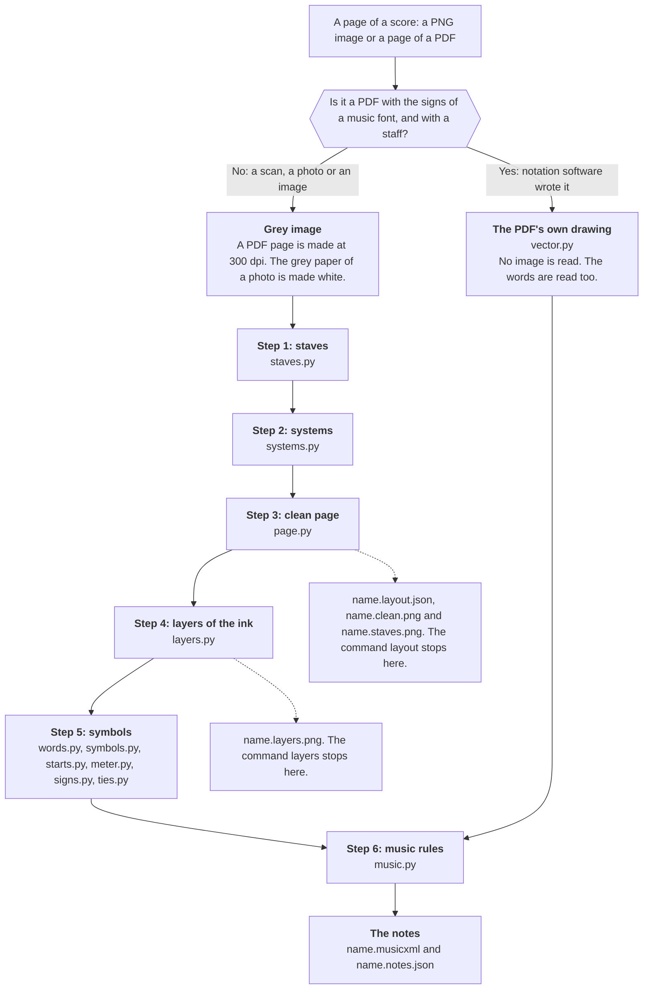
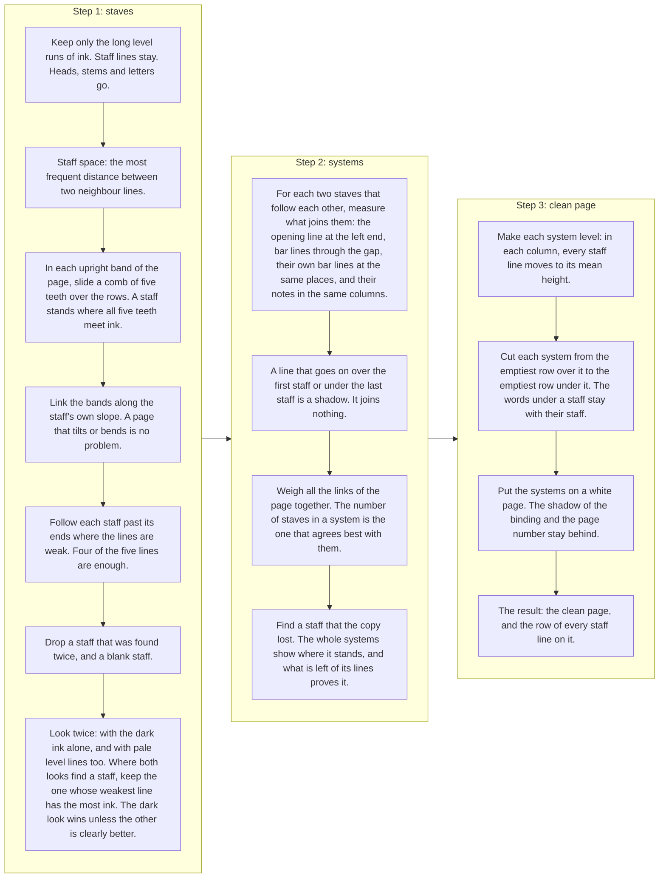
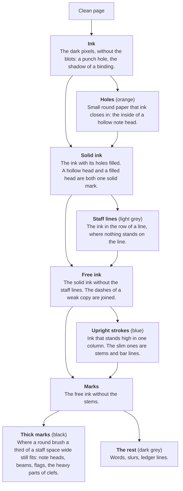
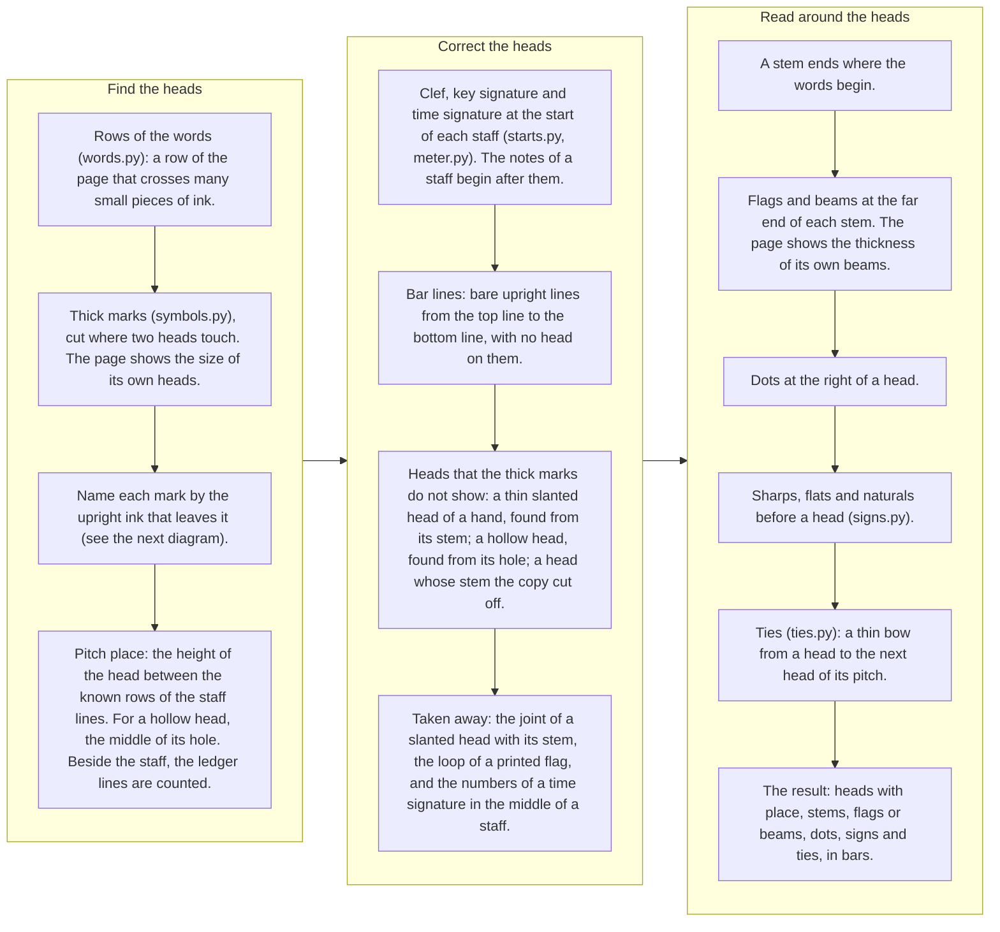
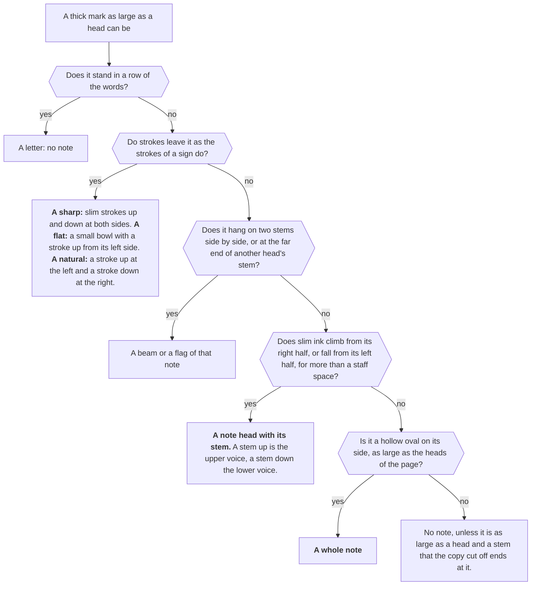
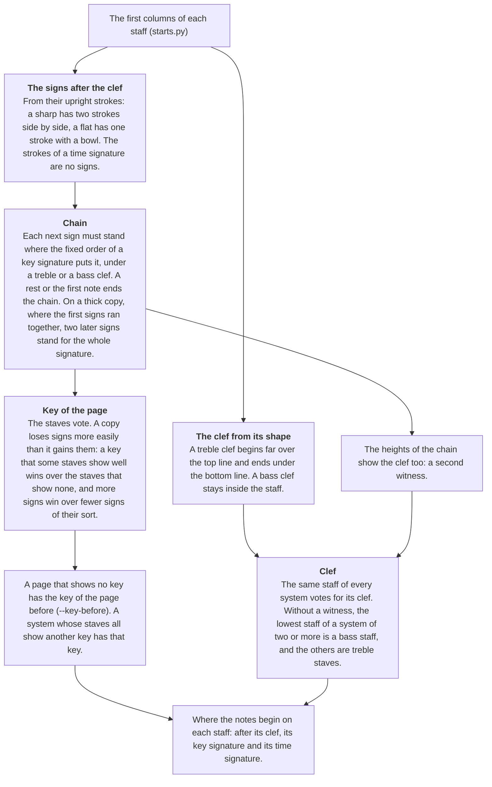
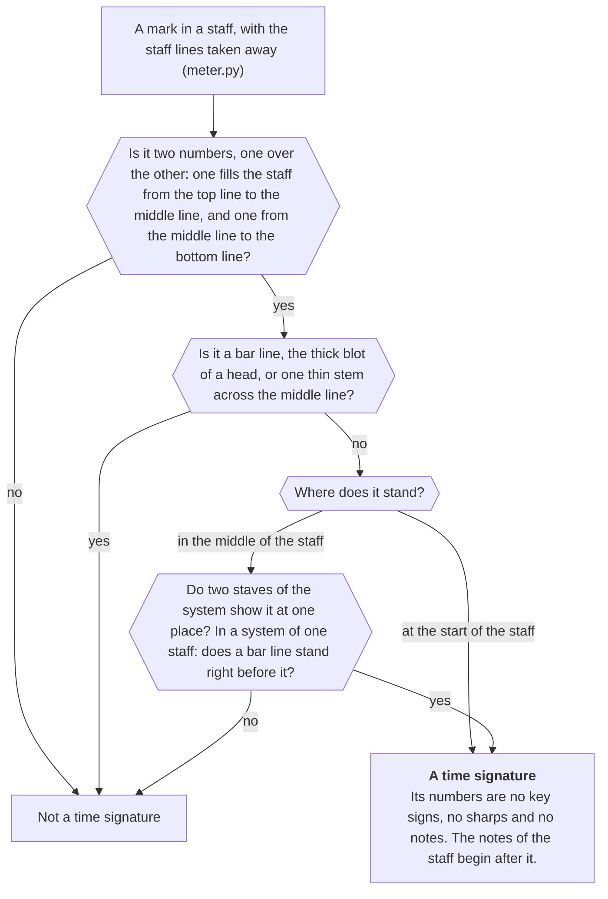
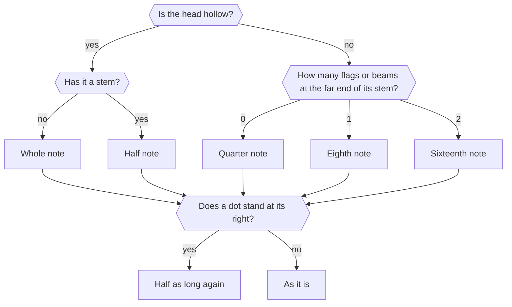
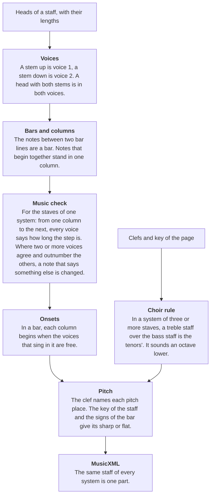
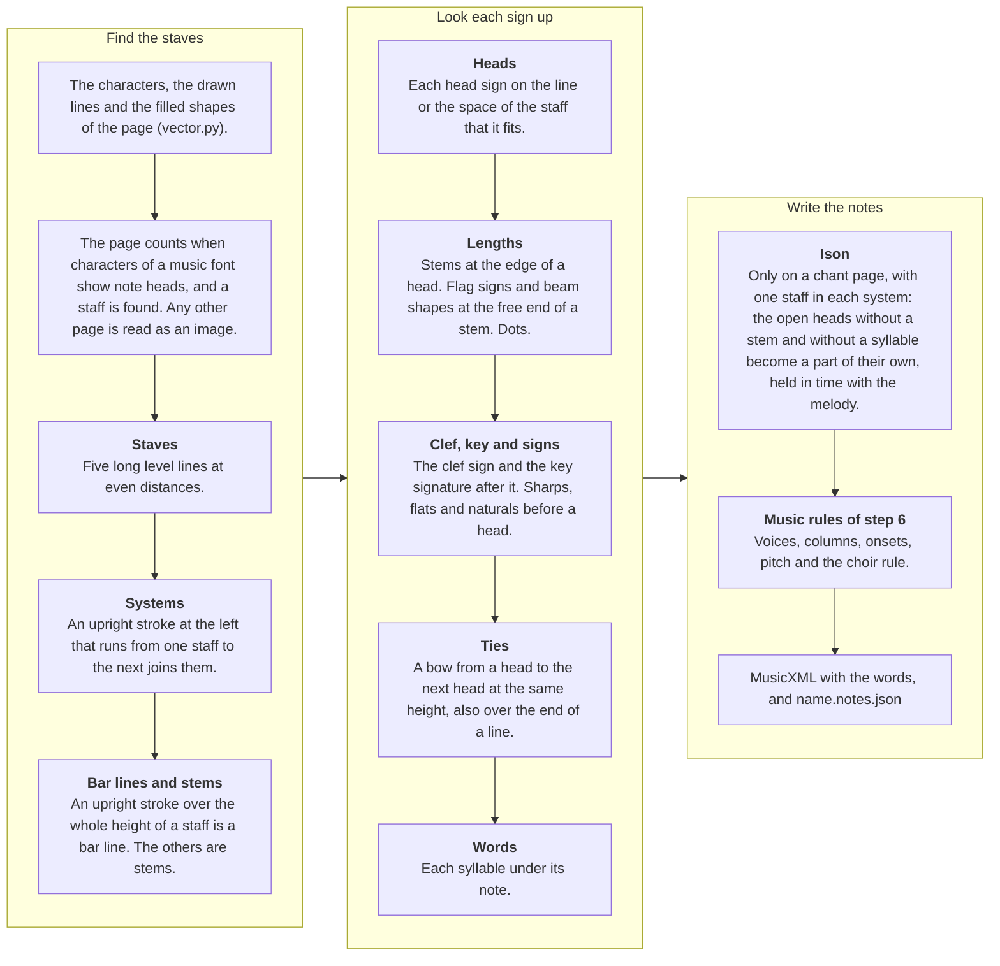

# scoreread: a local reader for choir scores

Version 0.6 (in work), 10 November 2026. One command reads a page of a score and writes its notes. Everything runs
on this computer: no network, no assistant, no cloud model and no neural network. Every step is rules on the ink of
the page, written in this repository, with OpenCV and NumPy. No other reader is a part of it.

```
python -m scoreread read "path/to/score.pdf" --page 1 --out out/my-hymn
python -m scoreread read page.png --out out/my-hymn
python -m scoreread layers page.png --out out/check       # the page with each layer of ink in its own colour
python -m scoreread layout page.png --out out/check       # only staves and systems, 2 seconds
```

`read` writes `<name>.musicxml` (the notes), `<name>.notes.json` (each note, its place and what it was read from),
`<name>.layout.json` (the staves and systems), `<name>.clean.png` (the page that was read), `<name>.staves.png` (the
scan with the staves drawn on it, as a check) and `<name>.layers.png` (the layers picture). One page takes about 14
seconds on one processor core. Python needs `opencv-python` and `numpy`; a PDF also needs `pdftoppm` (poppler), and
a PDF that notation software wrote is read from its own drawing with `pdfplumber`.

## The goal

Every score of the choir's app (LitChoir) must be read on this computer, with no AI in the reader, and none of them
under 99 % of the notes that its pages show. The words under the notes belong to the result. This is not reached:
see the results and the limits below.

## What the reader does

| Step | File | Model used? | What it does |
|---|---|---|---|
| 1. Staves | `scoreread/staves.py` | No | Finds each staff and follows its five lines along the page, also where the page bends, tilts or the lines are weak. Looks twice, with the dark ink alone and with pale level lines too (some copies print the staff in grey hair lines), and keeps the better staff at each place. Drops blank staves. |
| 2. Systems | `scoreread/systems.py` | No | Puts the staves into systems from the page's ink: the opening line, bar lines through the gap, and bar lines at the same places. Ink in the margin does not count. Finds a staff whose lines the copy lost. |
| 3. Clean page | `scoreread/page.py` | No | Makes each system level and puts the systems on a white page. The shadow of the binding and the page number stay behind. |
| 4. Layers | `scoreread/layers.py` | No | Splits the ink into staff lines, upright strokes (stems and bar lines), thick marks (note heads, beams, flags), the holes of hollow heads, and the rest. `layers` draws them in colours. |
| 5. Symbols | `scoreread/symbols.py`, `starts.py`, `meter.py`, `signs.py`, `ties.py`, `words.py` | No | Reads the note heads (filled, hollow, and the thin slanted heads of a hand), their stems, flags, beams and dots, the ledger lines, the bar lines, the clef and key signature of each staff, the sharps, flats and naturals before a note, and the ties. The key of a page is a vote of its staves (a copy loses signs more easily than it gains them), and a page without a key signature has the key of the page before. Finds the time signatures, so that their numbers are no notes and no sharps. Finds the rows of the words, so that a stem ends where they begin and a letter is no note. |
| 6. Music | `scoreread/music.py`, `reader.py` | No | Pitch from the clef, the key and the signs of the bar. Two voices on a staff from the stem direction. Notes that begin together stand in one column. The voices of a system must agree on the length of each step, and a note that disagrees is changed. Choir rule: a treble staff over the bass staff is the tenors'. Writes MusicXML. |
| Drawing | `scoreread/vector.py` | No | A PDF that notation software wrote holds each sign as a character of a music font at its exact place, and its words as text. Such a page is read from that drawing, with its words; no image is read. |

Steps 4 to 6 are the own symbol step. They replaced copisteria's network of version 0.4, which is only a yardstick
now: it lives in `bench/yardstick`, outside the reader (see "Tests").

## How the reader works, in diagrams

The diagrams show the logic of the reader as the code runs it. No box holds a model: each one is a rule on the ink,
or on the signs of a PDF. The yardstick in `bench/yardstick` is a test tool, not a part of the reader, and is not
shown. GitHub draws the diagrams from the text below (Mermaid).

### The whole reader



### Steps 1 to 3: staves, systems and the clean page



### Step 4: the layers of the ink

On the clean page the row of every staff line is known, so each layer comes from a plain measure of the ink. The
colours are those of `name.layers.png`.



### Step 5: from the layers to the symbols



What a thick mark is. Each mark is asked where upright ink leaves it.



### The clef, the key signature and the time signature



A time signature is found so that its numbers are not read as notes or as sharps. The numbers themselves are not
read yet.



### Step 6: the music rules

How long a note is:



From the symbols to the notes:



### A PDF that notation software wrote

Such a PDF holds each sign as a character of a music font at its exact place (Maestro, Petrucci, Anastasia, Leland,
Bravura and fonts like them), so nothing has to be recognised.



Not in the diagrams, because the reader of scans does not do it yet: the words of a scan, rests, slurs, triplets,
and the numbers of a time signature (see "Limits").

## Results on every score of LitChoir (the wide test)

The wide test reads every score of the app that has a typed hymn to compare with: 366 scores on 657 pages, 516 of
them scans. Notes right means pitch and length both right. The count is of the notes that the pages show: 5,836
typed notes that no page prints (mostly recited syllables) are listed apart.

| Kind of score | Scores | Notes right | At 99 % or more | At 90 % or more | Under 50 % |
|---|---:|---:|---:|---:|---:|
| PDFs that notation software wrote (read from their drawing) | 70 | 99.1 % (19,916 of 20,104) | 51 | 68 | 0 |
| Scans | 296 | 74.6 % (52,194 of 69,934) | 8 | 67 | 34 |
| All | 366 | 80.1 % (72,110 of 90,038) | 59 | 135 | 34 |

- Words: 5,586 of 28,976 syllables are right (19 %). All of them come from the software-made PDFs, where 92 % of
  the syllables are right. No word is read from a scan yet.
- The last rounds on the scans: new rules for the systems brought 1,511 notes, and the rules for keys and time
  signatures 713 (4 lost).
- 4 more scans are not counted: their page holds another version than the typed hymn.

## Results on the reader test (31 typed hymns, 38 pages, 6901 notes)

The kit is the small test that each rule is checked on. Notes right is counted by the kit's `score.py` against the
typed hymns, of all typed notes.

| Kind of score | Hymns | copisteria alone | homr alone | scoreread 0.4 (copisteria's network) | scoreread now (no model) |
|---|---:|---:|---:|---:|---:|
| Printed | 12 | 67 % | 82 % | 76 % | 91 % |
| Old copy (notes drawn by hand) | 9 | 76 % | 37 % | 88 % | 86 % |
| By hand | 5 | 65 % | 70 % | 79 % | 86 % |
| Poor (faded or broken) | 2 | 93 % | 49 % | 95 % | 79 % |
| Digital PDF | 3 | 81 % | 72 % | 81 % | 99 % |
| All 31 hymns | 31 | 71 % | 66 % | 81 % | 88.9 % (6132 notes) |

- Over all hymns the own rules read more notes right than the network they replaced: 88.9 % against 81 %.
- They are behind the network on two kinds: old copies (86 % against 88 %) and the two poor pages (79 % against 95 %).
- 8 of the 31 hymns are at 95 % or more, and 19 are at 90 % or more. 6 are under 80 %.

## Limits

- The reader is not accurate enough yet to put a scanned hymn into the app without a check. Only 8 of the 296
  scanned scores are at 99 %, and 34 are under 50 %: thick copies where signs and heads ran together, pages with
  pale staff lines, and pages where a clef is hidden.
- The rules and their limits were set on the same pages that test them. The figures above are therefore the best
  case. New pages will read worse until they are measured too.
- The wide test compares with typed hymns that were made for singing, not for testing. Some differ from the page
  (another key, an octave, a repeat written out). Known cases are told to the scorer; others count as wrong.
- About 17,700 drawn notes of the scans are wrong. Counted one round earlier (of about 18,700 then; a note can be
  wrong in two ways): about 7,300 are not read at all, about 6,900 have a wrong pitch (a wrong key or clef, or one
  place off), and about 6,100 a wrong length (a half note read as a quarter because the copy filled its hole, an
  eighth read as a quarter because its flag or beam was not seen, dots).
- The score counts each part. A staff of two parts is split by the stem direction (stem up is the upper part). One
  stem read wrong, or one head of a chord missed, gives the note to the wrong part.
- Not read yet on scans: the words, rests, slurs and triplets. A rest can be read as a note. Time signatures are
  found so that they are no notes, but their numbers are not read. A tie is read when its bow runs from head to
  head on one line of the page.
- The reader also writes notes that are not there (about 260 on the kit), from rests, letters of the words,
  ornaments and slurs. They are counted apart and do not lower notes right, but a singer would see them.
- The output is MusicXML for one page. The reader does not join pages or write the app's hymn format yet (the wide
  test joins the pages with a script of its own).

## Next steps

1. One command for a whole hymn: all pages, the key carried from page to page, the pages joined.
2. Pale staff lines, clefs hidden behind a bracket, and the pages where almost nothing is read.
3. Half notes whose hole the copy filled, by the notes that sound with them. Flags and beams that are not seen.
4. The words on scans, with no model.
5. Rests, with a check of each bar's length.
6. The app's hymn format.

## Tests

```
export SCOREREAD_KIT="$HOME/Projects/LitChoir/tmp/omr-test"     # the test kit, see below
PY="$SCOREREAD_KIT/tools/copisteria/.venv/bin/python"           # or any Python with opencv-python and numpy
$PY bench/drawn_check.py                                      # the whole reader on a page the script draws; needs no kit
$PY bench/staves_check.py "$SCOREREAD_KIT/pages" out/staves   # 38 of 38 pages right
$PY bench/systems_check.py "$SCOREREAD_KIT"                   # 37 of 38; on the other page the copy lost a staff
bash bench/kit.sh own                                         # reads all 38 pages (rules only)
bash bench/kit.sh v04 --yardstick                             # the yardstick: the same clean pages with copisteria's network
python3 "$SCOREREAD_KIT/score.py" --results out/kit --tools own v04
```

`bench/kit.sh` takes its Python from `SCOREREAD_PYTHON`, or the kit's copisteria environment without it.

The yardstick (`bench/yardstick`) reads the reader's clean pages with copisteria's network, to measure the own rules
against it. It is a test tool: the reader does not load it, and nothing of it ships with the reader.

The wide test (every score of LitChoir) is run with scripts outside this repository, because it needs the app's
scans and typed hymns.

## The test kit

The tests need the test kit, which is not in this repository. The reader itself does not need it.

- `pages/`: 38 page images of 31 hymns. They are scans of the choir's scores, so they stay out of git.
- `truth/`: the same hymns typed by hand, as the answer key.
- `score.py`, `cases.json`, `env.sh`: the scoring script, the list of hymns and the settings of the tools.
- `tools/copisteria`: copisteria with its own Python and its model files (about 4 GB with the other readers), for
  the yardstick (`bench/yardstick`).

`SCOREREAD_KIT` names the kit's folder. Without it, the tests look in `~/Projects/LitChoir/tmp/omr-test`.
`SCOREREAD_COPISTERIA` names another copy of copisteria.

## History

`experiments/2026-11-09-hard-scans/` holds the first tests on one difficult hymn, with a report. They found the three
causes that this reader removes: wrong systems from ink in the margin, staves found twice on bent pages, and the
ledger lines of one copyist.

Version 0.5 replaced copisteria's network with the own symbol step (layers, symbols, music). Each rule was switched
on alone and scored on all 38 pages, and a rule that did not gain notes was dropped.

Version 0.6 (in work) reads software-made PDFs from their drawing with their words, groups the staves of scans by
three more checks, votes for the key of a page, finds time signatures, and moved the yardstick out of the reader.
